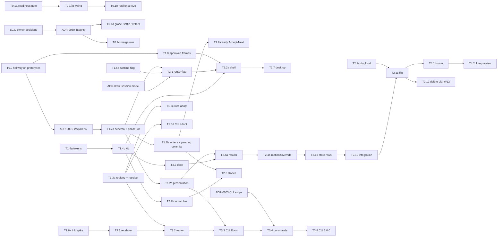

# hnch: one room, one button, one number. UI and UX proposal v2

**Status:** Draft. Proposal v2 for owner review; the owner decisions in §9.2 are still open.
**Date:** 2026-10-13
**Base:** `main@c0fae33` (the analysis did not change the repo)
**Shape:** Multi-phase programme: 6 phases, 114 tickets, proposed ADRs 0050–0055
**Companions:** [ux-overhaul-issues.md](ux-overhaul-issues.md) is the issue register behind every `UX-nnn` id. [docs/design.md](../design.md) is a draft rulebook extracted from §2.1, §4, §5 and §6 of this plan.

> **About the evidence references.** The citation keys below (audit and research reports, prototype notes and frames, judging notes, critic challenges) point to artefacts from the analysis session. They were not committed. The issue register carries the verified evidence for every `UX-nnn` issue, with repo paths and line numbers. Where a ticket says to re-run a session script (T5.4), recreate it under `packages/e2e` first.

- **Audience:** the repo owner, who makes the calls in §9, and the coding agents who execute §7 under the contract in §4.
- **How it was made:**
  - Three independent proposals: A "minimal", B "evolutionary" and C "signature".
  - Three judges: facilitator, engineering and design. Their totals tied 129 / 129 / 129.
  - One canonical issue register: 109 issues, of which 4 are critical and 44 are high.
  - The skeptic-verified audits, plus three research reports.
  - **New in v2:** two critics reviewed v1 (a plan critic, 18 challenges, and a design critic, 22). Two throwaway prototypes were then built and measured: a clickable web Room and a terminal Room on the repo's own Ink 5. Every critic challenge is answered in **Appendix C**. Every prototype finding is either applied in place or listed there.
- **The base:** proposal **A**. It is the only one whose first structural deliverable is the meeting loop itself (J-fac §3). The decision log in §0.3 lists how each fatal flaw the judges raised was resolved.
- **Labels:** **(opinion)** marks a design judgement. Numbers marked *target* are budgets. Numbers marked *measured (PW/PT)* come from the prototypes. Other numbers are measured or counted by the cited audit.

### Citation keys

| Key | Source (analysis-session artefact, not committed) |
|---|---|
| `UX-nnn` | [ux-overhaul-issues.md](ux-overhaul-issues.md): the canonical, de-duplicated issue IDs |
| `NEW-n` | Defects found after the register by the critics and confirmed by reading the code (§1.4). They have not been reproduced live |
| `JO` `HL` `VIS` `FE` `A11Y` `CLI` `LW` `LC` | `reports/{journeys,hotloop,visual,features,desktop_a11y,cli,live_web,live_cli}.verified.md`. IDs as printed there (J-xx, H-xx, VIS-xx, F-xx, RA-xx, CLI-xx, LW-xx, LC F-xx; verifier-found issues are M-x / Mx) |
| `COMP` `UXP` `CC` | `reports/competitors.md` (patterns P1–P21, §4 measurements), `reports/ux_patterns.md`, `reports/cli_craft.md` |
| `A:` `B:` `C:` | `proposals/{A-minimal,B-evolutionary,C-signature}.md` (section, row or line) |
| `J-fac` `J-eng` `J-des` | `judging/{facilitator,engineering,design}.md` |
| `CP-n` | Plan-critic challenge n (1–18), reproduced and answered in Appendix C |
| `CD-nn` | Design-critic challenge nn (01–22), reproduced and answered in Appendix C. `critic/contrast.py` holds its contrast script |
| `PW` | Web prototype: `prototype/web/NOTES.md` (numbered findings PW #1–#16), `results-all.json` (counts) and `contrast-tokens.txt`. Screenshots are in `prototype/web/shots/` |
| `PT` | Terminal prototype: `prototype/cli/NOTES.md` (learnings PT L1–L16), `frames/metrics.json`, `frames/resolver-check.txt` and `frames/logs/*.jsonl`. Frames are in `prototype/cli/frames/<size>/` |
| `brief` | `final/prototype-brief.md`. Hallway hypotheses H1–H8 are in brief §0 |
| `wf1` | `wf1.json`: the per-audit measured metrics |
| `tokens.out.json` | `final/tools/tokens.out.json`, produced by `final/tools/tokens.py` (OKLCH conversion, contrast, avatar variants). `final/tools/v2contrast.py` adds the v2 pairs |

Code paths are relative to the repo root.

---

## 0. Executive summary

hnch already has the fastest possible core:
- A voter taps one card per story.
- Unanimous auto-reveal is the best speed feature in the product (FE #34, HL §1).

Everything around that core costs time or trust:
- **A round can reveal before people have voted.** This happened in 2 of 2 voted-reloader trials (UX-001, LW-01).
- **A voter whose network drops for more than 5 s can become host of the whole room** (NEW-1, code-read). The same "offline peer" flaw sits under the host election.
- **A menu item or the back button strands peers** and can start two live rounds (UX-002, UX-003).
- **The host pays heavily for every story:** a modal, 3–5 taps and two route changes (UX-016, UX-017).
- **On a phone, the result is the 5th accordion card,** at y≈610 of 844 (UX-034, LW-02).
- **The session never records the number it exists to produce** (UX-033).
- **Dark mode is unreadable in places,** down to 1.72:1 (UX-048), and teammates in one meeting see two visual languages (UX-055).
- **The terminal client costs about 3× the keystrokes,** and it wipes the screen every second (UX-015, UX-095).

**The proposal shrinks hnch to one phase-driven Room on every surface.**
- **One host button that never moves:** `Start` → `Reveal · 3/5` → `Accept 8 · Next: PROJ-102`.
- **Results replace the cards in place** as a dot Strip that names the outliers.
- **The only new data is the agreed number,** captured by the same tap that advances.
- **Phone, desktop and terminal share one interaction registry.** You vote by typing the card face. The same keys work on web desktop and in the terminal, and the same words come from `@hnch/shared`.

**The prototypes show the loop is real, not aspirational** (*measured*, PW, PT):

| Loop | Phone (touch) | Desktop (keyboard only) | Terminal (pty, Ink 5) |
|---|---|---|---|
| Host, per round | 2 taps, 6 of 6 rounds | 2 keys, 6 of 6 rounds, 0 Tabs | 2 keys, 5 of 5 stories |
| Voter, per round | 1 tap | — | 1 key (2 for `13`) |

- **Interruptions:** 0 overlays and 0 route changes during the loop.
- **Last-voter misvote:** typing `1` then `3` as the last voter revealed **13**, never 1, at settle windows of 300, 500 and 700 ms on both surfaces.
- **Results above the fold:** the result sits above the fold on a 390×844 phone (hero at y=253, against y≈610 today).
- **What the prototypes also found:**
  - a dark-mode contrast hole;
  - a resolver bug in the brief;
  - a Split rule that over-fires;
  - an Ink 5 render budget that cannot be met;
  - three exit-path pitfalls in Ink 5.
  
  v2 fixes each of them in place.

**Sequencing puts trust before speed, and speed before beauty.** The schedule is re-planned with explicit week maths (§7.9).
1. **Phase 0 (weeks 1–3):** trust, correctness and guardrails come first (wave A). Readability and interim relief follow on today's screens (wave B). The hallway test runs on the prototypes in week 2.
2. **Phase 1 (weeks 2–5):** the shared writers, the registry, the tokens and the kit. ADRs 0050–0053 are accepted.
3. **The Room:** a web Room arrives behind a runtime `roomShell` flag. A dogfood slice is ready at the end of week 6, and the flag flips at the end of week 9. The CLI Room ships in parallel as CLI 2.0.0.
4. **Entry, summary and subtractions** follow in weeks 10–12. If week 1 starts on 2026-10-19, weeks 10–11 are the holidays, so no release gates fall in them. Polish and blocking gates run to week 14.

**Cuts.**
- **Removed:**
  - 3 of 6 routes, all 6 accordions, the round-start modal and the onboarding gate;
  - the accent picker and 2 of 5 "move on" verbs;
  - the CLI's agenda subcommands and config editors;
  - the in-app QR scanner, subject to the owner.
- **Kept:**
  - **Password rooms,** fixed and tucked away.
  - **The session name,** which is now finally shown.
- **Added for facilitators:**
  - a soft "step out";
  - a session summary with **Run it back**. v2 narrows Run it back to the summary card shown right after End (CP-3).

### 0.1 North star (one sentence)

> **Everyone can estimate a story in one tap or one key, and the host can move to the next one with one more, without anyone ever being moved to another screen, interrupted by a dialog, or shown a result they cannot trust.**

### 0.2 Before → after

"Today" figures are measured or counted from code by the cited audit. "Target" figures are budgets that §4.2 (R-03 to R-05) turns into CI-enforced tests. "Prototype" figures were measured on the throwaway prototypes (PW: Playwright on Chromium, with a WebKit smoke run; PT: a pty on the repo's own Ink 5.2.1). Actions follow the taxonomy in §2.5.

| Journey / metric | Surface | Today (evidence) | Target | Prototype (*measured*) | Enforced by |
|---|---|---|---|---|---|
| **Host, per round, queue present** | web phone | 3 taps + 1 modal + 2 route changes; about 8–12 s of tool overhead *(estimate)* (HL §1.1; `wf1` hotloop) | **2 taps** (Accept·Next + own card), 0 modals, 0 routes | **2 taps in 6/6 rounds**, light and dark; 0 overlays in 15 samples (PW `results-all.json`) | R-03 `budget.spec.ts` |
| Host, per round, queue present | web desktop (keyboard) | mouse only: 12 Tabs to Start, 6 Tabs to Reveal, `R` does nothing (LW-14, UX-019) | **2 keys** (⏎, face), 0 Tabs | **2 keys in 6/6 rounds**, 0 Tabs, 0 pointer events (PW) | R-03 |
| Host, per story, queue present | CLI | observed 9/8/6/4/6 keys over 5 stories (`wf1` live_cli; UX-015) | **2 keys** (⏎, face) | **2/2/2/2/2** (PT `budget-host-80x24`; the log's 4 for PROJ-105 includes `q` ⏎ to leave) | R-03 pty |
| Host, mean per story over the S1 mix (Close, Agreed, Split → Re-vote → Close, Close, Agreed) | web phone | — | **≤2.4** | **2.4** (12 taps over 5 stories; the Split story cost 4) (PW) | R-03 weighted |
| Host, per story, no queue | web | 4 taps + typing (HL §1.1) | **3** (Accept, Start, card); typing optional | not measured separately | R-03 |
| **Voter, per round** | web | 1 tap + 2 forced route changes (HL §1.2–1.3) | **1 tap**, 0 routes | **1 tap** in each of 5 stories; a Split costs +1 (PW) | R-01, R-03 |
| Voter, per vote | CLI | k + 1 = 1–8 keys, average 4.5; "13" takes 7 (CLI-01) | **1 key**; 2 for two-character faces | **1/1/2/1/1** (`13` = 2) (PT `budget-voter-80x24`) | R-03 |
| Host Start → voters see cards | web phone | 0.74 s, made of route transitions (LW S4) | ≤0.25 s on a local relay *target*, in place | not measurable (the prototype has no relay) | R-05 (report-only) |
| **Last vote → result readable** | web phone | ≈0.56 s route change, then the result is the 5th card at y≈610 of 844, under a 3 s scrim (LW-02, HL H-13) | ≤ settle + 0.4 s, with hero, Strip and primary above the fold | reveal at **settle + 6–9 ms** (306 / 507 / 709 ms); hero top y=253, Strip bottom 622 at 390×844 (PW) | R-05, R-21 |
| Last voter types `1` then `3` | all | a provisional "1" can reveal (HL H-03 caveat) | never reveals "1" | **0 wrong reveals** at settle 300 / 500 / 700 on web and terminal (PW S4; PT `S4-settle-*`) | R-14, R-17 |
| **New host → first vote** | web phone | 10 actions (7 taps + 18 keys); 4.3 s app wait (LW S1) | **4 taps** + name (one is the focus tap, §2.5); ≤1.0 s app wait *target* | **4 taps** + name (PW) | R-04 |
| New host → first vote | web desktop | 5 clicks (JO §1 a) | 0 clicks; 3 keys + name | **0 clicks** (PW) | R-04 |
| Invitee via link → first vote (new device) | web phone | 3 taps + name; link → lobby 1.68 s (JO §1 b; LW S2) | **2 taps** + name, plus 1 focus tap where the OS suppresses the keyboard. **1 tap** if the name is known | **2 taps** + name (PW; Playwright honours autofocus) | R-04 |
| Returning joiner by code | web phone | 4 taps + 6 keys; 3.0 s (LW S3) | **2 taps + 6 keys** (auto-submit), or a paste + 1 tap | **2 taps + 6 keys** (PW) | R-04 |
| Resume from Home | web | 1 tap (0.77 s). Password rooms re-prompt (UX-031) | **1 tap**, every room type | — | R-04 |
| Add N stories | web | 14 actions / 42 keys for 3, ≈31 s (LW S5) | Empty queue: 3 on touch (focus tap + paste), 1 on desktop; ≤4 / ≤3 via `+ Add`; any N | **1 paste** into the empty-queue field (PW; Playwright counts a paste as 1) | R-04 |
| Run it back right after End | web | 4 taps min, 7 typical to rebuild a room (JO §1 d) | **2 taps** from the summary card | **2 taps**, leftovers carried (PW) | R-04 |
| Change scale (host) | web | 3–4 taps through sheets nested 3 deep (JO §1 l) | **2 taps** | — | R-04 |
| Join → voted | CLI | `hnch join <url>` fails with "unknown-room"; npx prompt y/N (CC F9, F17) | `npx -y @xauyxau/hnch join <code\|link>` → name ⏎ → 1 key | join preview = **1 key** (prefilled name) (PT `voter-80x24`) | R-04 pty |
| Premature reveal on voted-peer reload | all | 2/2 trials (LW-01) | 0 / N | not measurable (no relay) | R-14 |
| Host role after an 8 s voter socket drop | all | the dropped voter can elect itself (NEW-1, code-read) | `hostParticipantId` unchanged | — | R-14 |
| Host controls before round 1 | web | 13 interactive controls (FE §1, live a11y snapshot) | ≤7 once someone has joined (§4.2 R-09) | **7** on phone and on desktop (PW) | R-09 |
| Routes / sheets / accordions | web | 6 / 12 (+4 alerts, +1 overlay) / 6 (FE §1) | **3 / 6 / 0** | — | R-01, R-22 |
| Token pairs failing WCAG AA | web | 29 of 41 (VIS metrics) | 0 in both themes, Ionic bridge pairs included | **0 of 114** static pairs; **0 of 2,018** rendered text nodes over 40 states (PW) | R-25 |
| Lighthouse a11y (Lobby → Room) | web desktop | 90 (A11Y metrics) | ≥98 *target* | — | R-33 to R-40 |
| Distinct font sizes / radii | web | 28 / 12 (VIS-15) | 8 / 4 + pill | — | R-24, R-28 |
| CLI output while voting (idle) | CLI 80×24 | 4–5 full clears per 4–5 s; 7.7 KB in 4 s at 60×20 (CLI-04, LC F-12) | 0 clears; ≤150 B/s (stopwatch only) | Ink 5: 0 clears but **2,414 B/s**. Ink 8: **137 B/s** (PT L5) | R-47 |
| Footer rows | CLI 80 / 60 cols | 2 / 3, word-broken (CLI metrics) | 1 / 1 | 1 at 60, 80 and 100 (PT L13) | R-46 |
| SGR codes with `NO_COLOR=1` | CLI | 44 (CLI-15) | 0 colour codes | **0** colour codes; inverse and bold kept (PT) | R-49 |

### 0.3 Decision log: what this synthesis decided, and why

Decisions D1–D17 are from v1; those changed in v2 say so. D18–D28 are new.

| # | Call | Over | Why (evidence) |
|---|---|---|---|
| D1 | **Base = A's product.** It is grafted with B's delivery mechanics and C's craft and shared writers. | B-as-base, C-as-base | The three judges tied on totals. A is the only proposal that delivers the loop before the look (J-fac §3). B's strangler and guardrails (J-eng) and C's registry, atomic writers and kit (J-des) graft onto it cleanly. |
| D2 | **Back = "step out", not Leave.** Back keeps presence and the host role, and Home shows "You're still in Sprint 42 · Return". Explicit **Leave** writes `leftAt` and keeps the Recent entry. A **host leaving with others online** is asked to hand off. *v2:* a host who stays stepped out for 60 s loses host liveness, and peers see "Hana stepped out" after 10 s (ADR-0052; CP-15). | A and C's Back = Leave | Under A, one iOS edge-swipe writes `leftAt`. That removes the host from the election set (ADR-0048), and the original host never reclaims the role (ADR-0010 §5). An unvoted voter's swipe would also auto-reveal without them (J-fac §4; J-eng A1). |
| D3 | **Password rooms are kept: hidden and fixed.** Only the create-time sheet and the "Password by default" pref are cut. | A's cut | Kollabe and Thunderdome both offer passwords (COMP:105, :146). Passwords are the only persistent-removal lever (ADR-0036 §6). *v2:* the UI hides password controls from non-hosts, but the relay's `PATCH /rooms/:uuid/access` has no host check (ADR-0017 trade-off). UX-006 is therefore mitigated only in the UI (CP-9). |
| D4 | **Terminal round fields are write-once. Skip story's 5 s Undo is a deferred commit held in a session-scoped pending-commit queue** in `DocService` and the CLI session, not in a toast. The queue flushes before any other host write and on step-out, Leave, `visibilitychange:hidden`, `pagehide`, teardown and exit. Authority is checked when the user acts. *v2:* Remove story and Undo paste use an immediate write plus a compensating Undo (CP-4, CD-20). | A's un-tombstone undo; C's local check | A's undo can produce two live rounds (UX-003) and breaks ADR-0046's monotonic model under merge (J-eng A2). A deferred commit that lives in a toast loses or delays its write on navigation, background throttling or app kill (CP-4). |
| D5 | **Typing a card writes only on commit.** *v2 rule:* a unique prefix commits at once, and the rest of that face's spelling is then absorbed for 450 ms. An exact prefix that is also the start of another face (`2` on Fibonacci, where `21` exists) commits on ⏎, a non-extending key, or 450 ms. | A's commit-then-refine; the brief's exact-match-only | With instant auto-reveal, a provisional "1" could reveal a round meant to be "13" (HL H-03). The terminal prototype found two bugs. The brief's exact-match rule never commits Risk `l/m/h/c` or T-shirt `xx`. A literal "commit on any unique prefix" double-votes `32` → 32 then 2, and `xxl` → XXL then L. The v2 rule passes all 18 cases (PT L2, `resolver-check.txt`). |
| D6 | **ADRs split by urgency (v2).** ADR-0050 *Live-round integrity* (W1) holds what trust needs now. ADR-0051 *Round lifecycle v2* is accepted only after the week-2 hallway test. ADR-0052 *Room session model* and ADR-0053 *CLI scope v2* follow. The design system and Ionic mode go to docs, not ADRs. | v1's single large ADR-0050, and ADR-0052 "one visual system" | v1 tied a Phase 0 critical fix to accepting a large ADR whose values waited on the hallway test (CP-10). adr/README:71-85 says library defaults, config and product mechanics belong in docs. |
| D7 | **The Phase 0 interim fixes are mandatory,** each ≤2 days with no new components (R-55). *v2:* the over-sized interim tickets are split or shrunk so that R-55 actually holds (CP-14). | C's "optional" interim; A's "don't patch code we delete" | One critical and three highs would otherwise wait 4–8 weeks (J-eng, J-des, J-fac graft 6). |
| D8 | **Global Ionic `ios` mode, plus A's dark `--ion-color-primary` bridge (`#7ED6AA`, ink `#0B2A20`).** *v2:* the dark brand fill moves from `#1F6B4F` to `#267A5A`, and a selected card always carries a 2 px `accent-text` ring (PW #1; CD-03). The decision is recorded in `docs/ionic.md` and `docs/design.md`, not in an ADR. | B's per-platform mode; C's fill-as-primary | "Two products in one meeting" (UX-055). The old dark fill was 2.67:1 against the stage and 2.38:1 against an unselected tile. |
| D9 | **Status semantics: Agreed = success, Close = neutral, Split = warning amber, No votes = neutral.** Never red. Always a glyph plus a word. | B and C (Close amber, Split neutral) | UXP §7.3: "warning = needs a talk". Split is the state where Re-vote becomes primary (J-des). |
| D10 | **Session name is kept and shown** in the header, the summary and the export. **Join preview:** "Join Sprint 42 · 4 people here". **Progress reads "Story 3 of 12" on every surface** (v2: one format, R-42). A **muted stopwatch** stays visible while voting. | A's cuts | Facilitators running several teams can't tell rooms apart, and they timebox by progress (J-fac grafts 4, 5, 8; UX-080). "3/12" reads aloud as a fraction or a date (CD-21). |
| D11 | **Session summary + Run it back.** *v2:* Run it back lives only on the summary card shown right after End or Leave-as-last. It is held in memory. There is no Recent-row Run it back and no recurring-meeting budget (CP-3). ⌘K palette and nudge stay deferred past v1. | v1's Recent-row ⋯ Run it back | ADR-0044 evicts Recent entries 24 h after last use. ADR-0023 §2 clears the cache when a session ends. ADR-0006 gives cross-meeting continuity to Teams. Run it back from Recent would need a new ADR and a threat model for storing story titles in plaintext. |
| D12 | **One typeface (Inter Variable)** with tabular numerals. The **"Ink & Dot" motif** is kept: one dot is one hunch. | C's Geist Sans + Mono | One family, one licence check, fewer bytes **(opinion)**. A digits-only display face for the hero is an O8 option (CD-07). |
| D13 | **CLI renderer target: Ink ≥6.5 with incremental rendering** (7.x preferred). The fallback is Ink 5 with a minute-granularity stopwatch. Views are pure `screen(state, W, H) → rows` functions. | v1's "Ink 7.x, not 8.0" | Measured on Ink 5: the stopwatch costs 2,414 B/s and tears. On Ink 8, 16 of 17 frames were byte-identical to Ink 5, at 137 B/s (PT L5). Pure views make snapshots possible without `ink-testing-library`, whose Ink 7/8 compatibility is unverified (PT L14). |
| D14 | **`roomShell` is a runtime flag** (*v2* mechanism): a build-time default, overridable with `?roomShell=0\|1` or a localStorage key. e2e runs both values against one build. The owner flips the default in T2.11. The CLI equivalent is `HNCH_ROOM=1` in 1.x, then 2.0.0 (CP-11). | A's flip-at-E2.8 | One-switch rollback for the biggest refactor. The client has no flag infrastructure today (CP-11). |
| D15 | **Phase 0 guardrails come before any pixel moves:** `budget.spec.ts` recording today's counts, iPhone and light baselines, and an axe smoke run. | — | Without a baseline, the budgets cannot prove gains, and CI never sees the iPhone UI (VIS M2). |
| D16 | **The CLI narrows to "parity = wire protocol + core loop + shared registry"** (ADR-0053). `hnch agenda *` and the Ink config editors are cut, in a **semver major (2.0.0)** after a deprecation release (CP-5). | B's "fix agenda list/mv" | Avoids rebuilding a surface we then delete (FE F-19, LC F-28). CONTRIBUTING.md:247 maps `feat!` to a major. |
| D17 | **Desktop primary lives in a fixed stage footer.** *v2:* the stage body reserves two H1 lines and a min-height, and the box is tested across 3 consecutive stories with 1- and 2-line titles (CD-08). | All three put the primary "under the stage" | Otherwise the button jumps between stories. PW measured an identical box in every phase at 390×844, 1024×768 and 1440×900. |
| D18 | **Host election gets the same readiness gate as auto-reveal.** It never debounces while the socket is down or unsynced, and it re-evaluates only after the first remote awareness, or after 1.5 s alone (CP-1). | v1 gated auto-reveal only | y-websocket drops every remote awareness state on close (`y-websocket.js:141-149`). The offline peer then sees itself as the only one online, wins `resolvePromotion` (`election.ts:103-158`), and `promoteHost` writes with no check (`roster-commands.ts:253-256`). |
| D19 | **One active round, by a deterministic merge rule.** The active round is the *last round in array order* when it is non-terminal. Earlier non-terminal rounds are "superseded": hidden from every phase and from history. The host tombstones them when it sees them. Host round writes pause while the client is not connected and synced (CP-2). | v1's local `startRound` guard only | `activeRound()` returns the last non-terminal round (`doc-projection.ts:807-836`). Once a newer round closes, an older open round resurfaces as a "zombie". A local guard can't stop concurrent appends. |
| D20 | **Close and Split are defined.** **Close:** a step distance ≤1, or 2 steps when the mode holds ≥60 % of ≥4 votes. **Suggestion:** the mode. A tie goes to the card nearest the average, and if still tied, to the higher card. On numeric scales the average is shown as `avg 8.4` meta (CP-6, CD-01, CD-09; O13). | Today's ≤1-step rule; the Poinz average rule | The v1 frames showed a Split as "Close" (5/8/13 is 2 steps). The terminal prototype found 5,5,8,8,13 over-triggering Split (PT L4). The Poinz rule would override majorities: 5,5,5,8 → 8 **(opinion)**. |
| D21 | **Session end keeps ADR-0023** (everyone lands on Home with the summary card). Principle 2 carries this as an explicit exception (CD-14). | Rendering "ended" in place | Rendering it in place would partially supersede ADR-0023 for little gain. |
| D22 | **Untrusted text is sanitised.** Names, story titles and session names go through `toDisplayText()` at every terminal render and print point. CSV cells are escaped. `hnch join <link>` uses only the code and ignores the link's origin unless it matches the configured relay (CP-9). | — | Any peer can write these strings, and nothing strips control characters today. A peer named with `ESC ] 52` could write to another user's clipboard. A crafted link could steer the CLI to an attacker's relay, which could capture the password hash and replay it. |
| D23 | **Mixed-version safety by signal, not enforcement.** Each client publishes `proto` in awareness. The host is warned about older peers, and users see an update notice when a peer is newer. There is no service worker in v1, and relay enforcement is deferred (CP-5, CD-11; O15, O16). | v1's "PWA update prompt" | The client has no service worker and the CLI has no update notifier (grep). One old peer recreates UX-001 for the whole room. |
| D24 | **Two reveal writers.** `manualReveal` is host-gated. `autoReveal` is not. It is written first by the client whose own vote completed unanimity; other peers write it as a fallback after settle + 1.5 s (CP-12). | v1's single path | Otherwise R-16's host check silently disables auto-reveal on every non-host. The settle window must be timed by the client most likely to change its vote: the last voter. |
| D25 | **The agreed value can be corrected.** `closedAt` stays write-once. `agreedCard` and `agreedBy` are last-writer-wins, editable from Stories → Done ⋮ → "Change value" (CP-13). | Write-once agreed value | Accept·Next is the most frequent action and has no undo. |
| D26 | **Hi-fi frames gate the Room build.** The prototype screenshots, updated with the v2 deltas, are approved by the owner against a written rubric (T1.0). They become the visual references (R-56) (CD-07). | Tokens-only spec | v1 specified tokens, not a look. |
| D27 | **A state and error catalog is part of the spec** (§6.7, R-57). It covers room full, removed, offline with a vote, everyone passed, late joiners, host away, duplicate names, old peers and more (CD-13). | Happy paths only | Those are the moments that decide trust. |
| D28 | **Late joiners don't block a round.** A participant whose `joinedAt` is after the round's `createdAt` counts toward unanimity only once they vote. A room with 0 eligible voters never auto-reveals (O14). | Every online voter counts | Otherwise one person joining mid-vote stalls the room until they notice the story. |

---

## 1. What we found: the state of hnch's UI and UX today

### 1.1 Ten themes

1. **The loop is not trustworthy** (2 critical, 6 high).
   - **Premature reveal.** A voted peer's reload, reconnect or soft exit reveals the round for everyone (UX-001). The cause is that `shouldAutoReveal` evaluates before remote awareness arrives (`packages/shared/src/auto-reveal.ts:56-70`; LW-01).
   - **Stranded peers.** The Estimating ⋯ "Session settings" item, and browser or OS back, leave peers on a stale Lobby (UX-002). That Lobby then offers "Start Round N+1" while a round is live, because `startRound` has no guard (`round-commands.ts:103-127`; UX-003).
   - **Leaked rounds.** Discarded rounds leak into History and the CLI's "latest result" (UX-004).
   - **Destructive single gestures.** One gesture discards a round: the host back chevron, or CLI `d`/`s` (UX-005).
   - **Permissions and roster.** Non-hosts can change scale and password (UX-006). Eligibility counts observers and leavers (UX-008).
2. **The host pays for everything around the vote** (1 critical, 5 high). Each story costs a modal with no autofocus (UX-016) and two route transitions (UX-017). Joiners get no waiting state (UX-020). Desktop hosts can't drive the loop from the keyboard (UX-019). The CLI loop costs about 3× the keys (UX-015). Market best is **1 click** from results to the next open round (COMP §4.2; Kollabe, Pointing Poker).
3. **The payoff is buried and gives no decision** (2 high, 6 medium).
   - **Buried result.** On a phone the result is the 5th card, partly under the footer (UX-034).
   - **No decision.** There is no agreed estimate (UX-033), no suggested card or outlier callout (UX-035), and the labels mislead: "Unanimous" for one vote, "Spread: Spread" (UX-036).
   - **Scrim.** A 3 s scrim covers the result (UX-037).
4. **Dark mode and the selected card are illegible; the look splits by platform** (7 high). The root cause is that one accent value is used both as fill and as text (`accent.service.ts:161-166`; VIS §5.1):
   - **Dark mode:** accent-as-text measures 1.72–2.65:1 (UX-048).
   - **Light mode:** the selected card's numeral is 2.45:1 (UX-050).
   - **Secondary text:** grey fails in both themes (UX-051).
   - **Accent picker:** 9 of 12 accents fail as text (UX-049).
   - **No brand:** the tab says "Ionic App" (UX-053).
   - **Two platforms, two looks:** desktop and Android get uppercase Material, while iPhone gets iOS (UX-055).
5. **Desktop doesn't use the desk** (3 high).
   - **Positional digits:** `8` casts 21 and the 0 card is unreachable (UX-018).
   - **Footer bar:** the CTA is a full-bleed 1436 px bar about 200 px below the content (UX-041).
   - **Dialogs:** a fixed 500 px height clips the QR (UX-044).
6. **Accessibility basics are missing** (7 high).
   - **Structure:** the Lobby has 0 headings (UX-066).
   - **Cards:** cards don't expose the pressed state and are 8+ tab stops (UX-067). No status is announced and focus drops to `<body>` (UX-068).
   - **Controls and gestures:**
     - The role toggle is not focusable (UX-069).
     - Pinch-zoom is disabled (UX-070).
     - Focus rings fail 3:1 in dark mode (UX-071).
     - Host actions on phones are swipe-only (UX-072).
7. **Configuration and disclosure bloat** (2 high, 12 medium/low).
   - **Disclosure:** 6 routes, 12 sheets nested up to 3 deep, and 6 accordions. "Locked" accordions still collapse (UX-042).
   - **Agenda rows:** each row has 5 icon buttons, and titles break mid-word (UX-043).
   - **Settings:** an accent picker, a default session name and password-by-default sit alongside the everyday settings (UX-079).
   - **Session name:** it can be edited but is never displayed (UX-080).
8. **The CLI's shell is fragile** (1 critical, 11 high).
   - **Deadlock:** the password editor deadlocks the session (UX-094).
   - **Rendering:** the screen wipes every second once the frame is taller than the terminal, and the footer wraps mid-word (UX-095, UX-096).
   - **Keys:** keys change meaning across screens (`s`, `a`), and destructive single keys act at once (UX-097). Overlays have no modal stack (UX-098).
   - **Quit and resume:** quit wipes the resume cache (UX-009), and the resume picker always fails with 2+ entries (UX-087).
   - **Agenda:** `hnch agenda add` never exits (UX-088), and the TUI never observes the agenda (UX-011).
   - **Passwords:** the password echoes (UX-089).
   - **Status:** the status stays "connecting" in password rooms (UX-012).
   - **Kicks:** a kick is ignored (UX-010).
9. **The session has no output and no closure.** There is no agreed value (UX-033), and finishing the agenda shows neither a summary nor an export prompt (UX-040).
10. **The guardrails don't see what users see.** CI has no iPhone, touch or light baselines, and it captures mid-transition frames (UX-108). Docs drift from the code (UX-107, UX-109).

### 1.2 The verified critical and high defects (48)

| Theme | Critical | High |
|---|---|---|
| Correctness / trust | UX-001, UX-002 | UX-003, 004, 005, 006, 007, 008, 009, 010, 011, 012 |
| Core-loop speed | UX-015 | UX-016, 017, 018, 019, 020 |
| Entry / join | — | UX-024, 025 |
| Results & decision | — | UX-033, 034 |
| Layout | — | UX-041, 042, 043, 044 |
| Visual system | — | UX-048, 049, 050, 051, 052, 053, 054 |
| Accessibility | — | UX-066, 067, 068, 069, 070, 071, 072 |
| CLI command surface | — | UX-087, 088, 089 |
| CLI TUI | UX-094 | UX-095, 096, 097, 098 |

Every one of these maps to a ticket in Appendix A. Phase 0 closes UX-001, UX-002 and UX-094 and relieves UX-015. Phase 1 brings CLI voters to 1–2 keys on today's screens (T1.3d), and the CLI Room closes UX-015 (T3.3).

### 1.3 What the market and the research say

- **The category has converged on one model:** link, name, table, reveal, distribution. **Speed is lost around the vote, not in it** (COMP §1.1–1.3).
- **The best tools:**
  - keep results **in place** on one table;
  - put **one button in a fixed spot** that changes "Reveal" → "Next" (COMP P1, P2; Kollabe's centre button);
  - offer a **snapped, one-tap suggested estimate** (COMP P8: PPO, Poinz "settle");
  - **name the low and high voters** (COMP P7; Cohn).
- **Users hate setup more than they want features.** 2025–26 launches pitch the *absence* of accounts, tours and ads (COMP §1.4). **Retyping stories** is the top complaint, and the content-blind answer is **paste-in, copy-out** (COMP §1.5, P4, P15).
- **Mobile quality is the category's weakest point.** A tool where every card is visible without scrolling at 320 px stands out (COMP §1.7, P10).
- **No mainstream terminal client exists** (COMP §1.8). hnch's CLI is a differentiator. **Ink 7/8 now provides alternate screen, `useWindowSize`, `usePaste` and incremental rendering** (CC §2). Keybindings-as-data with generated help is the 2025–26 pattern (Charm Bubbles; CC §4.3). The terminal prototype confirmed that incremental rendering is what makes an idle Room quiet: 137 B/s on Ink 8 against 2,414 B/s on Ink 5 (PT L5).
- **The pattern research** (UXP §0):
  - one room, one screen, with the phase driving the stage;
  - zero modals in the loop;
  - never stack sheets, and no accordions;
  - cards typed by face value with visible keycaps;
  - a dot strip over the full scale;
  - a text-safe accent step separate from the fill;
  - one visual language;
  - the CLI follows the same phase model and keymap.

### 1.4 Found after v1 (critic challenges, confirmed by reading the code)

The register (UX-001 to UX-109) predates the critics. Three further defects were confirmed in code and are tracked as `NEW-n`. None has been reproduced live yet. Each gets a regression test (T0.1e, T0.2c, T0.10a) before its fix lands.

| ID | Defect | Evidence | Severity **(opinion)** | Tickets |
|---|---|---|---|---|
| NEW-1 | **A voter whose socket drops for more than 5 s can elect itself host for the whole room.** On close, y-websocket removes every remote awareness state, so the offline peer sees only itself. The election debounces against the "missing" host, picks the lowest eligible id (itself) and writes `hostParticipantId` with no authority check. On reconnect that write syncs to everyone, and ADR-0010 §5 forbids reclaiming. | `node_modules/.pnpm/y-websocket@3.0.0_yjs@13.6.30/.../y-websocket.js:141-149`; `packages/shared/src/election.ts:103-158` (no connection input); `packages/shared/src/roster-commands.ts:253-256`; drivers started ungated at `packages/client/src/app/core/doc/doc.service.ts:749-760` and `packages/cli/src/session.ts:270` (CP-1) | critical (same class as UX-001) | T0.1a, T0.1f, T0.1g, T0.1e |
| NEW-2 | **Zombie round.** Two clients that each believe they are host can both append a round (hand-off race, an offline host, an old client). The room votes on the newer one. Once it closes, `activeRound()` falls back to the older, still-open round, and every peer drops back into voting on an old story. | `packages/shared/src/doc-projection.ts:807-836` (scan for the last non-terminal round); `packages/shared/src/round-commands.ts:103-127` (no guard) (CP-2) | high | T0.2a, T0.2c |
| NEW-3 | **Untrusted strings reach the terminal raw.** Display names, story titles and session names are written by any peer. No code strips control or escape sequences, and v1 adds new raw print points (exit summary, OSC 8 / OSC 52). | A grep finds no sanitiser outside tests in `packages/shared/src` or `packages/cli/src`. The only `sanitize` mentions concern avatar colours (`roster-commands.ts:143`, `doc-projection.ts:458`) (CP-9) | high (security) | T0.10a, T0.10b |

---

## 2. The north-star experience

### 2.1 One model for every surface: states, not pages

`phaseFor(projection): 'waiting' | 'voting' | 'revealed'` lives in `packages/shared` and replaces `screenFor` (`packages/shared/src/screen-for.ts`; CONTEXT.md "Screen selection").

**v2 change: the phase reads only the *last* round in array order (D19).** Yjs orders concurrent appends the same way on every peer, so every peer agrees on the phase. Any earlier round that is still non-terminal is **superseded**:
- it never becomes active again;
- it is hidden from history;
- the host tombstones it (`discardedAt`) when it sees it.

| Phase | Derived from (shared selectors only, R-15) | Stage | Host primary (fixed slot) | Voter | Viewer ("just watching") |
|---|---|---|---|---|---|
| **waiting** | No rounds, or the last round is closed (`closedAt`), discarded, or skipped (legacy `skippedAt`) | **Alone:** the invite panel (QR inline on desktop and in the CLI). **Otherwise:** the H1 is the *next* story's title, with meta "Up next · Story 1 of 5 · PROJ-101" (PW #14). Below it: "After this · 4", the last result line, and the story field. The field appears only when the queue is empty, and then it replaces `+ Add`. | `Start · PROJ-101`, or `Start a story` with no queue | "Waiting for Hana to start…" (UX-020) | same as voter |
| **voting** | The last round is non-terminal: it is the active round | Story bar, status line, the presence "table" (phone, PW #13), deck incl. **Pass** | `Reveal · 3/5`. Tonal-disabled `Waiting for votes · 0/5` (PW #3). `Reconnecting…` (disabled) while the client is not connected and synced (D19) | 1 tap or 1 key; changeable until reveal | "You're watching", with `Vote instead` in the stage body, never in the live region (PW #8) |
| **revealed** | The last round is revealed and `closedAt` is unset. In legacy docs, every revealed last round counts | Hero, **Strip**, Low/High (only the side that differs from the suggestion, PW #5), `avg 8.4` on numeric scales, Re-vote (quiet) | Per the outcome table in §6.1: `Accept 8 · Next: PROJ-102`, `Accept 8` (no queue) or `Re-vote` (Split, no votes) | Status line = outcome + wait: "≈ Close · range 5–13 · waiting for Hana" (PW #6) | same as voter |

**Not phases:**
- **Session end.** ADR-0023's observer still sends everyone Home, where the summary card renders. This is the one stated exception to principle 2 (D21).
- **Being removed.** It shows as a terminal Room state on web: "Hana removed you from Sprint 42", with `Done` going Home. The CLI exits (§6.7).

**Compatibility.** Old docs have no `closedAt`. In them, a revealed last round stays "revealed" until the next round starts, which is exactly today's "last result" anchor (A §3.1). New writes are additive (§3, data notes). Clients older than v2 see superseded rounds the old way. The `proto` signal warns the host about such peers (D23, R-59).

**Allowed overlays.** Each overlay sits one level deep and is never stacked (R-22):
- **Sheets:** Invite, People (phone; rail on desktop), Stories (phone; rail on desktop), Add stories (paste box), Profile, Room settings (host).
- **Confirms:** End for everyone, Remove person, host Leave with others online, and "Leave Sprint 42 first?" when you start or join another room while stepped out.
- **Undo toasts** (non-modal): Skip story, Remove story, Undo paste, Vote cleared.

**Routes: 6 → 3.**

| Route | Purpose |
|---|---|
| `/` | Home |
| `/join?code=` | deep-link landing (ADR-0026 unchanged) |
| `/room/:code` | the Room |

- `/lobby/:code` and `/estimating/:code` redirect to the Room.
- `/onboarding` and `/settings` are removed; Settings becomes the Profile sheet.

**Vocabulary** (CONTEXT.md is updated in the same PR, R-53):

| Old term | New term |
|---|---|
| Lobby / Estimating | Room (waiting / voting / revealed) |
| Abstain this round | Pass |
| Next Round N | Accept 8 · Next |
| Skip round / Discard | Skip story |
| Agenda | Stories |
| Round N | Story 3 of 12 (one format on every surface, D10) |
| Unanimous / Spread | Agreed / Split |

### 2.2 Web, phone (<600 px, coarse pointer)

**IA:** Home → (Join preview, only if the name is unknown or a password is needed) → Room. There are no other screens.

**Composition (opinion, validated visually in PW #13): "table in the middle, hand at the bottom".**
- **Voting:** the presence dots and names sit centred in the free space as the table, filling as people vote. The deck is anchored at the bottom, above the host's action bar.
- **On reveal:** the hero takes the table's place and the Strip takes the deck's place. The dots fly from their seats into their columns, so the morph is literal.
- **Why:** anchoring everything to the thumb zone left a dead void of about 300 px at 390×844.

**Per-round storyboard, steady state, queue present** (`p-light-20…29`, `overview-phone-light.png`):

| Step | What everyone sees | Host | Voter | Viewer |
|---|---|---|---|---|
| 1 revealed | Hero `8`, Strip, "Low: Ana (5) · High: Dev (13)" (`p-light-22-host-revealed-close.png`) | taps `Accept 8 · Next: PROJ-102` (**1**) | — | — |
| 2 voting | The stage cross-fades in place to PROJ-102. The meta row reads "Previous: PROJ-101 → 8" for the whole round (CD-06) | taps own card (**2**) | taps a card (**1**) | — |
| 3 settle | The last vote lands. The presence dots close into a ring and the status reads "Everyone's in…" for the settle window. Any vote change restarts it (`p-light-07-settling-everyones-in.png`) | — | can still change their vote | — |
| 4 revealed | Cards morph into the Strip (≤400 ms). The hero shows the suggested value | back to step 1 | — | — |
| **Σ per round** | **0 routes, 0 modals** | **2 taps** (*measured* 6/6, PW; today 3 + modal + 2 routes) | **1 tap** (*measured*) | **0** |

**Variations** (*measured* where marked):

| Case | Cost |
|---|---|
| Someone is AFK | +1 (`Reveal · 4/5`). *Measured* +1 in the terminal (PT `S3-afk-80x24`) |
| Override the suggestion | +1: tap a Strip column (≥44 px), or tap the hero to open the in-stage value chips (R-36). *Measured* +1 in the terminal (↓) |
| Split | The primary is `Re-vote`: **+2 host** (Re-vote + own re-vote card) and **+1 per voter** (*measured*, PW). Alternatively the host accepts a value: +1 |
| No votes (everyone passed) | The primary is `Re-vote`; a quiet `Skip story` sits in the stage |
| No queue | `Accept 8` → waiting (the story field is focused only on fine pointers, CD-15) → type or paste (optional) → `Start` → card: **3** |
| Skip a story | ⋯ → Skip story (2), with a 5 s Undo (pending commit, D4). *Measured*: Undo restored voting with the vote intact (PW S5, `p-light-47-skip-undo-toast.png`) |
| Fix a wrong accept | Stories → Done row ⋮ → Change value → value (4) (D25) |

### 2.3 Web, desktop (≥1024 px; keycaps and hover only on `pointer: fine`)

**Layout:**
- **Frame:** max 1136 px = a 720 px stage + 32 px gap + a 320 px rail (People · Up next · Done) + 2 × 32 px gutters (PW #11).
- **Wide screens (opinion, CD-08):** at ≥1600 px the stage steps up to 960 px, the hero to 96 px and the card tiles to 88 px. This is for the facilitator who shares the screen in a call.
- **Primary:** sits in the stage's fixed footer row. The stage body reserves two H1 lines plus `--hn-stage-body-min` (D17).
- **During reveal:** the rail lists each person's card, sorted by value. This matches the terminal's named histogram (CD-08).
- **Tablet (600–1023 px):** single column like the phone; People and Stories open as side sheets.

**Per-round storyboard, keyboard, queue present** (`d-light-02-voting-voted.png`, `d-light-03-revealed-close.png`, `d-light-15-typing-buffer-1.png`):

| Step | Host | Voter |
|---|---|---|
| 1 revealed | `⏎` = Accept · Next | — |
| 2 voting | type own card (`8`; `1` `3` = 13) | type the face (**1–2 keys**) |
| 3 auto-reveal | — | — |
| **Σ** | **2 keys, 0 Tabs, 0 pointer events** (*measured* 6/6, PW) | **1–2 keys** |

Today the host loop is mouse-only, with 12 Tabs to Start (LW-14), and positional digits make `8` cast 21 (UX-018).

### 2.4 CLI (80×24 design target, 60×20 minimum, side panel at ≥100 columns)

**IA:**
- **Commands:** `hnch` (launcher) · `create` · `join` · `resume` · `config`.
- **Room:** one alternate-screen Room with the same three phases.
- **Overlays:** `?` help, `i` invite, `+` add stories, and the menu (`m` outside voting, `esc` while voting).
- **On exit:** a plain-text summary is printed to scrollback, on every exit path (PT L16).

**Per-story storyboard.**

| Role | Today | Target | *Measured* (PT) |
|---|---|---|---|
| Host, queue present | `n` ⏎ ⏎ + k arrows + ⏎ (+`r`); observed 4–9 keys (`wf1`) | `⏎` (Accept · Next) → face → auto-reveal: **2 keys** | 2/2/2/2/2 (`budget-host-80x24`) |
| Voter | k + 1 keys; the cursor resets to 0, so a stray ⏎ votes "0" (HL H-11) | **1 key** (2 for `13`, `21`, `XL`) | 1/1/2/1/1 (`budget-voter-80x24`) |
| Viewer | `w` toggles; the roster shows departed people (LC M1) | 0 keys; the roster filters through `eligibleVoters`; `o` turns you into a voter | `o` works (`viewer-80x24`) |

### 2.5 Entry journeys and exits (budgets)

**Action taxonomy** (CD-15), used by every budget, by R-03/R-04 and by `budget.spec.ts`:

| Action | Counts as |
|---|---|
| A tap, a click, or a key or key chord | 1 |
| A touch paste (long-press, then Paste) | 2. A desktop ⌘V counts 1 |
| A **focus tap** needed because the OS does not raise the keyboard on autofocus (mobile browsers, iOS in particular; verify on a device) | 1 |
| Each OS share-sheet step | 1 |
| Typing a name, code or story | counted separately as "name", "6 keys" or "text" |

The host's two-character card faces (`13`, `21`) cost 2 keys, as they do for voters.

| Journey | Surface | Today | Target path | Budget | *Measured* |
|---|---|---|---|---|---|
| New host → first vote | phone | 10 actions, 4.3 s app wait (LW S1) | Home name field → `Start a room` → `Start a story` → card | **4 taps** + name (incl. 1 focus tap) | 4 taps + name (PW) |
| New host → first vote | desktop | 5 clicks (JO §1 a) | name, then ⏎ (Enter in the name field starts the room) → ⏎ (Start a story) → face | **0 clicks**, 3 keys + name | 0 clicks (PW) |
| New host → first vote | CLI | readline name (echoes), `s` ⏎ ⏎, arrows (CC F11, F20) | `hnch create` → name (Ink, prefilled) ⏎ → ⏎ → face | **3 keys** + name | — |
| Invitee via link, new device | phone | 3 taps + name; 1.68 s (LW S2) | Join preview "Join Sprint 42 · 4 people here" + name → `Join` → card | **2 taps** + name (+1 focus tap where the OS suppresses the keyboard) | 2 taps + name (PW, `p-light-01-join-preview.png`) |
| Invitee via link | desktop | — | name ⏎ → face | **2 keys** + name | 2 keys (PW) |
| Invitee via link, known name | phone | 1 tap after onboarding auto-nav (JO §1 b) | link → Room → card | **1 tap** | — |
| Invitee, password room | phone | 5 taps + name + password; a wrong password flashes the Lobby (JO §1 b′, UX-030) | same preview + password field → `Join` | **2 taps** + name + password (+1 focus tap) | not built |
| Returning by typed code | phone | 4 taps + 6 keys; 3.0 s (LW S3) | Home code field (one native input) → 6 chars auto-submit → card; a pasted link works (UX-026) | **2 taps + 6 keys**, or a paste (2) + 1 tap | 2 taps + 6 keys (PW) |
| Join | CLI | `join <url>` rejected; y/N npx prompt; 13.5 s cold (CC F9, F17) | `npx -y @xauyxau/hnch join K7P-9MR` (or a link) → name ⏎ → face | **2 prompts + 1 key** | join preview = 1 key (PT) |
| Resume | web | 1 tap (0.77 s); password rooms re-prompt (UX-031) | Recent row | **1 tap**, every room | — |
| Resume | CLI | works only after a crash (UX-009); the picker fails with 2+ entries (UX-087) | `hnch` launcher → ⏎ on "Resume K7P-9MR · 5 min ago", or `hnch resume` | **1 key** | — |
| **Run it back** (right after End or Leave-as-last) | web | 4 taps min, 7 typical to rebuild a room (JO §1 d) | Summary card → `Run it back` (same name and scale, unestimated stories queued) → `Start` | **2 taps**. A password room asks for a new password first (+ password) (CP-3) | 2 taps (PW, `p-light-35-summary-with-run-it-back.png`) |
| Prep N stories | web | 14 actions / 42 keys for 3 (LW S5) | Empty queue: paste into the story field. Otherwise: `+ Add` → paste N lines → `Add` | Empty queue: touch **3** (focus tap + paste), desktop **1** (⌘V into the focused field). Via `+ Add`: touch 4, desktop 3. Any N | 1 paste into the empty-queue field (PW) |
| Prep N stories | CLI | `hnch agenda add` hangs (UX-088) | `hnch create --stories file` or `-`; in-Room `+` paste | 0 keys beyond the command / 1 paste + ⏎ | — |
| **Step out** (Back, OS back) | web | Back keeps you online, yet Home doesn't say so; "Jump back in" tears down the session and triggers UX-001 | Room → Home with the session kept alive; a live "You're still in Sprint 42 · Return" row. Start or Join while stepped out asks "Leave Sprint 42 first?" | **1** (Return = 1) | ‹ and browser Back both kept round, host and presence (PW S6, `p-light-49-home-stepped-out.png`) |
| **Leave** | web | 3 taps; "Leave forgets the room" (LW-23) | ⋯ → Leave (writes `leftAt`, keeps Recent). Host with others online: + "Make Ana host and leave" | **2** (host: 3) | confirm shown (PW, `p-light-51-confirm-host-leave.png`) |
| End for everyone | web | 3 taps | ⋯ → End for everyone → confirm → everyone lands on Home with the summary card | **3** | `p-light-31-confirm-end.png` |
| Change scale | web | 3–4 taps, nested sheets (JO §1 l) | `Scale · Fibonacci ▾` in the waiting stage (host only) → pick. Also in ⋯ → Room settings | **2 taps** | — |

---

## 3. Cut / merge / hide / add: every feature

**Verdicts:**

| Verdict | Meaning |
|---|---|
| KEEP | unchanged |
| FIX | keep, repair a defect |
| SIMPLIFY | same job, less UI |
| MERGE | folded into another feature |
| HIDE | moved ≥1 disclosure level down |
| CUT | removed |
| ADD | new |

- **Row numbers** are the inventory rows `#n` of `features.md` §2.
- **Proposed ADRs (v2):**
  - 0050 Live-round integrity;
  - 0051 Round lifecycle v2;
  - 0052 Room session model and history cache v2;
  - 0053 CLI scope v2;
  - conditional: 0054 Remove in-app QR scanning, 0055 Remove preset overrides (§7.2).
- **No ADR (docs only):** the design system, the Ionic mode and the Teams demotion.

### 3.1 Entry, identity, Home

| # | Feature | Verdict | Rationale | User-visible effect | ADR | Data / migration |
|---|---|---|---|---|---|---|
| 1 | Onboarding name gate (route + `displayNameGuard`) | **CUT** → the name is asked inline on Home (first run) and on the Join preview | It puts an extra screen on the main invite path (FE F-18; UXP §3.1); no autofocus and no context (UX-027) | First-run users type their name where they are; no separate screen | none | Delete the guard's deep-link stash (`display-name.guard.ts:31-51`) |
| 2 | Display-name edit / mid-session rename | **KEEP** (Profile sheet); **CUT** CLI in-session rename | Off-loop; fix the project.md drift (rename *is* allowed) | Rename lives in Profile. Duplicate names in a room get a " ·2" suffix (§6.7) | none | none |
| 3 | Avatar colour: 12 swatches, custom hex, CLI Ink picker, `--color` | Swatches **KEEP**. Custom hex **HIDE** behind "Custom…", rendered through an OKLCH lightness clamp (§5.1). CLI Ink picker **CUT**; `--color` kept | Hex was "per user request" (ADR-0043 §6), so hide it rather than cut it (FE F-15). Today's dots vanish in dark mode (UX-057) | Every dot is legible, the Strip included (surface ring, §5.1); hex is one tap deeper | ADR-0053 (0043 §7 partial, CLI picker); the render-time clamp needs no ADR | Stored values unchanged; rendering only |
| 4 | Create Room | **FIX + SIMPLIFY**: "Start a room", with a busy state and an error toast | Silent failure when the relay is unreachable (UX-024) | Feedback within 100 ms; an error with a retry | none | none |
| 5 | Create-time password sheet | **CUT** | Causes the orphaned room (UX-025) and the lockout (UX-007) | The password is set later in Room settings | none | none |
| 6 | "Jump back in" banner | **MERGE** into Recent | Two components do one job, and the banner shows cached state as live (UX-028) | One list | none | none |
| 7 | Recent rooms (2–5) | **SIMPLIFY**: 1–5 rows showing session name, dashed code and "last seen 12 min ago" (live only while connected); row ⋯ offers **Remove** only (v2: no Run it back from Recent, D11) | UX-028; R-43; ADR-0044 24 h TTL | Rooms are recognisable by name | **ADR-0052** (cache v2: additive `sessionName`; `lastScreen` retired; partially supersedes ADR-0044's entry-shape clause) | Optional field; old entries show the code |
| 8 | Home ⋯ holding only "Settings" | **CUT** → the avatar button opens Profile | A one-item menu (VIS-32) | One fewer tap to Profile | none | none |

### 3.2 Join

| # | Feature | Verdict | Rationale | User-visible effect | ADR | Data / migration |
|---|---|---|---|---|---|---|
| 9 | 6 segmented code inputs + Join page for typed codes | **SIMPLIFY**: one native input on Home, styled as segments; accepts a code or a link, auto-submits at 6 characters, Enter submits, `autocomplete="one-time-code"` | A pasted link becomes "HTTPSH"; no autofocus or Enter (UX-026); `parseInviteContent` already exists (A11Y RA-25) | Paste a link or type 6 characters, done | none (ADR-0026's liberal accept) | none |
| 10 | Deep-link auto-join `/join?code=` | **KEEP**; adds a room preview ("Join Sprint 42 · 4 people here") only when the name is unknown or a password is needed | Primary path; reassures first-time invitees (J-fac graft 4; C:104) | Known names land straight in the Room | ADR-0026 unchanged | The preview syncs the doc read-only before `joinSession` (no awareness state, no participant write) and closes its socket before joining (K11). Password rooms show "Password required" instead of the name. **security-reviewer** signs off on this pre-auth sync (T4.2) |
| 11 | In-app QR scan (MLKit + web ZXing overlay) | Phase 1: **HIDE** on fine pointers without touch. Phase 4: **CUT**, subject to the owner (§9 O5) | OS cameras open `/join?code=` (FE F-11); the scanner even shows on desktop (UX-085); no native projects exist yet | Phones use the camera app | **ADR-0054 supersedes ADR-0034** (only at the cut) | Remove the ZXing chunk (389 LOC + 899 test LOC, FE) and stop preloading it now (R-61) |
| 12 | Password field on Join | **KEEP + FIX**: autofocus, stays on Join when wrong, field cleared | UX-030 | No Lobby flash | none | none |
| — | "Just watching" at join | **ADD** | Stakeholders never touch the deck (FE M7) | One switch on the Join preview; `--watch` in the CLI | none (ADR-0020) | none |

### 3.3 Room shell (old Lobby)

| # | Feature | Verdict | Rationale | User-visible effect | ADR | Data / migration |
|---|---|---|---|---|---|---|
| 13 | Big room code + copy | **MERGE** into the header "Sprint 42 · K7P-9MR" button, which opens Invite | The code is metadata, not the hero (UXP §7.1); two toasts at once (LW-36) | Calmer header; Invite is one tap. Below 360 px the share glyph hides and the stack shows 2 dots + count (PW #10) | none | none |
| 14 | QR display sheet | **KEEP** inside Invite; **FIX** the quiet zone and the fixed 500 px dialog. **ADD** an inline QR in the desktop host-alone waiting state, so it can be projected (CD-08) | VIS-11, UX-044 | A scannable QR on desktop | none | none |
| 15 | Share invite (3 controls) | **MERGE** into the Invite sheet: phone = OS share, desktop = copy link + one toast, plus the CLI line | One job (FE #15; UX-029) | One Invite everywhere (`p-light-40-invite-sheet.png`) | none | none |
| 16 | Accordion chrome (6 sections) | **CUT** | Results are 5th (UX-034); locked accordions still collapse (UX-042) | No collapsing anything | none (docs/ux.md) | none |
| 17 | Participants list | **SIMPLIFY**: people stack in the header → People sheet (phone) / rail (desktop) | FE #17 | Presence at a glance | none | none |
| 18 | "Swipe a row for host actions" hint | **CUT** → a visible ⋮ per row on every surface | Swipe-only actions (UX-072) | Kick and hand-off are discoverable | none | none |
| 19 | Make host (hand-off) | **HIDE** (People row ⋮; CLI menu); **FIX** the copy ("Hana made Ana host", no warning haptic) | UX-078 | Clear notices | none (ADR-0010/0048) | none |
| 20 | Remove person (kick) | **HIDE** (People row ⋮), confirm kept | It affects someone else, so confirm rather than undo | The removed person sees "Hana removed you" (web) or exits (CLI) (§6.7) | none (ADR-0036; persistent removal = password rotation, kept) | none |
| 21 | Self role chip in the voting header | **CUT** from the header → "Just watching" in ⋯, on the People row and at join | Not focusable and 1.72:1 (UX-069); flipping it mid-round changes the denominator (HL H-25) | Cleaner voting header | none (ADR-0020) | none |
| 22 | Session settings sheet (3-deep) | **SIMPLIFY** → host-only **Room settings**, one level: session name, scale (segmented), password switch | Non-hosts can change scale and password (UX-006); nesting (VIS-17) | Joiners see no settings; hosts get one sheet | none | Writer refusal `not-host` (cooperative, ADR-0001). **Limit:** the relay's `PATCH /rooms/:uuid/access` has no host check (ADR-0017:20), so UX-006 is mitigated in the UI only |
| 23 | Estimating ⋯ → "Session settings" | **CUT** (Phase 0) | Strands peers and lets two rounds run at once (UX-002) | — | none | none |
| 24 | Session name + "Default session name" pref | Name **KEEP and SHOW** (header, Recent, Join preview, summary, export, tab title). Pref **CUT** (web + CLI) | Today it is never shown (UX-080); facilitators juggle rooms (J-fac) | Rooms have names | none | The CLI config key `defaultSessionName` is ignored with a one-time notice |
| 25 | Room ⋯ menu | **SIMPLIFY**. Host: Room settings · Skip story · Copy summary · End for everyone. Everyone: Just watching · Profile · Leave | FE #25 | ≤7 rows; only the destructive *label* is red (UX-056) | none | none |
| 26 | Copy results (per-person Markdown) | **SIMPLIFY** → "Copy summary": a `Story \| Points` table built from agreed values; CSV download with formula-safe cells (R-58); per-person detail optional | The export has no decision today (FE M4; COMP P15) | Pastes cleanly into Jira, Linear or Markdown | none | none |
| 27 | Back vs Leave vs End (+ CLI quit) | **FIX semantics**. **Back = step out** (soft: presence and host role kept; an awareness `away` flag; Home shows "You're still in … · Return"; Return re-enters *without* teardown). A host away for 60 s loses host liveness, so the normal election runs. **Leave** (⋯) writes `leftAt` and keeps the Recent entry. A **host with others online** is asked "Make {next} host and leave?". **End for everyone** is confirmed | D2; UX-032; fixes the UX-001 trigger (`room-join.service.ts:87` teardown); CP-15 (a stepped-out host stalled the room) | Back is safe; Leave is deliberate; the host role never vanishes by one gesture | **ADR-0052** (step-out + `away` liveness; refines ADR-0010/0048). ADR-0036 §3 holds | `leftAt` semantics unchanged; `away` is awareness-only |
| 28 | Connection chip + banner + "Reconnected" toast | **MERGE** → one header status: hidden while live; "◌ Reconnecting…" after 2 s; "✗ Offline · your vote will sync" after 5 s. **v2:** votes and story edits stay local-first, but host round writes (Start, Reveal, Accept·Next, Re-vote, Skip) pause until connected and synced (D19) | Duplicate signals (UX-061); JO J-21; CP-2 (offline round writes create zombies) | One quiet indicator; the primary shows `Reconnecting…` | **ADR-0050** (narrows docs/project.md "Offline Support" for host round writes) | none |
| 29 | Host-change toast | **KEEP + FIX** copy | UX-078 | — | none | none |

### 3.4 Round lifecycle

| # | Feature | Verdict | Rationale | User-visible effect | ADR | Data / migration |
|---|---|---|---|---|---|---|
| 30 | Round-start sheet before every story | **CUT** from the loop: Start comes from the queue ("autopilot") or the story field. The title is edited inline by the host in any phase; details sit behind "More" | The biggest repeated host cost (UX-016; COMP P3) | 0 modals per story | none (ux.md) | none |
| 31 | Re-vote | **KEEP**: quiet button in the revealed stage (`v`); primary on Split and on No votes. The previous tally shows as hollow dots, with the note "Re-vote · last time 3–13" | No context today (UX-038) | `p-light-28-host-revote-close-ghosts.png` | none | `parentRoundId` unchanged |
| 32 | Next Round | **MERGE** into `Accept 8 · Next` | One tap records and advances | — | ADR-0051 | — |
| 33 | Manual reveal | **KEEP** as the voting-phase primary `Reveal · 3/5` (⏎). Host-gated writer `manualReveal` | — | — | ADR-0050 | — |
| 34 | Unanimous auto-reveal | **KEEP + FIX**. Readiness gate (connected + synced + first remote awareness, or 1.5 s alone; never while the socket is down). 5 s presence grace. **Settle window** (300–700 ms; default set by the W2 hallway, O11), restarted by any vote change. The writer `autoReveal` is not host-gated. The primary writer is the client whose own vote completed unanimity; others fall back after settle + 1.5 s. Late joiners count only once they vote, and 0 eligible voters never auto-reveal (D24, D28) | UX-001 (critical); UX-014 (the last voter can't change their mind); CP-12 | No early reveals; "Everyone's in…" for half a second | **ADR-0050 supersedes ADR-0018.** The gate alone is compatible with ADR-0018 (LW-01) and ships first | none |
| — | Host election readiness gate | **ADD (fix)**: the same readiness predicate as auto-reveal is a new input to `evaluateElection`/`resolvePromotion` | NEW-1 (CP-1) | Nobody becomes host by losing their network | **ADR-0050** (refines ADR-0010 and ADR-0048) | none |
| 35 | Skip round (`skippedAt`, no confirm) | **MERGE** into **Skip story** (one verb) | 5 "move on" verbs (FE F-10) | — | **ADR-0051 supersedes ADR-0040** | `skippedAt` no longer written; still read through `terminalState()` |
| 36 | Discard via the host back chevron | **CUT the trigger.** Phase 0: confirm on the chevron. Later: **Skip story** in ⋯ (voting → `discardedAt`, and the linked story → `skipped`; revealed → `closedAt` with no value, and the story stays `consumed` but is listed as Skipped), with a **5 s Undo as a pending commit** (D4) | UX-005; CP-4 (no `consumed → skipped` transition exists, docs/schema.md:170-173) | Back never destroys | **ADR-0051 supersedes ADR-0045 and ADR-0046** | Tombstones stay monotonic |
| 37 | Round-edit sheet; "Add a descriptor" placeholder | **SIMPLIFY**: inline story edit (host) in every phase; done stories are edited from the Stories row ⋮ (title *and* agreed value, D25). **CUT** the sheet and the placeholder | One edit affordance | Tap the title to edit | none | none |
| — | `startRound` active-round guard + merge rule | **ADD (fix)**: `startRound` refuses with `round-active`. Superseded rounds are hidden, and the host tombstones them | UX-003; NEW-2 (CP-2) | Never two live rounds on any peer | **ADR-0050** (partially supersedes ADR-0046's `currentRound()` selection clause; ADR-0051 then consolidates) | none |
| — | **Agreed estimate** `agreedCard?`, `agreedBy?`, `closedAt?` on the round | **ADD** | The session's output does not exist (UX-033; COMP P8) | "Agreed 8" in Stories, the summary, the export and the CLI; "Previous: PROJ-101 → 8" during the next round | **ADR-0051** (additive; `closedAt` write-once, `agreedCard`/`agreedBy` last-writer-wins, D25) | Old clients ignore the fields. Old revealed rounds without `closedAt` stay "revealed" until the next start |
| — | `acceptAndNext()`, `suggestAgreed()`, `classifyResult()`, `skipStory()`, `changeAgreedValue()`, pending-commit queue in shared | **ADD** | One `Y.transact`: no peer sees an agreed-but-not-advanced state; web and CLI print the same number (J-eng graft 3) | — | ADR-0051 | none |

### 3.5 Voting

| # | Feature | Verdict | Rationale | User-visible effect | ADR | Data / migration |
|---|---|---|---|---|---|---|
| 38 | Card grid | **KEEP**, rebuilt as `hn-card-tile` native `<button aria-pressed>` with roving tabindex. Phone: 4 columns (5 above 9 faces, with 1:1 tiles, R-21); desktop: one row ≤10. One face size per deck, from the longest face (PW #9). The story is the H1 | UX-067; "Round N" is the H1 today (FE M5) | Every card visible at 320 px | none | none |
| 39 | Number keys (positional) | **FIX** → type the face, with the v2 resolver (D5). Phase 0 interim: visible positional keycaps | UX-018; PT L2 | `8` votes 8 | none | none |
| 40 | "Abstain this round" button | **SIMPLIFY** → **Pass** tile in the deck (`-` key); same `hnch_abstain` sentinel | One control type (COMP P9; FE F-13) | One fewer button | **ADR-0051: ADR-0041 §5 (UI) and §7 (CLI key) partial** | Sentinel unchanged |
| 41 | Avatar vote row, "N of M voted", "Waiting on" | **KEEP + FIX** as one status line (a persistent polite live region with a throttled policy, R-34) plus the phone table | UX-047, UX-068 | "You voted 8 · waiting on Sam, Bob" | none | none |
| 42 | Elapsed stopwatch | **KEEP, de-emphasised**: tabular `text-3` in the story bar while voting; "took 1:12" after reveal. The CLI repaints only that cell on Ink ≥6.5; on the Ink 5 fallback it shows minutes only (R-47) | Facilitators timebox (J-fac graft 8); ⏱ renders as tofu (UX-060) and as 2 cells in string-width 7.2 (PT L7) | — | ADR-0050 restates | none |
| 43a | Ticket chip + "Details" accordion | Chip **KEEP** (auto-link); description **HIDE** behind "More" (shown only if present) | — | — | none | none |
| 43b | Haptics | **KEEP + ADD** a round-open cue and `selectionChanged` on picks, **only where supported**. The Profile switch is hidden when `navigator.vibrate` is missing and the app is not native (iOS Safari); the service must not throw (R-63) | UX-020; UXP §5.4; CD-10 (`@capacitor/haptics` web build throws without `navigator.vibrate`) | iPhone web users get the visual and title cue instead | none | none |
| — | Attention cue for background tabs | **ADD**: `● Vote ·` tab-title prefix and a favicon dot while your vote is due; no sound by default; CLI `--bell` opt-in (R-63) | CD-10: desktop voters sit behind the video call | You notice a round opened without a sound | none | none |

### 3.6 Results, history, delight

| # | Feature | Verdict | Rationale | User-visible effect | ADR | Data / migration |
|---|---|---|---|---|---|---|
| 44a | Vote groups with name chips | **MERGE** into **the Strip**: a dot plot over the full scale; mode column tinted; Low/High named (only the side that differs from the suggestion, PW #5); `role="img"` plus a hidden table | Gaps are invisible and chips are 1.72:1 (UX-034, UX-048); UXP §9; COMP P7 | The disagreement is visible at a glance | none | none |
| 44b | Avg / Med + Unanimous / Close / Spread | **SIMPLIFY** → suggested card + "range 5–13" + `avg 8.4` (numeric scales, text-3 meta). **Agreed** (≥2 equal votes) / **Close** / **Split** / **No votes**, defined in §6.1 (D20); never red | Decimals that aren't cards; "Spread: Spread"; 1 vote = "Unanimous" (UX-035, UX-036); research expects an average (COMP:26, CD-09) | One number to accept, the average still visible | none | Shared presentation strings |
| 45 | Celebration overlay (scrim, emoji, 3 s) | **SIMPLIFY** → "hnch'd" moment: dots converge, stamp, ≤900 ms vector dot burst, `pointer-events:none`, no scrim. The static stamp shows under reduced motion too | UX-037 | Accept is clickable on the first revealed frame (*measured* 67/67 frames, PW) | none (ux.md:248-256) | none |
| 46 | Round history list | **MERGE** into **Stories → Done** (agreed value per story; re-vote lineage as a row detail) | Two lists answer one question (FE F-23) | One list | none | none |
| — | Session summary (on End and on Leave-as-last) + **Run it back** | **ADD** (Phase 4). Run it back only from this card (D11). It carries name, scale and unestimated stories, and asks for a new password if the room had one. Totals: a sum for each numeric scale; a distribution for categorical scales ("3 M · 2 L"); untitled stories are numbered "Story 1…N" (CD-14) | Peak-end (UXP §7.5); no closure today (UX-040); CP-3 | "12 stories · 41 pts · 18 min" · Copy · Run it back | none (ADR-0023 toast + Home kept; ADR-0044 untouched) | Held in memory after teardown; not in the cache. A reload loses it (accepted, K20) |

### 3.7 Stories (old Agenda)

| # | Feature | Verdict | Rationale | User-visible effect | ADR | Data / migration |
|---|---|---|---|---|---|---|
| 47 | Agenda panel | **MERGE / PROMOTE** → **Stories**: Up next / Done / Skipped. The queue drives the primary; tapping a row in the Stories sheet or rail starts it (the waiting stage's Up next rows are not interactive, R-09). "Now" is derived from `activeRound.agendaItemId` | The biggest speed lever, buried (FE #47; UX-022) | — | ADR-0051 restates ADR-0045 consumption | none |
| 48 | Add/edit story sheet | **SIMPLIFY** → **paste box**: one line per story; `KEY-123 Title` and tracker URLs parsed by the shared `parseStoryLines`. Inline row edit. One "Undo paste" toast per batch | 10 stories = 10 modals; an error on open (UX-021) | Paste 30 stories at once (`p-light-42-add-stories-preview.png`) | none | `source:'paste'` fits ADR-0042's open enum |
| 49 | Reorder ↑/↓ (5 icons per row) | **HIDE** → row ⋮ "Do next" / "Move to end"; drag on desktop | Titles wrap mid-word (UX-043) | Rows show only the title | none | none |
| 50 | Item skip vs cancel + "Show cancelled" | **MERGE** → **Remove** for a never-started story: writes `cancelled` at once and hides it everywhere (Stories, export). Undo re-inserts a copy (compensating write, D4). **Skip story** (started) is the only path to "Skipped" | Two near-identical terminal states; a double paste must not leave 30 permanent Skipped rows (CD-20) | One verb per object | none | `cancelled` keeps its existing meaning ("soft-deleted, excluded", docs/schema.md:168) |
| 51 | Skip icon not registered | **FIX** (Phase 0) + registry test | An invisible but clickable destructive button (UX-054) | — | none | none |

### 3.8 Scales

| # | Feature | Verdict | Rationale | User-visible effect | ADR | Data / migration |
|---|---|---|---|---|---|---|
| 52 | 5 presets with edit pencils | **SIMPLIFY**: Fibonacci (default) · T-shirt · More… (Powers of 2, Linear, Risk, Custom) | One decision, usually made once | — | none | none |
| 53 | Preset-override editor | Phase 2: **HIDE** (off the in-session picker). Phase 4: **CUT** → "Duplicate as custom", subject to the owner | A third nesting level; two editors for one concept (UX-081) | — | **ADR-0055: ADR-0019 partial** (only at the cut) | Each device-local override auto-converts to a custom scale "{Preset} (custom)" |
| 54 | Custom scale editor (web sheet + CLI Ink) | Web **SIMPLIFY** → a comma field with live card preview inside Room settings. It warns about faces that can't be typed (a reserved first character such as `?` or `-`, or non-ASCII); those stay reachable with the arrows (R-51). CLI editor **CUT** (`--scale custom-…`). Peers see the card list ("1·2·3·5·8"), never a UUID | UX-081; CP-16 (the validator rejects only the sentinel, `scales.ts:23`) | — | ADR-0053 (CLI); ADR-0019 unchanged | none |
| 55 | Default scale pref | **CUT** as a setting → implicit "last used" | A setting nobody revisits **(opinion)** | — | none | The stored pref seeds "last used" once |

### 3.9 Access

| # | Feature | Verdict | Rationale | User-visible effect | ADR | Data / migration |
|---|---|---|---|---|---|---|
| 56 | Password-protected rooms | **KEEP-HIDE + FIX** (D3): a host switch in Room settings; cache the hash on every set or rotate, clear it on Open; access mode read from `GET /rooms/:code`; "Password" disabled until non-empty; Home rejoin passes the hash. **security-reviewer** signs off (T0.4b) | UX-007, UX-013, UX-030, UX-031; the CLI deadlock UX-094 is fixed separately | Hosts are never locked out; joiners see the right state | none (ADR-0017 / 0035 / 0044 unchanged) | none |
| 57 | "Password by default" (web + CLI) | **CUT** | A default for a rare decision; a source of UX-007 and UX-025 | — | none | Stored prefs ignored |

### 3.10 Settings → Profile sheet

| # | Feature | Verdict | Rationale | User-visible effect | ADR | Data / migration |
|---|---|---|---|---|---|---|
| 58 | Theme System / Light / Dark | **KEEP** | — | — | none | — |
| 59 | Accent colour (12) | **CUT** (Phase 1, T1.8a) | 9 of 12 fail as text; a 24-palette QA matrix (UX-049) | One brand green | none (ADR-0043 keeps the palette for avatars; editorial fix of its WCAG premise, VIS M8) | The stored accent is ignored |
| 60 | Relay URL editor | **HIDE**: web removes it (single-origin per ADR-0029/0031; **verify** before deleting); native shows it under Advanced only when Phase 6b ships; CLI keeps `--relay-url` / `HNCH_RELAY_URL` | A self-hoster setting next to everyday ones | — | none | none |
| 61 | Keyboard shortcuts rows | **CUT** → the `?` overlay generated from the registry, plus a "Single-key shortcuts" toggle (WCAG 2.1.4) | Shown on phones too (VIS M6) | — | none | none |
| 62 | Version / About | **KEEP** (Profile footer) | — | — | none | — |

### 3.11 CLI

| # | Feature | Verdict | Rationale | User-visible effect | ADR | Data / migration |
|---|---|---|---|---|---|---|
| 63 | `hnch create` | **KEEP + ADD** `--stories <file\|->`; name asked in Ink with a prefilled default; validate before prompting | CLI-17; CC F20 | — | none | none |
| 64 | `hnch join <code\|link>` | **KEEP + FIX + ADD**: accepts links but uses **only the code**; the link's origin is ignored unless it matches the configured relay (a warning names the other origin, and `--relay-url` overrides explicitly). Also `--watch`, `--name`, `--password-stdin`; masked prompt; wrong-password branch; human errors, exit 2 | UX-089, UX-090; CP-9 (a crafted link must not steer the PBKDF2 hash to another relay; the hash is a credential, ADR-0026:22) | Paste the invite link | **ADR-0053** (ADR-0026 CLI clause) | none |
| 65 | `hnch resume` | **FIX**: quit writes `leftAt` and **keeps** the cache entry (updates `lastSeenAt`); picker bug fixed | UX-009, UX-087; CP-18 | `hnch resume` after `q` rejoins | none (conforms to ADR-0044) | none |
| 66 | `hnch config` Ink UI (6 items, 5 sub-screens) | **CUT** → flags only (`--name --color --scale --relay-url --json`) | Serves the parity contract, not CLI users (FE #66; UX-083) | — | ADR-0053 | Dropped keys ignored |
| 67 | `hnch agenda add\|list\|skip\|cancel\|mv` | **CUT** in CLI 2.0.0 (after a 1.x deprecation release) → `create --stories` + in-Room `+` paste. Phase 0 keeps only the hang fix (`awareness.destroy()`) | Unusable ids, hanging processes (UX-088, UX-092, UX-093) | — | ADR-0053 (ADR-0021 §2 narrowing; LC F-28) | none |
| 68 | Lobby key hints (9–10) | **SIMPLIFY** → registry-generated footer: ≤5 hints (≤3 under 72 columns) + `? help` + `q leave` | UX-096 | One row at 60/80/100 (*measured*, PT) | none | none |
| 69 | Voting keys `s`/`d` (instant) | **CUT** as keys → Skip story in the menu, with undo; Phase 0: confirm | UX-097, UX-005 | — | none | none |
| 70 | Card picker (arrows only, resets to 0) | **FIX** → type the face; arrows wrap and start at your vote (Phase 0) | UX-015 | — | none | none |
| 71 | Share picker + single-item `m` | **MERGE**: `c` copies the link; `i` opens the invite overlay (code, link, QR, npx line); `m` holds the menu | FE #71, CLI-23 | — | none | none |
| 72 | In-session settings `e` | **CUT** except Scale and Password (host, in the menu → Room settings). `e` becomes Edit story (release note) | Hides the round while open (CLI M7, UX-105) | — | ADR-0053 | none |
| 73 | Parity contract (ADR-0021 §2) | **SIMPLIFY**: parity = wire protocol + core loop (vote, pass, reveal, accept/next, re-vote, skip story, add stories, invite, watch, hand off, leave, end) + shared registry; management UIs may be web-only | ADR-0021's own revisit clause (UX-082) | — | **ADR-0053** | none |

### 3.12 Spec-only and other additions

| Feature | Verdict | Rationale | ADR |
|---|---|---|---|
| Teams (project.md; ADR-0007), Nearby discovery | **DEMOTE in docs to "not in v1"** (owner decision §9 O9). v2 no longer deprecates ADR-0007: ADR-0006 names Teams as the cross-meeting mechanism, and v2 adds no replacement (CP-3) | Unbuilt; adds scope to a "quick" product (FE F-26 note) | none |
| ⌘K command palette | **DEFER** past v1 | <20 actions; `?` + keycaps suffice (CC §2; J-des) | — |
| Host "nudge" | **DEFER** past v1 | Awareness-only signal; revisit after budget measurements (COMP P14) | — |
| Countdown timer, tracker OAuth, async voting, confidence, chat | **REJECT** | ADR-0018; ADR-0001 content-blindness; COMP P5, P15–P17 | — |
| Title, favicon, manifest, `theme-color` per scheme, OG card, live `document.title` | **ADD** (Phase 1 static, Phase 5 live) | "Ionic App" on every tab and unfurl (UX-053; COMP P12) | none |
| Service worker, offline shell, install prompt | **DEFER** past v1 (O15). The v1 claims of "precached" fonts and a "PWA update prompt" are withdrawn | No service worker exists (`main.ts`; no `ngsw-config.json`); a stack addition would need an ADR (CP-5, CD-11) | (future ADR) |
| Shared interaction registry + card-key resolver + message catalog | **ADD** | One source for keys, labels, strings and docs (UX-019, UX-097; CC R18; CD-18) | none |
| Shared selectors `historyRounds`, `latestResultRound`, `eligibleVoters`, `storyNumber`, `displayNames`, `outdatedPeers` | **ADD** (Phase 0) | Fix leaks on both surfaces (UX-004, UX-008); duplicate names; mixed versions | none (implements ADR-0036/0046) |
| `proto` awareness field + mixed-version notices | **ADD** (Phase 0) | D23 | ADR-0050 |
| `toDisplayText()` + `csvCell()` | **ADD** (Phase 0) | NEW-3 (D22) | none |
| CLI exit summary, launcher, invite overlay with QR (31×16 cells, PT L10) | **ADD** | Peak-end; scrollback-friendly (CC §4.13) | none |

**Net effect:**

| Measure | Before | After |
|---|---|---|
| Routes | 6 | 3 |
| Sheets and modals | 12 | 6 (Invite, People, Stories, Profile, Room settings, Paste) |
| Accordions | 6 | 0 |
| "Move on" verbs | 5 | 3 round verbs (Reveal, Re-vote, Accept·Next) + 1 story verb (Skip story) + Remove for unstarted stories |
| CLI commands | 5 + 5 agenda subcommands + 6 config flags | 5 (`hnch`, `create`, `join`, `resume`, `config`), flags only |

Removed product LOC is ≈1.7k by FE's estimate for the cut list. Removing the old pages adds a further ≈2.6k LOC (J-eng).

---

## 4. Rules: the contract for humans and agents

### 4.1 Design principles (8)

1. **The vote is the meeting.** Anything that is not voting, revealing or deciding gets out of the way or moves one level down.
2. **One room, one button.** The phase drives the stage. Nobody is ever navigated by someone else's action. The one exception is session end (ADR-0023), which takes everyone to the summary on Home (D21). The host's one primary action never moves.
3. **Trust first.** Never reveal early, never strand a peer, never lose a vote, never destroy on Back, never hand the room to someone who just lost their network.
4. **The number, in place.** Results replace the cards. Lead with one card value, and name the low and high voters.
5. **Type what you see; say the same thing everywhere.** Card faces are keys. Web and terminal share one registry of words and keys.
6. **Undo beats confirm; confirm beats regret.** Reversible actions get a 5 s undo. Actions that affect someone else get a confirm. A decision that was recorded can be corrected later (D25).
7. **Subtract before you add.** A new control must pay for itself by removing one.
8. **Calm by default, one moment of joy.** Ink and dot: paper, one green, and a dot per hunch. "hnch'd" is the only flourish, and it never blocks.

### 4.2 Hard rules (testable)

Each rule names its check.
- **CI** means the check blocks merge once Phase 0's baselines exist. Until then it runs report-only.
- **v2** marks a rule that is new or changed. Appendix C records why.
- There are **63 rules**.

#### Flow and speed budgets

| ID | Rule | Verified by |
|---|---|---|
| R-01 | A session is one route. Remote state never navigates anyone; it changes the stage in place. Session end (ADR-0023) is the one exception. | e2e: 3 clients × 3 stories. `location.pathname` is constant after join and the router `NavigationEnd` count is 0 during the loop |
| R-02 | The loop (start → vote → pass → reveal → accept/next → re-vote) presents **zero** modals, sheets, alerts or popovers. Non-modal undo toasts are allowed. | e2e DOM observer on `ion-modal`, `ion-alert`, `ion-popover` during the loop spec (PW: 0 in 15 samples per run) |
| R-03 | **v2. Per-round budgets** (action taxonomy, §2.5). With a queue: host ≤2 per round (Accept·Next + own card); voter 1 (2 for a two-character face, host included); viewer 0. A Split costs the host +2 to re-vote or +1 to accept a value, and each voter +1. Without a queue: host ≤3. **Weighted fixture** (S1: Close, Agreed, Split → Re-vote → Close, Close, Agreed): host mean ≤2.4 per story, voter ≤1.2. | `packages/e2e/tests/journeys/budget.spec.ts` action counter. CLI: pty, counting keys between `round-open` events in the app event log (PT method). Fails CI when exceeded |
| R-04 | **v2. Entry budgets** as in §2.5, counted with the taxonomy. New host: phone 4 taps + name, desktop 0 clicks. Invitee ≤2 taps + name (+1 focus tap on touch; ≤1 when the name is known). Code ≤2 taps + 6 keys. Resume 1. Add N stories with an empty queue: 3 touch / 1 desktop. Scale 2. Run it back 2. CLI join ≤2 prompts + 1 key. | `budget.spec.ts` personas on the WebKit iPhone and desktop profiles; pty |
| R-05 | **v2. Latency (report-only, trend-gated).** Visual feedback ≤100 ms for any input. Host action → peers' stage updated ≤250 ms on a local relay. Last vote → Strip visible ≤ settle + 400 ms. No spinner for local actions; any spinner appears only after 150 ms. | Playwright `performance.now()` marks and pty timestamps, median of 5 runs. A >20 % regression of the median against the last baseline fails the nightly job, not merge (CP-17) |
| R-06 | **v2.** One primary action per phase per role, host only, in a **fixed slot**. Within one profile, the bounding box differs by ≤2 px across waiting, voting and revealed, and across 3 consecutive stories with 1- and 2-line titles. The box keeps one hue family across phases: disabled is tonal (PW #3). | e2e geometry on the WebKit iPhone 13 (390×664), 1024×768 and 1440×900 profiles (PW: identical box at 390×844, 1024×768 and 1440×900) |
| R-07 | Nothing modal sits between opening a link and seeing cards, except a name field (when unknown) and a password field (when required). No tours, and no auto-opened Share or QR. | e2e invite-link spec |
| R-08 | Recording the agreed value costs zero extra actions: the advance action writes it (`acceptAndNext`). | Loop spec: `agreedCard` is set with the same action count as R-03 |
| R-09 | **v2. Subtraction rule.** A PR that adds a visible Room control removes one, or moves one a disclosure level down. Host Room controls before round 1, once someone has joined, stay ≤7: 4 in the header (‹, name·code, people, ⋯) + `+ Add` *or* the story field (never both) + Scale + Start. Up next rows in the waiting stage are not interactive. | PR template checkbox; e2e counts interactive a11y nodes in the Room (PW: 7 on phone and desktop) |

#### Safety and state

| ID | Rule | Verified by |
|---|---|---|
| R-10 | **v2.** Back, Esc and OS back never change room state. "Step out" keeps presence and the host role, sets an awareness `away` flag, and Return never tears down the session. A host away for ≥60 s loses host liveness (ADR-0052). Starting or joining another room while stepped out goes through Leave. | e2e: OS back during voting leaves the round `voting`, `hostParticipantId` unchanged and `leftAt` unset; Return does not reconnect the provider |
| R-11 | **v2. Destructive actions.** Skip story → 5 s Undo (pending commit, D4). Remove story and Undo paste → immediate write + compensating Undo. End for everyone, Remove person and host Leave with others online → confirm. Never a bare single key. | Unit test on the registry `destructive` field; pty: `s` and `d` do nothing while voting |
| R-12 | **v2.** Terminal round fields (`revealedAt`, `skippedAt`, `discardedAt`, `closedAt`) are **write-once**. No writer deletes them, and an undo never un-tombstones. `agreedCard`/`agreedBy` are last-writer-wins and correctable (D25). The pending-commit queue flushes before any other host writer and on step-out, Leave, `visibilitychange:hidden`, `pagehide`, teardown and CLI exit. | Shared unit tests plus property tests over random command interleavings and two-doc merges. Cases: skip then Start within 5 s; remove then Accept·Next within 5 s; host change mid-window; tab hidden mid-window; reveal mid-window |
| R-13 | **v2. One active round on every peer.** The active round is the last round in array order when it is non-terminal. Earlier non-terminal rounds are superseded: hidden from phase and history, and tombstoned by the host when it sees them. `startRound` refuses with `reason:'round-active'`. Host round writes (Start, Reveal, Accept·Next, Re-vote, Skip) refuse with `reason:'not-ready'` while the client is not connected and synced. | Two-doc concurrent-merge fixtures: every peer's projection exposes ≤1 active round, and all peers converge on the same one. Property test; e2e "browser back → Start" |
| R-14 | **v2. Readiness, grace and settle.** Auto-reveal **and host election** never evaluate before the peer is connected, synced and has seen the first remote awareness update (or 1.5 s alone), and never while the socket is down. A dropped peer stays in the denominator for 5 s. Settle window: 300–700 ms (default from O11), restarted by any vote change the writer sees. `autoReveal` is written first by the client whose vote completed unanimity; other peers write it as a fallback after settle + 1.5 s. Late joiners count only once they vote. 0 eligible voters never auto-reveals. | e2e: voted-voter reload ×4, unvoted reload, 3 s socket drop → 0 premature reveals. **Voter socket dropped 8 s → `hostParticipantId` unchanged after reconnect** (web and CLI pty). Injected latency skew between peers. A non-host peer still auto-reveals while the host is stepped out. Table-driven unit tests on gate × grace × settle × pass × viewer × solo × late joiner |
| R-15 | UI reads rounds and participants **only** through shared selectors (`phaseFor`, `historyRounds`, `latestResultRound`, `eligibleVoters`, `storyNumber`, `suggestAgreed`, `classifyResult`, `displayNames`, `terminalState`). | **v2:** an in-package unit test in client and CLI (`no-raw-round-reads.spec.ts`): no `isTerminalStatus`, `.rounds.at(-1)`, `revealedAt` or `skippedAt` reads, and no raw `participants` maps, in `packages/client/src/app/**` or `packages/cli/src/ui/**` |
| R-16 | **v2.** Host-only controls render only for the host, **and** the shared host writers refuse non-hosts (cooperative, per ADR-0001). The exception is `autoReveal`, which any eligible peer may write (D24). A pending commit checks authority when the user acts. The relay cannot enforce host-only access changes (ADR-0017:20), so UX-006 is mitigated in the UI only. | e2e as a joiner; unit tests: writers return `{applied:false, reason:'not-host'}` |
| R-17 | **v2.** A vote is written only on commit. A unique prefix commits at once, and the rest of that face's spelling is then absorbed for 450 ms. An exact prefix that is also the start of another face commits on ⏎, a non-extending key, or 450 ms. A partial key sequence never writes. | The 18 cases of `resolver-check.mjs` (Risk `l/c/low/high`, T-shirt `xx/xxl`, Powers of 2 `32/64/16/1`, Fibonacci `1/13/15`) as shared unit tests; property test over random custom scales; e2e: typing `1`,`3` as the last voter never reveals "1" (PW, PT: 0 wrong reveals) |

#### Layout and responsive

| ID | Rule | Verified by |
|---|---|---|
| R-18 | Breakpoints are phone <600, tablet 600–1023 and desktop ≥1024. Keycaps, hover actions and tooltips render only on `(pointer: fine)`. | Visual baselines at 320, 390, 768, 1024 and 1440 |
| R-19 | **Phone.** 16 px gutters. The primary is sticky inside the safe area, full width minus the gutters, ≥52 px tall. No horizontal scroll at 320. | e2e geometry (PW: `scrollWidth = 320` on every screen) |
| R-20 | **v2. Desktop.** Frame max 1136 (720 stage + 32 gap + 320 rail + 2 × 32 gutters). Stage 720 at 1024–1599, 960 at ≥1600. The primary sits in the stage's footer row, never wider than the stage. The stage body reserves 2 H1 lines and `--hn-stage-body-min`, so the footer never moves. | e2e geometry plus R-06 |
| R-21 | **v2.** On the WebKit **iPhone 13 (390×664)** and **iPhone SE (320×568)** profiles, for host and voter: while voting, every card of every built-in deck and of custom decks with ≤11 faces, plus Pass, sits above the action bar. After reveal, the hero, Strip and primary are all visible. Tiles are 3:4 up to 9 faces and 1:1 above. | e2e `boundingBox().bottom ≤ innerHeight − actionBar` (PW measured 390×844 and 320×568 voting only; 390×664 is unmeasured and must pass in T2.3/T2.4a) |
| R-22 | One sheet level at most; never open a sheet from a sheet. No accordions in the Room. ≤2 disclosure levels. | Lint: `ion-accordion` banned under `app/room/**`. `hn-sheet` asserts at runtime that ≤1 modal is presented |
| R-23 | **v2.** Text never breaks mid-word. Titles get 1 line with ellipsis (Room header, rows) or 2 lines with word wrap (story H1). Below 360 px the header hides the share glyph and shows 2 dots + count, so the room name keeps ≥5 characters. | Stylelint bans `word-break: break-all`; screenshot at 320 (PW #10) |

#### Visual system

| ID | Rule | Verified by |
|---|---|---|
| R-24 | **v2.** Tokens only. No raw colour, `font-size`, `border-radius`, shadow, duration **or spacing (`margin`, `padding`, `gap`, `inset`)** literals outside `packages/client/src/theme/**`. | Stylelint `declaration-strict-value` + `color-no-hex` |
| R-25 | **v2.** Text ≥4.5:1 and state or focus UI ≥3:1, in **both** themes, **including Ionic-internal text** and these non-text pairs: accent fill vs surface and bg; the selected-tile ring vs `surface-2`; avatar dots vs `accent-soft` (via the surface ring); `on-danger`; `on-accent-2`; the tonal disabled primary. | `theme/tokens.contrast.spec.ts` over the token table plus the bridge pairs (PW: 114 pairs pass); axe `color-contrast` on every Room phase × light/dark × phone/desktop |
| R-26 | Accent used as text or icon colour reads `--hn-accent-text`. `color="primary"` is used only for solid fills through `hn-button`. | Template lint rule |
| R-27 | **v2.** One Ionic mode (`ios`) with `rippleEffect:false`. Across engines, compare **structure, not pixels**: computed mode = `ios`, resolved token values, and component geometry ±1 px. Pixel baselines are kept per engine and profile. | `capture.spec.ts` matrix + a computed-style probe (CP-17, CD-16) |
| R-28 | One family (Inter Variable). The 8 type tokens only. Sentence case. ≤3 weights. `tabular-nums` on every changing number. One card-face size per deck, from the longest face. | Stylelint bans `text-transform: uppercase`; grep for font-size literals = 0 |
| R-29 | **v2.** Status is always **word + glyph + colour**: `✓ Agreed` (success), `≈ Close` (neutral), `↔ Split` (warning; `⇄` in a terminal whose renderer measures `↔` as 2 cells), `– No votes` (neutral). Never red. The classification follows the §6.1 table. | Unit test on `round-presentation` with the R-52 fixture; component snapshot |
| R-30 | Icons come only from the registry concept table (§5.7). No emoji in UI chrome. | A unit test parses templates and fails on unregistered names |
| R-31 | **v2.** Motion is ≤400 ms (the hnch'd moment ≤900 ms), uses `transform` and `opacity` only, never blocks input (`pointer-events:none`, no scrim), and honours reduced motion, including Ionic `animated:false`. *Local* selection and navigation started from the keyboard are not animated. Shared phase transitions animate for everyone. The static "✓ hnch'd" stamp shows in every mode. | e2e: the primary passes `elementFromPoint` throughout a consensus reveal (PW: 67/67 frames); reduced-motion snapshot (PW: 0 sparks, no animation >200 ms) |
| R-32 | **Delight budget.** A delight moment adds 0 actions, lasts ≤900 ms, is non-blocking, and has a reduced-motion variant. | Review checklist |

#### Accessibility (WCAG 2.2 AA)

| ID | Rule | Verified by |
|---|---|---|
| R-33 | **v2.** Every screen has exactly one H1 and labelled regions (header, stage, people, stories). In the Room the H1 is the story title, or "Story 3" for an untitled story. | axe; a11y-tree snapshot |
| R-34 | **v2. Announcement policy.** One persistent status line per phase, `role="status" aria-live="polite"`, never created inside `@if`. It announces only: phase changes, your own vote, "Everyone's in", and a spoken result ("Close, suggested 8, range 5 to 13; low Ana, high Dev"). Vote counts are throttled to ≤1 announcement per 5 s. The waiting-on list and any buttons stay out of the live region. | Unit test on the announcement reducer; axe; manual screen-reader pass in the Phase 2 exit |
| R-35 | **v2.** The deck is native buttons with `aria-pressed`, a single tab stop (roving tabindex), arrows to move, and Space or Enter to cast the focused card. The global ⏎ primary fires only when focus is not on a button or a field. | e2e keyboard spec |
| R-36 | **v2.** Targets are ≥44×44 on coarse pointers and ≥24×24 on fine (2.5.8). Strip columns are full-height hit areas. When a column is narrower than 44 px (Fibonacci at 320, Linear), tapping the hero opens an in-stage row of 44 px value chips for overrides. This is not a sheet. Focus is never obscured (2.4.11): `scroll-padding-bottom` equals the action-bar height. | axe `target-size`; Playwright focus sweep |
| R-37 | **v2.** Single-key shortcuts can be turned off, and never fire while a text field has focus (2.1.4). Esc in a field hands keys back to the room. `?` opens help while the field is empty. | e2e with the toggle off; e2e with focus in the story field (PW #4: "?mi" typed into the field before the fix) |
| R-38 | Pinch-zoom is allowed (no `user-scalable=no`). Content reflows at 320 CSS px (1.4.10). | `index.html` lint; e2e at 320 |
| R-39 | Accessible names contain the visible text (2.5.3). | axe `label-content-name-mismatch` |
| R-40 | Every route sets a `<title>`. The Room title is `{name or CODE} · {phase} · hnch`, for example `Sprint 42 · voting 3/5 · hnch`. R-63 adds the vote prefix. | e2e `document.title` |

#### Copy and microcopy

| ID | Rule | Verified by |
|---|---|---|
| R-41 | **v2.** Sentence case. Device-neutral verbs ("Add stories", never "Tap +"). "You" for yourself. One playful word: "hnch'd", spoken as "Agreed" (`aria-label`). Never claim encryption. The relay is described as "never looks inside your room". | String lint for `Tap ` / `Click ` in shared strings; review |
| R-42 | **v2.** Phase labels, status lines, button labels and story numbering come from the `@hnch/shared` message catalog (`round-presentation` + registry), never from per-surface literals. Progress reads **"Story 3 of 12"** everywhere. A surface may only change case or compose shared fragments: the terminal adds `· suggested 8` because it has no hero. | Snapshot tests in both packages import the shared strings |
| R-43 | Never present cached state as live. Recent says "last seen …" unless the session is connected. | Unit test on the Recent row copy |
| R-44 | Errors say what happened and what to do next, with no internals ("Room K7P-9MR wasn't found. Check the code or ask for a new link."). | Copy review; pty error specs; the §6.7 rows |

#### CLI / TUI

| ID | Rule | Verified by |
|---|---|---|
| R-45 | **v2.** The frame fits 80×24. The minimum is 60×20. The side panel appears at ≥100 columns, except while the host waits alone. **On Ink 5 the frame is exactly `rows − 1` tall.** At or above `rows`, `ink.js:121-122` clears the terminal on every render. The only allowed clear is one per resize. | Pure `screen(state, W, H)` snapshots at 60, 80, 100 and 120 columns; pty (PT L6: 0 `ESC[2J`/`ESC[3J` mid-session) |
| R-46 | **v2.** The footer is one row: ≤5 hints (≤3 under 72 columns) + `? help` + `q leave` (outside voting), truncated by priority, never wrapped, and generated from the registry. While a card prefix is pending, the ⏎ primary hint becomes `⏎ vote <face>`. | Snapshot at 3 widths (PT: one row at 60/80/100) |
| R-47 | **v2.** Idle output in waiting and revealed is 0 bytes. While voting it is ≤150 B/s, from the stopwatch cell only. That needs Ink ≥6.5 incremental rendering (PT: Ink 8 137 B/s; Ink 5 2,414 B/s). On the Ink 5 fallback the stopwatch shows minutes only (≤1 repaint per minute). No `ESC[2J`/`ESC[3J` mid-session. Alternate screen, with an exit summary to scrollback. `--inline` for screen readers, `TERM=dumb` and Zellij. | pty byte counter over 4 s idle windows per phase |
| R-48 | **v2.** One input router with a mode stack. Esc closes the top layer and never quits. A base-level Esc within 400 ms of a layer closing is ignored. `q` acts only at the base layer outside voting. While voting, letters and digits are card faces: a command letter that is not a face flashes "letters are cards while voting; esc opens the menu". | pty (CLI-08 and cli M3 repros; PT `esc-rules`: all true) |
| R-49 | **v2.** Colour precedence is `--no-color` > config > `NO_COLOR` > `FORCE_COLOR` > `TERM=dumb` > TTY. `NO_COLOR` is a **theme switch**, never `FORCE_COLOR=0`, which also strips inverse and bold. Every inverse-only state also has a glyph (▲ cursor, ▸ selection). At start-up, glyph widths are checked against the renderer's own `string-width` (`↔` → `⇄` on Ink 5). Meaning is never carried by colour alone. ASCII glyph fallback with `HNCH_ASCII=1` or `TERM=linux`. | pty: `NO_COLOR=1` → 0 SGR colour codes (PT); `FORCE_COLOR=0` cursor still visible by glyph; CI width check |
| R-50 | **v2.** Secrets are never echoed and never in argv (`--password-stdin`). Errors are three-part. Exit codes are 0/1/2/130. No `console.*` while Ink is mounted. The exit promise is taken at render time, and quit renders an empty tree, waits one tick, then unmounts. | pty: the summary follows `ESC[?1049l` for `q`, the confirm, Ctrl+C (130) and host-ended (PT L9); console spy in session tests |

#### Cross-surface consistency

| ID | Rule | Verified by |
|---|---|---|
| R-51 | **v2.** One **interaction registry** (`packages/shared/src/interaction/`) declares every command: `{id, label, keys, phase, role, destructive, priority, disabledReason}`. Web keycaps, tooltips and `?`, the CLI footer, `?` and menu, and the key tables in `docs/ux.md` and `docs/cli.md` are all generated from it. **Reserved keys win** (`?`, `-`, ⏎, Esc, ⌫, Space). Faces that cannot be typed stay reachable with the arrows and are flagged by the scale editor. | Property test: no key maps to two intents in any reachable state, over the 5 built-ins plus generated custom scales (with `?`, `-`, `☕`, `½`, multi-word and non-ASCII faces); docs-table snapshot |
| R-52 | **v2.** The same doc fixture yields the same classification, suggested value, status words, average and story number on web and CLI. The fixture covers Agreed, Close (both branches), Split, 1 vote, 0 votes, all pass, categorical scales, a mixed-scale session, discard-after-unclosed-reveal, a superseded round and a late joiner. | A shared fixture test imported by both packages |

#### Process

| ID | Rule | Verified by |
|---|---|---|
| R-53 | Docs move with code: `docs/ux.md`, `docs/schema.md`, `docs/cli.md`, `docs/design.md` and `CONTEXT.md` change in the same PR as behaviour. An ADR comes before any change that contradicts an Accepted ADR. | PR checklist; CI path warning when `packages/client/src/app/**` changes without `docs/` |
| R-54 | Visual baselines include iPhone (WebKit, touch), Android and desktop profiles, in light and dark. Re-baselining happens in a dedicated PR per phase. | `capture.spec.ts` matrix |
| R-55 | Interim fixes to code scheduled for deletion are ≤2 days each and add no new components. **v2:** the ticket list now complies (T0.6g/j/k, T1.3c and T1.3d are all S). | Review checklist |
| R-56 | **v2 new. Approved key frames.** Every Room phase × role × phone/desktop × light/dark, plus 4 terminal frames, matches the frames the owner approved in T1.0. | Perceptual diff (report-only) + owner sign-off per phase |
| R-57 | **v2 new. State matrix.** Every row of §6.7 has a fixture snapshot on web and in the CLI, with copy from `@hnch/shared`. | Fixture snapshots in both packages |
| R-58 | **v2 new. Untrusted text.** Display names, story titles, session names and ticket ids pass `toDisplayText()` at every CLI render and print point (exit summary and OSC 8 labels included) and at web display. It strips C0/C1 controls, ESC sequences and bidi overrides. CSV cells that start with `=`, `+`, `-`, `@`, tab or CR are prefixed with `'`. | Unit fixtures with `ESC]52`, `ESC[2J` and U+202E; pty: a peer named with an OSC 52 sequence writes nothing to the clipboard and does not retitle the terminal |
| R-59 | **v2 new. Mixed versions.** Every client publishes `proto` (an integer) in awareness. A peer with a lower or missing `proto` triggers a one-time host notice ("Dev uses an older hnch, so results may reveal early. Ask them to update."). A newer `proto` seen on any peer triggers "A newer hnch is available": web shows it on Home or after End only; the CLI shows it on exit. | Two-version fixtures; e2e with a stubbed old peer |
| R-60 | **v2 new. Strings.** Every user-facing string comes from the shared message catalog with plural and select forms. Numbers and times go through `Intl`. No concatenated sentences. `<html lang>` is set. Layouts tolerate +40 % text: the primary truncates the story title first, never the verb or the value. English only in v1. | Catalog lint; a pseudo-locale (+40 %) screenshot run |
| R-61 | **v2 new. Byte and device budgets** (report-only until Phase 5; targets confirmed against the T0.8b baseline). Invitee path (`/join` → Room): initial JS ≤250 kB gzip, fonts ≤60 kB, LCP ≤1.5 s on throttled 4G on a mid-range Android profile, INP ≤100 ms, CLS ≤0.05. No preloading of the scanner chunk. CLI cold `npx -y` ≤5 s. | Lighthouse CI on the invitee path; `angular.json` budgets tightened from 1.6 MB / 2 MB; CLI cold-start timer |
| R-62 | **v2 new. Focus anchor.** When a phase change removes the focused element (the deck on reveal, the Strip on Accept), focus moves to the new phase's H1 or hero (`tabindex=-1`), without a second announcement. | e2e keyboard spec: `document.activeElement` is never `<body>` after a phase change |
| R-63 | **v2 new. Attention.** While your vote is due, the tab title is prefixed `● Vote ·` and the favicon gets a dot; both revert on your vote. No sound by default (everyone is in a call). Haptics only where supported: the switch is hidden when `navigator.vibrate` is missing and the app is not native. The CLI rings `BEL` on round open only with `--bell`. | e2e `document.title`; unit test that `HapticService` never throws on iOS web |

### 4.3 Definition of Done for any UI change

- [ ] The behaviour matches §2 and §6 (including the §6.7 state rows it touches), or the PR updates them, plus `docs/ux.md` / `docs/cli.md` (R-53, R-57).
- [ ] Budgets: `budget.spec.ts` and the CLI pty counter pass with no regressions (R-03, R-04).
- [ ] No new modal in the loop (R-02), and no new Room control without a removal (R-09).
- [ ] Shared-only reads (R-15), shared words from the catalog (R-42, R-60), and untrusted text through `toDisplayText()` (R-58). The keys and labels for any new command are in the registry (R-51).
- [ ] Tokens only, spacing included (R-24). Contrast spec and axe are green in light and dark (R-25).
- [ ] Phone 390 + 320, tablet 768 and desktop 1440 screenshots, in light and dark, re-approved in this PR and checked against the approved frames (R-54, R-56).
- [ ] Keyboard path works: one tab stop for the deck, focus visible, not obscured and anchored on phase change, shortcuts off-able (R-35 to R-37, R-62).
- [ ] Live region policy, headings and title (R-33, R-34, R-40, R-63).
- [ ] Motion: ≤400 ms, non-blocking, reduced-motion variant (R-31, R-32).
- [ ] CLI: pure-view snapshots at 60/80/100/120. Idle bytes within R-47. `NO_COLOR` clean, with glyphs for inverse states. Esc/`q` semantics (R-45 to R-50).
- [ ] Destructive paths: undo or confirm as specified. Back is safe (R-10, R-11). Host round writes pause while offline (R-13).
- [ ] Copy reviewed: sentence case, device-neutral, "you" (R-41).
- [ ] Any schema change: reviewed by `yjs-schema-architect`, additive, with mixed-version behaviour documented in `docs/schema.md`.
- [ ] Anything touching passwords, links, relay requests, clipboard or terminal escape output: `security-reviewer` sign-off.
- [ ] `reviewer` agent pass. The PR description lists before/after action counts and the Room control count.

### 4.4 Instructions for coding agents (draft text to commit)

#### `packages/client/CLAUDE.md`: append

```markdown
## UI contract (read before any UI change)

- Read `docs/design.md` first. It is the design system and rulebook (R-xx IDs). `docs/ux.md` describes flows; §6.7-style state rows live there too.
- The session UI is ONE route: `app/room/`. Phases come from `phaseFor()` in `@hnch/shared`. Never navigate in response to remote state (session end via ADR-0023 is the only exception).
- Read rounds/participants only through shared selectors (`phaseFor`, `historyRounds`, `latestResultRound`, `eligibleVoters`, `storyNumber`, `suggestAgreed`, `classifyResult`, `displayNames`). Never read `revealedAt`/`skippedAt`/`discardedAt` or `.rounds.at(-1)` directly (the no-raw-round-reads spec fails).
- Write through shared writers only (`acceptAndNext`, `skipStory`, `startRound`, `manualReveal`, `changeAgreedValue`, …). Terminal fields are write-once. Skip story's undo is the pending-commit queue in `DocService` (flush before any host write and on step-out, Leave, visibilitychange:hidden, pagehide, teardown) — `hn-toast` only renders it. Host round writes are disabled while the provider is not connected+synced.
- Keys, labels and help text come from `@hnch/shared/interaction` (registry + message catalog). Do not hand-write a shortcut, footer hint, `?` row or user-facing string.
- Untrusted text (names, story titles, session names) goes through `toDisplayText()`; CSV through `csvCell()`.
- Styling: `--hn-*` tokens only, spacing included. No hex, px font sizes, radii, spacing or durations in components. Accent as text = `--hn-accent-text`. `color="primary"` only via `hn-button` fills. The disabled primary is tonal.
- Build with the kit in `app/ui/` (`hn-button`, `hn-card-tile`, `hn-strip`, `hn-hero`, `hn-table`, `hn-action-bar`, `hn-sheet`, `hn-toast`, `hn-status-line`, `hn-kbd`, …). Pages never style Ionic internals.
- Ionic mode is global `ios`, ripple off (`docs/ionic.md`). Sheets: one level, never nested; no `ion-accordion` in the Room.
- Every Room PR states: action counts before/after, Room control count before/after (subtraction rule), screenshots phone 390 + desktop 1440 × light/dark, compared with the approved frames.
- Icons: register in `core/icons.ts` using the concept table in `docs/design.md`. No emoji in chrome.
- `roomShell` is a runtime flag (`core/feature-flags.ts`: build default, `?roomShell=`, localStorage). Both values must pass e2e until the old pages are deleted.
- Interim fixes on `lobby/` or `estimating/` (until deleted): ≤2 days, no new components.
```

#### `packages/cli/CLAUDE.md`: append

```markdown
## TUI contract (read before any UI change)

- Read `docs/design.md` §Terminal and `docs/cli.md`. Parity = wire protocol + core loop + shared registry (ADR-0053); management UIs may be web-only.
- Views are pure `screen(state, W, H) → rows` functions; Ink only paints, diffs and routes input. Snapshot views at 60/80/100/120 cols without a TTY.
- One Room (`ui/Room.tsx`) with phases from `phaseFor()`; layout: header · rule · story line · status · stage · presence · toast row · rule · footer. Fits 80×24 (min 60×20; side panel ≥100 cols, not while the host waits alone). On Ink 5 the frame is exactly rows−1 tall; one clear per resize only.
- All input goes through `ui/keymap-router.ts` (mode stack). Never add a leaf `useInput`. Esc closes the top layer, never quits (400 ms base guard); `q` only at base outside voting. While voting, letters/digits are card faces; reserved keys (`?`, `-`, ⏎, Esc, ⌫, Space) win.
- Footer, `?` help and the menu are generated from `@hnch/shared/interaction`. ≤5 hints (≤3 under 72 cols) + `? help` + `q leave`, one row, truncate by priority; hide the ⏎ primary hint while a card prefix is pending.
- Votes resolve through the shared `resolveCardKey()`; write only on commit.
- Every string a peer can write passes `toDisplayText()` before render or print (exit summary, OSC 8 labels included).
- Colours: semantic tokens in `ui/theme.ts` mapped to ANSI-16. NO_COLOR is a theme switch, never FORCE_COLOR=0. Every inverse state also has a glyph (▲ cursor, ▸ selection). Measure layout with Ink's own `string-width`; self-check glyph widths at start-up (↔ → ⇄ on Ink 5).
- Render budget: 0 bytes idle in waiting/revealed; ≤150 B/s while voting (Ink ≥6.5 incremental rendering; on Ink 5 the stopwatch shows minutes). No full clears mid-session; no `console.*` while mounted (use the toast row).
- Exit: take `waitUntilExit()` at render time; on quit render an empty tree, wait one tick, unmount, then print the summary. pty tests for keys, NO_COLOR, exit codes (0/1/2/130) and the summary on every exit path.
```

#### `docs/design.md` (new): skeleton and opening text

```markdown
# design.md — hnch design system and UI rulebook

Authoritative for *how hnch looks and behaves on screen* (web phone, web desktop, terminal).
`docs/ux.md` = flows and state rows; `docs/schema.md` = data; `docs/ionic.md` = Ionic mode and bridge;
ADR-0050/0051/0052/0053 = the structural decisions behind this file.

## 1. Principles            (the 8 principles, verbatim from the proposal §4.1)
## 2. Rules R-01…R-63       (table: rule · check) — CI references these IDs
## 3. Phases and the Room   (phaseFor truth table; outcome table; per-phase primary per role)
## 4. Tokens                (colour light/dark with OKLCH + hex + measured ratio; type; space; radius;
                             elevation; motion) — generated from theme/tokens.ts; do not edit by hand
## 5. Components            (hn-* kit: purpose, states, a11y contract, do/don't)
## 6. Icons                 (concept → ionicon table)
## 7. Copy                  (voice, glossary, message catalog conventions, status lines per phase/role, errors)
## 8. Keys                  (generated from @hnch/shared/interaction — do not edit)
## 9. Terminal              (ANSI token map, glyph table + ASCII fallback, 80×24 grid, frames)
## 10. Approved frames      (links to docs/design/frames/*.png from T1.0; R-56)
## 11. Definition of Done   (checklist)
```

---

## 5. Design system spec: "Ink & Dot" (calm edition)

**The idea (opinion).** hnch is a *hunch*, and a hunch is a dot: one person's gut feel placed on a scale. One dot is used everywhere:
- the brand mark;
- presence and the phone "table";
- the Strip;
- the header status;
- the CLI `●`;
- the hnch'd burst.

The look is paper, ink and one racing green, with nothing loud. This is C's motif (C §4.1). It uses A's tokens and Ionic bridge (A §6.3, E0.5), and one typeface (D12). The web prototype renders the whole system in both themes (`overview-phone-light.png`, `overview-phone-dark.png`, `overview-desktop.png`).

**Where it is recorded.** The values below go to `docs/design.md`, generated from `theme/tokens.ts`. The Ionic mode and bridge go to `docs/ionic.md`. None of this needs an ADR, because adr/README:79-82 says library defaults and config do not (D6).

### 5.1 Colour tokens

- **Sources.** The light values are the validated set from `visual-contrast-proposed.txt` (36 of 36 pairs pass, against 29 of 41 failing today). The OKLCH values come from `final/tools/tokens.py` (`tokens.out.json`). The v2 additions were checked by the web prototype's static checker (`prototype/web/contrast-tokens.txt`, 114 pairs) and by `final/tools/v2contrast.py`.
- **Shipping.** Ship OKLCH in CSS, with the hex as the `@supports not (color: oklch(0 0 0))` fallback.
- **Naming.** Tokens use the prefix `--hn-`. The old `--hnch-*` names alias the new ones for one release, then are deleted.

| Token | Role | Light hex · OKLCH | Dark hex · OKLCH |
|---|---|---|---|
| `bg` | page (paper) | `#F6F6F3` · oklch(97.2% 0.004 106) | `#101211` · oklch(18.0% 0.004 165) |
| `surface` | stage, sheets, rail | `#FFFFFF` · oklch(100% 0 0) | `#1A1C1B` · oklch(22.4% 0.004 165) |
| `surface-2` | card tile at rest, inputs, Strip track | `#EEEEE9` · oklch(94.8% 0.007 107) | `#232624` · oklch(26.5% 0.006 157) |
| `line` | hairlines (decorative) | `#DCDCD6` · oklch(89.3% 0.008 107) | `#2C302D` · oklch(30.4% 0.008 153) |
| `line-strong` | borders that convey state | `#8C8C85` · oklch(63.8% 0.010 107) | `#6A6F6B` · oklch(53.6% 0.009 152) |
| `text` | primary ink | `#161716` · oklch(20.3% 0.002 145) | `#F1F2EF` · oklch(96.0% 0.004 122) |
| `text-2` | secondary; **Close** and **No votes** status | `#3F413E` · oklch(37.2% 0.006 135) | `#C9CCC7` · oklch(84.1% 0.008 132) |
| `text-3` | meta, stopwatch, `avg` (replaces `#8E8E93`) | `#62645F` · oklch(50.0% 0.008 125) | `#9EA29C` · oklch(70.7% 0.010 135) |
| `accent` | solid fill: primary button, selected card | `#0B3D2E` · oklch(32.3% 0.058 168) | **v2:** `#267A5A` · oklch(52% 0.095 164) (was `#1F6B4F`, PW #1) |
| `on-accent` | ink on the fill | `#FFFFFF` | `#FFFFFF` |
| `on-accent-2` | **v2 new:** keycap ink on a filled button or selected card | `#E7ECEA` | `#E9F2EF` (white at 0.90 alpha) |
| `accent-text` | links, chips, tonal buttons, Re-vote, icons, **selected-tile ring** | `#0B4A37` · oklch(36.6% 0.069 167) | `#7ED6AA` · oklch(80.8% 0.107 161) |
| `accent-soft` | tonal background; mode column on the Strip; **disabled primary fill** | `#E2EEE8` · oklch(93.8% 0.015 165) | `#1E3A2F` · oklch(32.2% 0.040 167) |
| `focus` | 2 px focus ring | `#1F7A57` · oklch(51.8% 0.101 163) | `#7ED6AA` · oklch(80.8% 0.107 161) |
| `success` | **Agreed**, hnch'd | `#16794A` · oklch(51.0% 0.115 157) | `#5BD38C` · oklch(78.0% 0.149 155) |
| `warning` | **Split**, reconnecting | `#8F5A00` · oklch(51.4% 0.111 70) | `#F2B44C` · oklch(80.9% 0.138 77) |
| `danger` | destructive labels and confirms only | `#B42318` · oklch(50.0% 0.182 30) | `#FF8070` · oklch(74.1% 0.158 29) |
| `on-danger` | **v2 new:** ink on a solid danger button (End for everyone, Remove person) | `#FFFFFF` | `#161716` |

**Measured contrast.** Every pair meets ≥4.5:1 for text and ≥3:1 for UI. The sources are `tokens.out.json` (v1 pairs) and PW `contrast-tokens.txt` (v2 rows).

| Pair | Light | Dark |
|---|---|---|
| text / bg | 16.60 | 16.74 |
| text / surface | 17.98 | 15.24 |
| text-2 / surface | 10.31 | 10.56 |
| text-3 / surface | 5.99 | 6.61 |
| text-3 / bg | 5.53 | 7.26 |
| text-3 / surface-2 | 5.14 | 5.90 |
| text-3 / accent-soft (Strip face on the mode column) | 5.02 | 4.77 |
| on-accent / accent | 12.20 | **5.24** (v2) |
| on-accent-2 / accent (keycap on a fill) | 10.19 | 4.59 |
| **accent fill / surface** (primary vs stage, UI) | 12.21 | **3.27** (v1: 2.67, failed) |
| **accent fill / bg** (UI) | 11.26 | 3.58 |
| **accent-text ring / surface-2** (selected vs unselected tile, UI) | 8.80 | 8.78 |
| accent-text / surface | 10.25 | 9.86 |
| accent-text / bg | 9.47 | 10.82 |
| accent-text / accent-soft (also the tonal disabled primary label) | 8.60 | 7.10 |
| success / surface | 5.43 | 9.09 |
| success / accent-soft (Agreed on the mode column) | 4.56 | 6.55 |
| warning / surface | 5.78 | 9.31 |
| warning / surface-2 | 4.97 | 8.30 |
| danger / surface | 6.57 | 6.99 |
| **on-danger / danger** | 6.58 | 7.33 (white would be 2.45) |
| line-strong / surface | 3.38 | 3.34 |
| focus / surface | 5.28 | 9.86 |
| focus / bg | 4.87 | 10.82 |

**Why the dark fill and the ring changed.**
- **The old fill sank into the page.** `#1F6B4F` measured 2.67:1 against the dark stage, and 2.38:1 against an unselected tile (`critic/contrast.py`; CD-03).
- **The new fill.** PW chose `#267A5A`: white text is 5.24:1 and the fill is 3.27:1 against the stage. It is still only 2.92:1 against an unselected tile (`v2contrast.py`).
- **So selection never relies on the fill alone.** A selected tile always carries a 2 px `accent-text` ring, which measures 8.78:1 in dark and 8.80:1 in light.
- **Mint was considered.** A mint fill (`#7ED6AA` with ink `#0B2A20`, 8.80:1 against `surface-2`) would cut the dark greens from three to two (CD-07). It stays an O8 option for the hallway test (H8).

**The Ionic bridge** (D8; VIS §5.1; A E0.5):
- **Light:** `--ion-color-primary: #0B3D2E`, `--ion-color-primary-contrast: #FFFFFF`. As text on white this is 12.2:1, so primary-as-text is safe.
- **Dark:** `--ion-color-primary: #7ED6AA` and `--ion-color-primary-contrast: #0B2A20`.
  - Ionic-internal primary text (alert buttons, the iOS back chevron, clear/outline buttons, chips) measures 10.82:1 on `#101211`, 9.86:1 on the surface and 8.80:1 on `#232624` alert backgrounds.
  - Dark ink on mint is 8.85:1.
- **Brand fills stay racing green.** `hn-button[kind=primary]` sets `--background: var(--hn-accent)` and `--color: var(--hn-on-accent)` explicitly. Never use `color="primary"` on its own (R-26).
- **Disabled primary is tonal:** `accent-soft` fill with an `accent-text` label. This removes PW #3's green → grey → green flicker at round start.
- `--ion-color-medium` is retired as a text colour. It is mapped to `text-3`.

**Status semantics** (D9; R-29):

| Status | Glyph + word | Colour |
|---|---|---|
| Agreed | `✓ Agreed` | `success` |
| Close | `≈ Close` | `text-2` (neutral) |
| Split | `↔ Split` (terminal on Ink 5: `⇄`) | `warning` |
| No votes | `– No votes` | `text-2` (neutral) |

- **Never red.** Disagreement is normal (UXP §7.3, A16).
- **One gap, with mitigation.** Dark `success` and `accent-text` are perceptually close (ΔE_OK = 0.053, `tokens.out.json`). The glyph and word are therefore mandatory. PW found them distinguishable in context; the H8 hallway check is still open (§9 O8).

**Avatar dots** (ADR-0043 keys unchanged; render-time variants; C §4.3):
- **Method:** each variant keeps the OKLCH hue, with lightness adjusted until the dot reaches ≥3:1 against `bg`, `surface` and (dark) `surface-2`. Initials ink is whichever of `#FFFFFF` / `#161716` gives ≥4.5:1.
- **v2: the mode column.** Against the light `accent-soft` mode column, 8 of 12 light variants fall to 2.73–2.96:1, and 3 of 12 dark variants fall to about 2.45:1 (`critic/contrast.py`; CD-03). So dots on the Strip, the table and stacks carry a **1.5 px `surface` ring**. The ring separates every dot from whatever tint it sits on, and `accent-soft` joins the clamp targets for the dot fill itself.
- **Hue collisions:** when two people in a room share a hue, the later joiner's dot gets a 2 px `line-strong` ring.
- **Custom hex:** goes through the same clamp at render time. Stored values are untouched.

| Key | Base | Light variant (≥3:1) · ink | Dark variant (≥3:1) · ink |
|---|---|---|---|
| racing-green | `#0B3D2E` | `#0B3D2E` (11.3) · white 12.2 | `#497866` oklch(53.3% 0.059 168) (3.03) · white 5.05 |
| dijon | `#C9A227` | `#AE8A0C` (3.01) · ink 5.51 | `#C9A227` (6.32) · ink 7.43 |
| blue | `#0A84FF` | `#0A84FF` (3.37) · **ink** 4.93 (white today: 3.41–3.65, fails) | `#0A84FF` (4.19) · ink 4.93 |
| indigo | `#5E5CE6` | `#5E5CE6` (4.67) · white 5.06 | `#5E5CE6` (3.02) · white 5.06 |
| violet | `#BF5AF2` | `#BF5AF2` (3.25) · ink 5.10 | `#BF5AF2` (4.34) · ink 5.10 |
| pink | `#FF375F` | `#FF375F` (3.25) · ink 5.10 | `#FF375F` (4.34) · ink 5.10 |
| red | `#FF453A` | `#FF453A` (3.15) · ink 5.28 | `#FF453A` (4.49) · ink 5.28 |
| orange | `#FF9F0A` | `#CA7D0B` (3.01) · ink 5.52 | `#FF9F0A` (7.43) · ink 8.74 |
| amber | `#FFD60A` | `#A78C0F` (3.03) · ink 5.48 | `#FFD60A` (10.82) · ink 12.73 |
| green | `#30D158` | `#07A43C` (3.04) · ink 5.46 | `#30D158` (7.56) · ink 8.89 |
| teal | `#40C8E0` | `#139CB1` (3.02) · ink 5.49 | `#40C8E0` (7.68) · ink 9.04 |
| graphite | `#1C1C1E` | `#1C1C1E` (15.7) · white 17.0 | `#6F6F71` (3.05) · white 5.01 |

"ink" = `#161716`. Today graphite is 1.00:1 and racing green 1.39:1 on dark (UX-057).

### 5.2 Type

One family: **Inter Variable**.
- **Hosting:** self-hosted, `font-display: swap`. The weight axis is limited to 400–750. Verify the SIL OFL licence in T1.4a.
- **Subsets (v2, CD-18):** Latin + Latin-Ext + Vietnamese load by default (≤60 kB, R-61). Cyrillic and Greek load through `unicode-range` only when a glyph needs them, so a teammate named Łukasz, Nguyễn or Юлия renders in Inter.
- **No precache claim.** v1 said "precached for offline use", but there is no service worker (O15).
- **Fallback stack:** `system-ui, -apple-system, "Segoe UI", Roboto, sans-serif`.
- **Features:** `font-feature-settings: 'tnum', 'cv11'` on numerals.
- **Mono** is only used for the npx line in Invite: `ui-monospace, SFMono-Regular, Menlo, monospace`.
- **Display face option (O8, opinion):** a digits-only display face (subset ≈10 kB) for the hero and card faces would add character at almost no byte cost (CD-07).

| Token | Size / line · weight | Use |
|---|---|---|
| `--hn-type-caption` | 12/16 · 500 | meta row ("Story 3 of 12 · PROJ-101"), keycaps, badges |
| `--hn-type-small` | 14/20 · 400 | status line, secondary, chips |
| `--hn-type-body` | 16/24 · 400 | body; inputs (16 px avoids the iOS zoom) |
| `--hn-type-label` | 15/20 · 600 | buttons, list titles (sentence case, no tracking); card faces of ≥4 characters ("Medium") |
| `--hn-type-title` | 20/28 · 600 | story H1 on phone; sheet titles |
| `--hn-type-headline` | 28/34 · 700, −0.01em | story H1 on desktop; card faces of 3 characters ("XXL") |
| `--hn-type-numeral` | 40/40 · 700, tnum | card faces of ≤2 characters |
| `--hn-type-display` | 64/64 · 750, tnum (96 at ≥1600 px) | revealed hero value; summary totals |

- **One face size per deck** (v2, PW #9). The scale's longest face picks numeral, headline or label for the whole deck. Mixed sizes within one deck looked broken: "Low" at 28 px next to "Medium" at 15 px.
- **Weights:** 400, 600 and 700 (750 for display only). No `text-transform: uppercase` anywhere. Today there are 28 sizes and 5 weights (UX-059).

### 5.3 Space, radius, elevation, layout

- **Space:** `--hn-space-1…8` = 4 / 8 / 12 / 16 / 24 / 32 / 48 / 64. Phone gutter 16; today it is 42 (UX-045). Spacing literals are banned (R-24).
- **Radius:** `sm 8` (chips, inputs, keycaps), `md 12` (buttons, card tiles), `lg 20` (stage, sheet top), `pill 999` (dots, code pill).
- **Elevation:** one elevated plane, the stage.

| Level | Used for | Light | Dark |
|---|---|---|---|
| `e0` | `bg`, rail, lists | flat | flat |
| `e1` | stage, card tiles | `0 1px 2px rgb(0 0 0 / .06), 0 1px 1px rgb(0 0 0 / .04)` | no shadow; 1 px `line` border + surface step |
| `e2` | sheets, popovers, toasts | `0 8px 24px rgb(0 0 0 / .12)` | `0 8px 24px rgb(0 0 0 / .5)` + 1 px `line` |

No card-in-card. No accordion cards.

**Layout tokens:**

| Token | Value |
|---|---|
| `--hn-header-h` | 52 |
| `--hn-action-h` | 52 phone / 44 desktop |
| `--hn-frame-max` | **1136** (v2, PW #11) |
| `--hn-stage-max` | 720; **960 at ≥1600 px** (v2, CD-08) |
| `--hn-rail-w` | 320 |
| `--hn-stage-body-min` | 320 desktop / 0 phone, plus a reserved second H1 line on desktop (v2, D17) |
| `--hn-tile-w` | 64 desktop; 88 at ≥1600 px; phone tiles fill 4 columns (5 above 9 faces) |
| `--hn-dialog-w` | 480, height auto |

- **Strip height** is bounded: stacks cap at 5 dots, then a `+N` chip. Below a viewport height of 700 px they cap at 3 (CD-04). That keeps the stage body within `--hn-stage-body-min` (D17).
- **Desktop "queue done" state:** the presence row is dropped there, because the rail already shows people (PW #12).

### 5.4 Motion

| Token | Value | Use |
|---|---|---|
| `--hn-dur-press` | 100 ms | press scale .97, card lift 4 px |
| `--hn-dur-state` | 160 ms | presence dot fills, chips, toasts |
| `--hn-dur-enter` | 240 ms | phase cross-fade, sheet, stamp |
| `--hn-dur-cap` | 400 ms | max for anything in the loop; reveal morph total |
| `--hn-dur-delight` | 900 ms | hnch'd burst only (non-blocking) |
| `--hn-settle` | 500 ms (tunable 300–700; set by O11 after the W2 hallway) | the auto-reveal settle window (ADR-0050) |
| `--hn-ease-out` | `cubic-bezier(.05,.7,.1,1)` | entering |
| `--hn-ease-std` | `cubic-bezier(.2,0,0,1)` | moving |
| `--hn-ease-spring` | `cubic-bezier(.34,1.4,.64,1)` | card select and hero entrance only |

**Signature moments.** Each costs 0 taps and never blocks (C §4.5, trimmed):
1. **Lift:** the selected card rises 4 px, fills with accent and gains its ring.
2. **Settle ring:** during the settle window the presence dots close into a ring, and the status reads "Everyone's in…" (`p-light-07-settling-everyones-in.png`).
3. **Reveal morph:** on phone, the dots fly from their seats on the table into their Strip columns. Uses View Transitions, feature-detected (UXP §10.2), with a ≤40 ms stagger and ≤400 ms total.
4. **hnch'd:** on Agreed (≥2 votes), the dots converge, a "✓ hnch'd" stamp lands on the hero, a ≤900 ms vector dot burst plays, and a success haptic fires where supported (`p-light-24-host-agreed-burst.png`). *Measured*: the primary stayed clickable on 67/67 frames during the burst (PW).
5. **Stamp:** on Accept, the number flies into Stories → Done (240 ms). The next round's meta row then reads "Previous: PROJ-101 → 8".

**Reduced motion** turns all five into cross-fades and sets `provideIonicAngular({ animated: false })`. The settle ring still fills, because it carries information (PW). The static "✓ hnch'd" stamp still shows. Local selection and navigation started from the keyboard are not animated, but shared phase transitions animate for everyone (R-31, CD-12). No `transition: all`.

### 5.5 Ionic mode decision

- **Configuration:** `provideIonicAngular({ mode: 'ios', rippleEffect: false, backButtonText: '', backButtonIcon: 'chevron-back-outline', animated: !prefersReducedMotion })` in `packages/client/src/main.ts`.
- **Recorded in:** `docs/ionic.md` (lines 5–7 are rewritten) and `docs/design.md`, after the owner decides O2 on day 1. **v2: there is no ADR.** This is a library default under ADR-0002 (adr/README:79-82; CP-10).
- **Where Ionic is used:** toolbar, sheets, popovers, alerts, toasts and gestures only.
- **Plain semantic HTML on tokens:** the stage (story bar, table, deck, Strip, hero, action bar).
- **Android check:** hardware back and sheet drag in `ios` mode (A R6, C R5).
- **WebKit parity:** PW ran the loop on WebKit in both themes with 0 errors and no overflow (`webkit-phone-dark-revealed.png`).

### 5.6 Brand components to build (`packages/client/src/app/ui/`)

| Component | Responsibility | Replaces / fixes |
|---|---|---|
| `hn-button` | Kinds: primary (accent fill), secondary (accent-text outline), quiet (text), danger (`on-danger` on `danger`). **Disabled = tonal.** Sentence case. Keycap slot on fine pointers (`on-accent-2`) | md uppercase; primary-as-text (UX-048, UX-055) |
| `hn-action-bar` | The one primary per phase. Phone: sticky in the safe area. Desktop: the stage footer row. Sets `scroll-padding-bottom` | full-bleed `ion-footer` (UX-041) |
| `hn-room-header` | ‹ step-out · "name · CODE" (opens Invite) · people stack · status dot · ⋯. Below 360 px: share glyph hidden, 2 dots + count | big code card, connection chip and banner (UX-061) |
| `hn-story-bar` | Meta row "Story 3 of 12 · PROJ-101 · 0:42" (or "Previous: PROJ-101 → 8" for the first round after an Accept); H1 title (host: inline edit, paste-split) | "Round N" H1 (UX-077) |
| `hn-status-line` | Persistent polite live region using the R-34 announcement reducer; copy from the shared catalog; buttons never inside | no announcements (UX-068) |
| `hn-table` | **v2 new (phone/tablet):** presence dots + names centred as the table, filling as people vote. On reveal it hands its space to the hero | the dead void (PW #13) |
| `hn-deck` + `hn-card-tile` | Native `<button aria-pressed>`; roving tabindex. States: idle / hover / selected (fill + ring) / pending-commit (2 px dashed `line-strong` border + "typing…" hint, CD-03) / pass / disabled. One face size per deck; keycaps only on letter scales (numeric decks show one keycap hint row) | `ion-card` grid (UX-067) |
| `hn-strip` | Dot plot over the full scale + Pass column; mode tint; suggested caret ▲; Low/High (only the side that differs); hollow dots for the previous round; `role="img"` + a visually hidden table. Columns are full-height hit areas | vote groups (UX-034) |
| `hn-hero` | Display value or "Split · 3–21", status word + glyph, "took 1:12", `avg 8.4`. **Tappable for the host on coarse pointers:** opens the in-stage value chip row (44 px chips, R-36) | Avg/Med decimals (UX-035) |
| `hn-dot` / `hn-avatar-stack` | Avatar dot with variants (§5.1), a 1.5 px surface ring, voted / waiting / away rings, collision ring; stack of ≤4 + count | 10 px initials, colour-only state (UX-057) |
| `hn-chip`, `hn-kbd` | Tonal chip; keycap | `ion-chip` with role-less `aria-pressed` |
| `hn-sheet` | Single level (runtime assert), `handleBehavior:'cycle'`, header actions per `docs/ionic.md` | nested sheets (UX-044) |
| `hn-toast` | One row, semantic icon, optional Undo button, one at a time. **v2:** it only *renders* undo. The commit logic lives in the `DocService` pending-commit queue (D4) | stacked toasts (LW-36) |
| `hn-code-input` | One native input styled as 6 segments; accepts a link; auto-submit | 6 inputs, "HTTPSH" (UX-026) |
| `hn-paste-box` | Multi-line story paste with a live parsed preview ("3 stories · PROJ-101 Login form …"); one "Undo paste" toast per batch | one sheet per story (UX-021) |
| `hn-summary-card` | Session summary: totals (a sum per numeric scale, a distribution per categorical scale), `Story \| Points` table, Copy, CSV, Run it back (host, only here) | no closure (UX-040) |

### 5.7 Iconography

- **Set:** Ionicons **outline** at 20 px in content and 24 px in toolbars.
- **Registry:** one registry, `packages/client/src/app/core/icons.ts`. A test fails on any template name that is not registered, and on Ionicons console warnings (UX-054).
- **No emoji in chrome.** The concept table (B §4.6, extended):

| Concept | Icon | Concept | Icon |
|---|---|---|---|
| Step out (back) | `chevron-back-outline` | Overflow | `ellipsis-horizontal` |
| Invite | `person-add-outline` | Copy link | `copy-outline` |
| Share | `share-outline` | QR | `qr-code-outline` |
| Stopwatch | none (tabular text) | Re-vote | `refresh-outline` |
| Skip story | `play-skip-forward-outline` | Remove story | `close-outline` |
| End for everyone | `power-outline` | Leave | `exit-outline` |
| Offline / reconnecting | `cloud-offline-outline` / `sync-outline` | Watch only | `eye-outline` |
| Add / paste stories | `add-outline` / `clipboard-outline` | Undo | `arrow-undo-outline` |
| People | `people-outline` | Profile | `person-circle-outline` |
| Help / keys | `help-circle-outline` | Host | text badge "host" (not a star or a crown) |

Skip and End no longer share an icon (A11Y M6).

### 5.8 Terminal palette (ANSI-16 semantic tokens)

| Token | ANSI | Use | Web twin |
|---|---|---|---|
| `fg` | default | body | `text` |
| `muted` | bright black | hint labels, rules, `·` separators (never the only copy of essential information) | `text-3` |
| `accent` | green | brand `●`, your own vote (heavy box), links | `accent-text` |
| `success` | green **bold** + `✓` + word | `✓ Agreed`, `✓ voted`, `● live` | `success` |
| `neutral` | default **bold** | `≈ Close`, `– No votes` | `text-2` |
| `warning` | yellow | `↔`/`⇄ Split`, `◌ reconnecting` | `warning` |
| `danger` | red | destructive confirms, errors, `✗ offline` | `danger` |
| `cursor` | inverse **+ glyph `▲` under the focused card** | focused card | `focus` |
| `selection` | inverse **+ glyph `▸`** | selected histogram row, menu item | — |

- **v2: inverse never stands alone.** At chalk level 0 (`FORCE_COLOR=0`, `TERM=dumb`), inverse and bold vanish too. Without a glyph, the arrow-key cursor became invisible (PT L8, `80x24-FORCE_COLOR0/01-cursor-on-card-1.ansi`; matches CLI-15).
- **`NO_COLOR` is a theme switch** that drops colour props and keeps inverse and bold. *Measured*: 0 colour codes, 18 inverse kept (PT).

**Accent choice (opinion).** The accent is green, not CC §4.5's cyan, so that "hnch is green" holds on every surface (J-des). Accent and success share a hue, so success always carries a glyph and a word. If the terminal hallway test (H7, H8) shows confusion, switch to cyan (§9 O8).

**Glyphs** (ASCII fallback with `HNCH_ASCII=1` or auto on `TERM=linux`; widths self-checked at start-up against the renderer's own `string-width`, R-49):

| Glyph | ASCII | Meaning |
|---|---|---|
| ● | `*` | live / voted / brand |
| ○ | `o` | waiting |
| ◌ | `~` | reconnecting |
| ✗ | `x` | offline |
| ✓ | `+` | agreed / voted |
| ≈ | `~=` | close |
| ↔ (`⇄` on Ink 5) | `<>` | split |
| – | `-` | no votes / watching |
| ▸ | `>` | next / selection |
| ▲ | `^` | cursor / suggested |
| █ | `#` | Strip bar |
| ─ | `-` | rule |

`string-width` 7.2.0 (Ink 5) measures `↔` and `⏱` as 2 cells, while terminals draw 1. Every row containing `↔` was one cell short (PT L7). Layout code must import `string-width` from Ink's own dependency tree.

### 5.9 TUI layout grid (80×24)

| Row | Content |
|---|---|
| 1 | Header: `hnch● Sprint 42 · K7P-9MR` … right-aligned `● live · Hana (host)` |
| 2 | Rule (muted) |
| 3 | Story line: `Story 3 of 12 · PROJ-101 · Login form validation` … right-aligned `0:42` |
| 4 | Status line (phase copy from the shared catalog) |
| 5 | blank |
| 6–16 | **Stage**, 11 rows. Voting: a row of 3-row card boxes (heavy border = your vote, dashed = pending-prefix candidates; a flat `[8]` row when boxes don't fit) + pass hint + a hint row. Revealed: one histogram row per scale value (empty rows included) + pass row + hint row. Waiting: invite panel with the QR, or Up next |
| 17 | Presence: `● you ● Ana ○ Sam ○ Bob ● Dev – Eve watching   3 of 5 voted` (it sits right under the deck; the spare rows go below it, PT deviations) |
| 18–20 | spare; at 60×20 this collapses |
| 21 | **Toast row** (reserved, never shifts layout) |
| 22 | Rule |
| 23 | Footer (one row, generated) |
| 24 | **unused, and load-bearing on Ink 5:** a frame of `rows − 1` avoids `clearTerminal` on every render (R-45; PT L6) |

**Other widths and layers:**
- **≥100 columns:** a 30-column right panel holds People · Up next · Done. It is suppressed while the host waits alone, because it would duplicate Up next and squeeze the QR. With people present, the stage shows a "Next up" block instead of a second list (PT).
- **60×20:**
  - the session name is dropped from the header;
  - presence collapses to "3 of 5 · waiting Sam, Bob";
  - histogram names are truncated with `…`;
  - the footer keeps ≤3 hints + `?`;
  - the **invite overlay takes over** the header-through-toast rows, with the code and `c copy link` beside the QR (`60x20/02-invite-overlay.txt`).
- **QR:** version 3, **31×16 cells** with a 1-module margin (PT L10; v1 said 31×17). It is hidden in ASCII mode. Under `NO_COLOR`, polarity is right only on dark themes, and phone scanning is still unverified.
- **Overlays** blank the body band under them, rather than splicing a box over cards or bars (PT L13).

---

## 6. Screen specs

**About the frames.**
- All wireframes are **(opinion)**. The approved look comes from T1.0, which starts from the prototype screenshots cited beside each frame (R-56).
- Phone frames are drawn at 390×844 and must also pass the WebKit iPhone 13 (390×664) and iPhone SE (320×568) profiles (R-21).
- Labels in `[ ]` are buttons, `( )` are avatars, and `▓` is a selected fill.

**The canonical fixture (v2).** Every revealed frame uses the same room so that the frames agree with each other (CP-6, CD-01):
- **Voters (5):** Hana (host), Ana, Sam, Bob, Dev.
- **Watching:** Eve.
- **Close round:** Ana 5 · Sam, Bob, Hana 8 · Dev 13. That is n = 5, a step distance of 2, and a mode share of 60 %, so it is **Close** under D20. The suggestion is 8 and `avg 8.4`.
- **Split round:** Ana 3 · Sam, Bob, Hana 8 · Dev 21. That is a step distance of 4, so it is **Split**. The prototypes use the same Split votes (PT `80x24-S2-split/01-revealed-split.txt`).

### 6.1 Web Room, phone

**Waiting: host, alone.** The invite panel is the empty state and disappears when the first person joins (UXP §3.2; COMP P11: never auto-open a sheet). Prototype: `p-light-20-host-waiting.png`.

```
┌──────────────────────────────────────┐
│ ‹  Sprint 42 · K7P-9MR ⤴    (H) 1  ⋯ │  header 52: step out · Invite · people · menu
├──────────────────────────────────────┤
│ Up next · Story 1 of 5 · PROJ-101    │  caption, text-3
│ Login form validation                │  H1 = the next story (PW #14)
│ Invite your team                     │  small
│ [ Share link ]        Show QR        │  secondary + quiet
│                                      │
│ After this · 4               + Add   │  label + quiet (paste box); rows not interactive
│  PROJ-102  Password reset            │  rows: 1 line, ellipsis
│  PROJ-103  Export CSV                │
│ Scale · Fibonacci ▾                  │  host only, waiting only
│                                      │
├──────────────────────────────────────┤
│ [  Start · PROJ-101                ] │  hn-action-bar (sticky, safe area)
└──────────────────────────────────────┘
```

- **With an empty queue:** the H1 is the room name ("Sprint 42"). The story field ("Type or paste a story") replaces `+ Add`, so the host control count stays at 7 (R-09). The field is autofocused only on fine pointers.

**Waiting: voter.**
- It is the same screen without Add, Scale or the action bar.
- The status line reads `Waiting for Hana to start…`.
- The last result shows compactly: `Last: PROJ-100 Search · Agreed 5`.

**Voting: voter.** "Table in the middle, hand at the bottom" (PW #13). The host sees the same, plus the action bar `[ Reveal · 3/5 ]`. Prototype: `p-light-06-voted-waiting-on.png`.

```
┌──────────────────────────────────────┐
│ ‹  Sprint 42 · K7P-9MR ⤴  (A)(S)+3 ⋯ │
├──────────────────────────────────────┤
│ Story 3 of 12 · PROJ-101       0:42  │  caption, text-3; stopwatch tabular
│ Login form validation                │  H1 (title 20/28), 2 lines max
│ You voted 8 · waiting on Sam, Bob    │  status line (polite live region, R-34)
│                                      │
│        (A)✓   (S)·   (B)·            │  hn-table: dots fill as people vote
│        Ana    Sam    Bob             │
│           (D)✓    (H)✓               │
│           Dev     you                │
│                    – Eve watching    │
│ ┌───────┐┌───────┐┌───────┐┌───────┐ │
│ │   0   ││   1   ││   2   ││   3   │ │  4 columns, 3:4 tiles; 1:1 above 9 faces
│ └───────┘└───────┘└───────┘└───────┘ │
│ ┌───────┐┌▓▓▓▓▓▓▓┐┌───────┐┌───────┐ │
│ │   5   │▓   8   ▓│  13   ││  21   │ │  selected: accent fill + 2 px accent-text ring
│ └───────┘└▓▓▓▓▓▓▓┘└───────┘└───────┘ │
│ ┌───────┐                            │
│ │ Pass  │                            │  Pass tile = hnch_abstain sentinel
│ └───────┘                            │  voters: no action bar
└──────────────────────────────────────┘
```

- **Before your first vote,** for your first 2 rounds on a device, the status line reads `Pick a card · votes stay hidden until everyone's in` (CD-22).
- **The Pass tile's** accessible description is "Sit this one out — doesn't count".

**Revealed: host, Close** (canonical fixture). Prototype: `p-light-22-host-revealed-close.png`; dark `p-dark-22-host-revealed-close.png`.

```
┌──────────────────────────────────────┐
│ ‹  Sprint 42 · K7P-9MR ⤴  (A)(S)+3 ⋯ │
├──────────────────────────────────────┤
│ Story 3 of 12 · PROJ-101 took 1:12   │
│ Login form validation                │
│ ≈ Close · range 5–13 · avg 8.4       │  status line
│                 8                    │  hn-hero display 64 = suggestion (tap: value chips)
│                                      │
│               ⓗ                      │  stacks ≤5 (≤3 below 700 px height) then +N
│               ⓑ                      │
│           ⓐ   ⓢ   ⓓ                  │
│  0 1 2 3  5   8  13  21     │ Pass   │  hn-strip: full scale, Pass apart, dots ringed
│               ▲                      │  suggested caret; mode column (8) tinted
│ Low: Ana (5) · High: Dev (13)        │  only the sides that differ from 8 (PW #5)
│ Tap a value to accept it instead     │  host hint, first 3 accepts; hidden on Agreed
│                        ↺ Re-vote     │  quiet secondary inside the stage
├──────────────────────────────────────┤
│ [ Accept 8 · Next: PROJ-102        ] │
└──────────────────────────────────────┘
```

Legend: ⓐ Ana 5 · ⓢⓑⓗ Sam, Bob, Hana 8 · ⓓ Dev 13. Eve is watching and is not on the Strip.

**Revealed: outcome table (v2, complete)** (CP-6, CD-01, CD-09; D20; O13). *n* = non-pass votes. *d* = step distance in card order. *m* = mode share.

| Outcome | Rule | Hero | Status line (shared) | Suggestion | Host primary |
|---|---|---|---|---|---|
| **Agreed** | n ≥ 2, all equal | `5` + "✓ hnch'd" stamp + burst | `✓ Agreed · everyone said 5` | the value | `Accept 5 · Next: PROJ-102` |
| **Close** | d ≤ 1; or d = 2 ∧ m ≥ 60 % ∧ n ≥ 4. Categorical: 2 adjacent values | the suggestion | `≈ Close · range 5–13 · avg 8.4` (avg on numeric scales only) | mode. A tie goes to the value nearest the average, then the higher one. Categorical: mode, tie → higher | `Accept 8 · Next: PROJ-102` |
| **Split** | everything else (off-scale values count as Split) | `Split · 3–21` (title size) | `↔ Split · Ana (3) and Dev (21) — hear them out` | none; no caret, no Low/High callout (PW #5) | `[ Re-vote ]`. Picking a value (column, hero chips, keys) turns it into `Accept 8 · Next` |
| **1 vote** | n = 1 | the value | `1 vote` (no status word, UX-036) | that value | `Accept 5 · Next: PROJ-102` (keeps the fixed slot, R-06) |
| **No votes** | n = 0 (everyone passed, or nobody voted before a manual reveal) | `—` | `– No votes` | none | `[ Re-vote ]`; quiet `Skip story` in the stage |

- **Every outcome without a queue** ends in `Accept v` instead of `Accept v · Next: …`. The no-votes case keeps `Re-vote`.
- **Mixed scales.** Each round is classified on the scale it was started with. The summary totals each numeric scale separately and shows categorical scales as a distribution.
- **Fixtures.** All rows are R-52 fixtures. Split is the rule most likely to need tuning: PT L4 found it over-firing under the brief's rule. The week-2 hallway records the Split rate (H6, O13).

**Revealed: host, Split.** Prototype: `p-light-26-host-split.png`.
- The hero reads `Split · 3–21` and there is no caret.
- The primary is `[ Re-vote ]` (+2 for the host, +1 for each voter).
- Tapping a column, or the hero and then a chip, turns the primary into `Accept 8 · Next: PROJ-102` (+1).
- **Re-vote:** the previous tally shows as hollow dots, with "Re-vote · last time 3–21" (`p-light-28-host-revote-close-ghosts.png`).

**Voters during reveal.**
- They see the same stage without the hint, Re-vote or the action bar.
- Their status line carries the outcome and the wait: `≈ Close · range 5–13 · waiting for Hana` (PW #6).
- When the host picks a value other than the suggestion, the voters' line reads `Hana picked 13`. This comes from an awareness-only `hostPick`; there is no doc write (CD-06).
- **During the next round,** the meta row reads `Previous: PROJ-101 → 8`. The live region announces "Agreed 8 for PROJ-101" once.

**Waiting after the queue runs out (the "done" state).** Prototype: `p-light-29-host-done.png`.

```
├──────────────────────────────────────┤
│ Sprint 42                            │  H1 = room name (empty queue)
│ All 12 stories estimated · 18 min    │  small, text-2
│ 41 points · 7 hnch'd                 │  per numeric scale; categorical: "3 M · 2 L"
│ [ Copy summary ]                     │  secondary
│                                      │
│ ┌──────────────────────────────────┐ │
│ │ Type or paste a story (optional) │ │  story field; a paste of many lines → queue
│ └──────────────────────────────────┘ │
├──────────────────────────────────────┤
│ [  Start a story                   ] │  End for everyone lives in ⋯
└──────────────────────────────────────┘
```

**Ended: everyone lands on Home with the summary card.** This keeps ADR-0023's toast-then-Home behaviour (D21). Prototype: `p-light-35-summary-with-run-it-back.png`.

```
┌──────────────────────────────────────┐
│ ● hnch                          (H)  │
│ ┌──────────────────────────────────┐ │
│ │ Session ended · Sprint 42        │ │  hn-summary-card (in memory only)
│ │ 12 stories · 41 pts · 18 min     │ │
│ │ PROJ-101 Login form          8   │ │  first 3 rows, "+9 more"
│ │ PROJ-102 Password reset      3   │ │
│ │ [ Copy summary ]  Run it back    │ │  Run it back: host only, if leftovers exist
│ └──────────────────────────────────┘ │
│ [         Start a room             ] │
│ ┌──────────────────────────────────┐ │
│ │ Code or link                     │ │
│ └──────────────────────────────────┘ │
│ Recent …                             │
└──────────────────────────────────────┘
```

Run it back from a password room asks for a new password before it creates the room, because the old hash is salted with the old room's UUID (CP-3).

**Overlays (phone).**

| Overlay | Contents |
|---|---|
| **Invite** sheet | Big code `K7P-9MR` (display), `[ Share link ]` (OS share), `Copy link`, QR (4-module quiet zone), and the CLI line `npx -y @xauyxau/hnch join K7P9MR` (`p-light-40-invite-sheet.png`) |
| **People** sheet | Rows: dot · name · badges (`you`, `host`) · state (`✓ voted` / `· waiting` / `– watching` / `◌ away`) · ⋮ (host: Make host, Remove…; self: Just watching, Edit name) |
| **Stories** sheet | Up next (tap = start now; ⋮ Do next / Edit / Remove), Done (agreed values; ⋮ Edit title / **Change value**), Skipped (Bring back) |

### 6.2 Web Room, desktop (≥1024)

**Voting: host.** Prototype: `d-light-02-voting-voted.png`; typing buffer `d-light-15-typing-buffer-1.png`.

```
┌────────────────────────────────────────────────────────────────────────────────────────┐
│ ‹ ● hnch   Sprint 42 · K7P-9MR  ⤴ Invite                               (H) Hana   ⋯    │
├───────────────────────────────────────────────────────────────┬────────────────────────┤
│  Story 3 of 12 · PROJ-101                             0:42     │ People · 5 + 1 watching│
│  Login form validation                                         │ (A) Ana     ✓ voted    │
│  (second H1 line reserved)                                     │ (S) Sam     · waiting  │
│  You voted 8 · waiting on Sam, Bob                             │ (B) Bob     · waiting  │
│  ┌────┐┌────┐┌────┐┌────┐┌────┐┌▓▓▓▓┐┌────┐┌────┐┌──────┐      │ (D) Dev     ✓ voted    │
│  │ 0  ││ 1  ││ 2  ││ 3  ││ 5  │▓ 8  ▓│ 13 ││ 21 ││ Pass │      │ (H) you     ✓ host     │
│  └────┘└────┘└────┘└────┘└────┘└▓▓▓▓┘└────┘└────┘└──–───┘      │ (E) Eve     – watching │
│  Type a card · – pass · ⌫ clear · ? keys                       │ Up next · 9     + Add  │
│                                                                │  PROJ-102 Password…    │
│  ─────────────────────────────────────────────────────────     │ Done · 2               │
│  [ Reveal · 3/5   ⏎ ]                         Skip story       │  PROJ-99  Search   5 ✓ │
│  (stage footer row: fixed position across phases and stories)  │                        │
└───────────────────────────────────────────────────────────────┴────────────────────────┘
```

**Revealed: host.** The stage body keeps its height and the footer row does not move (R-06, R-20). During reveal the rail lists each person's card, sorted by value (CD-08). Prototype: `d-light-03-revealed-close.png`; dark Agreed `d-dark-06-agreed.png`.

```
│  Story 3 of 12 · PROJ-101                       took 1:12      │ Votes · 5              │
│  Login form validation                                         │ (A) Ana          5  low│
│                                                                │ (S) Sam          8     │
│  ≈ Close · range 5–13 · avg 8.4                                │ (B) Bob          8     │
│                    8                                           │ (H) you          8     │
│                   (H)                                          │ (D) Dev         13 high│
│                   (B)                                          │ (E) Eve   – watching   │
│              (A)  (S)  (D)        │                            │                        │
│   0   1   2   3   5    8   13   21    │  Pass                  │                        │
│                        ▲ suggested                             │                        │
│  Low: Ana (5) · High: Dev (13)        ← → or type to change    │                        │
│  ─────────────────────────────────────────────────────────     │                        │
│  [ Accept 8 · Next: PROJ-102   ⏎ ]                ↺ Re-vote  V │                        │
```

**Other desktop layouts.**
- **Host alone (waiting):** the QR is shown inline in the stage, so it can be projected in the call (CD-08).
- **≥1600 px:** the stage is 960 px, the hero 96 px and the tiles 88 px.
- **Tablet (600–1023):** the phone layout with a 560 px max-width stage. People and Stories open as right-side sheets (`t-light-03-revealed.png`).
- **Keys dialog (`?`):** generated from the registry (`d-light-10-keys-dialog.png`).

### 6.3 Entry and join

**Home: first run** (A §3.2). Returning users see "Hi Hana ✎" instead of the name field.

```
┌──────────────────────────────────────┐
│ ● hnch                          (H)  │  wordmark · avatar = Profile sheet
│ Quick story pointing. No accounts.   │  first run only
│ The relay never looks inside a room. │  accurate to ADR-0001; no encryption claim (CD-22)
│ Your name                            │
│ ┌──────────────────────────────────┐ │
│ │ Hana                             │ │  autofocus (fine pointer); Enter = Start a room
│ └──────────────────────────────────┘ │
│ [         Start a room             ] │  primary
│ ┌──────────────────────────────────┐ │
│ │ Code or link                     │ │  hn-code-input; auto-submit at 6
│ └──────────────────────────────────┘ │
│ Recent                               │  hidden when empty
│  Sprint 42 · K7P-9MR · 12 min ago  ⋯ │  ⋯ = Remove
│  Team Kiwi · B4Q-7XT · yesterday   ⋯ │
└──────────────────────────────────────┘
```

**While stepped out of a session,** a live row sits above Recent: `● You're still in Sprint 42 · [ Return ]   Leave` (`p-light-49-home-stepped-out.png`).
- `Start a room`, a code, or a Recent row asks "Leave Sprint 42 first?" and routes through Leave, with the hand-off confirm for a host (CP-15).
- If the session ends while you are stepped out, the row becomes "Sprint 42 ended · See summary".

**Join preview** (`/join?code=`). It appears only when the name is unknown or a password is required. A known name with no password skips it. Prototype: `p-light-01-join-preview.png`.

```
┌──────────────────────────────────────┐
│ ● hnch                               │
│ Join Sprint 42                       │  title (session name from read-only sync)
│ K7P-9MR · 4 people here · Hana hosts │  small, text-2
│ Your name                            │
│ ┌──────────────────────────────────┐ │
│ │                                  │ │  autofocus, enterkeyhint="go"
│ └──────────────────────────────────┘ │
│ ○ Just watching                      │  switch (viewer role, ADR-0020)
│ [              Join                ] │
└──────────────────────────────────────┘
```

**Variants and errors on the preview:**
- **Password room:** the title reads `Join K7P-9MR`, the subline reads `Password required`, and an autofocused password field follows the name. A wrong password stays on this screen with the field cleared and the error "That password didn't work." (UX-030).
- **Room full and expired rooms:** see §6.7.

### 6.4 Minimal settings

**Profile sheet** (from the Home avatar and Room ⋯):

| Row | Control | Notes |
|---|---|---|
| Name | text field | applies everywhere, mid-session too |
| Colour | 12 swatches + "Custom…" | render-clamped (§5.1) |
| Theme | System · Light · Dark | segmented |
| Single-key shortcuts | switch | fine pointer only (WCAG 2.1.4) |
| Haptics | switch | shown only where haptics work (native, or `navigator.vibrate`), R-63 |
| About | version · source | footer |

**Room settings sheet** (host only, ⋯ → Room settings, one level):

| Row | Control | Notes |
|---|---|---|
| Session name | text field | shown in the header, Recent and summary |
| Scale | Fibonacci · T-shirt · More… | More… expands inline: Powers of 2, Linear, Risk, Custom (comma field + live card preview, with a warning for faces that can't be typed). Changes apply from the next story |
| Password | switch + field | "Password" can't be committed empty. Rotating it is the persistent-removal lever (ADR-0036 §6). The relay can't stop a non-host from changing it (ADR-0017:20) |

### 6.5 CLI command surface

| Command | Behaviour |
|---|---|
| `hnch` (TTY) | Launcher: `Start a room` · `Join (paste code or link)` · `Resume Sprint 42 · K7P-9MR · 5 min ago`. Without a TTY: help with examples, exit 2 |
| `hnch create [--name <s>] [--scale <id>] [--stories <file\|->] [--password-stdin]` | Opens the Room as host. `--stories` takes one story per line (`PROJ-1 Title`), using the shared parser from web paste |
| `hnch join <code\|link> [--name <s>] [--watch] [--password-stdin]` | Accepts `K7P-9MR`, `k7p9mr` or `https://hnch.dev/join?code=K7P9MR`. **Only the code is used.** A link whose origin differs from the configured relay prints a warning naming that origin; `--relay-url` is the explicit override (ADR-0053; CP-9) |
| `hnch resume` | Rejoins the most recent room (picker if several); works after any quit, because quit keeps the cache entry |
| `hnch config [--name] [--color] [--scale] [--relay-url] [--json]` | Flags only |
| Global flags | `--no-color`, `--inline`, `--screen-reader`, `--reduce-motion`, `--bell`, `-h/--help`, `-v/--version` |

Exit codes: 0 ok, 1 runtime error, 2 usage error, 130 interrupted.

**One-liners:**

```
npx -y @xauyxau/hnch join K7P-9MR
hnch create --name "Sprint 42" --stories backlog.txt
pbpaste | hnch create --stories -
hnch join "https://hnch.dev/join?code=K7P9MR" --watch
```

**Shared keymap** (v2; generated from `packages/shared/src/interaction/`; web desktop and CLI):

| Intent | Key | Phase | Role | Safety |
|---|---|---|---|---|
| Vote | type the face (`8`; `1` `3` = 13; `m` = M; `xl`; Risk `l m h c`) | voting | voter | Resolver per D5/R-17. Candidates highlight at once; the write happens on commit |
| Move / cast | ←/→, then Space (web: Enter on a focused card casts) | voting | voter | **No `h`/`l`**: they are T-shirt `L` and Risk `High`/`Low` (PT L11; CD-02) |
| Pass | `-` | voting | voter | reserved key |
| Clear vote | ⌫ | voting | voter | Undo toast "Vote cleared" |
| **Primary** | ⏎: Start / Reveal / Accept · Next / Re-vote | all | host | **Ignored while a prefix is pending and for 600 ms after any vote key** (the footer shows `⏎ vote 2` instead). On web it fires only when focus is not on a button or field (CD-02) |
| Re-vote | `v` | revealed | host | — |
| Change the agreed value | ←/→ (web), ↑/↓ or ←/→ (CLI, the histogram is vertical), or type the value | revealed | host | — |
| Edit story | `e` | waiting, revealed | host | inline field; Esc hands keys back |
| Add stories (paste) | `+` | waiting, revealed | host | — |
| Invite / copy link | `i` / `c` | waiting, revealed | all | — |
| Watch ↔ vote | `o` | waiting, revealed | all | — |
| Menu | `m` (waiting, revealed); `esc` at the base layer while voting (CLI) | all | all | Skip story (undo), Room settings, Hand off, End (confirm), Leave |
| Undo | `u` on both surfaces while an undo toast shows, if `u` does not start a face in the current deck; also `⌘Z`/`Ctrl+Z` on web | any | the actor | — |
| Help | `?` | any; in a text field only while it is empty | all | reserved key |
| Close top layer | Esc | any | all | never quits; a base-level Esc within 400 ms of closing a layer is ignored |
| Leave | `q` (CLI base layer, not voting) / ⋯ → Leave | any | all | confirm only for a host with others online |

**Rules:**
- **While voting, letters and digits belong to the deck.** No command letter is bound in that phase. This removes today's `s` = start/skip and `a` = agenda/abstain collisions (UX-097). A command letter that is not a face flashes "letters are cards while voting; esc opens the menu (leave is there)" (`80x24/17-voting-q-is-not-a-command.txt`).
- **Reserved keys win over faces:** `?`, `-`, ⏎, Esc, ⌫ and Space. Custom faces that start with a reserved character, or that are not ASCII, are cast with the arrows. The scale editor says so (R-51; CP-16).

### 6.6 TUI frames (80×24)

The frames below are the terminal prototype's output (PT `frames/80x24/`), adjusted to the canonical fixture and to the "Story 3 of 12" format.

**Waiting: host alone.** The invite panel shows a real QR (version 3, 31×16 cells) inline. Prototype: `80x24/01-waiting-alone-invite.txt`.

```
 hnch● Sprint 42 · K7P-9MR                                 ● live · Hana (host)
────────────────────────────────────────────────────────────────────────────────
 Waiting · 5 stories up next                     ▄▄▄▄▄▄▄  ▄     ▄▄ ▄▄▄ ▄▄▄▄▄▄▄
 1 here · you're the host                        █ ▄▄▄ █ ▀█▄█▀ ▄ ▄▀▀▄█ █ ▄▄▄ █
                                                 █ ███ █ ▀▀▄▀▄▄▄▄▀█▄█▀ █ ███ █
 Invite your team                                █▄▄▄▄▄█ █ █ ▄▀█▀█▀▄ ▄ █▄▄▄▄▄█
 People join in one tap from the link              … (QR, 31×16 cells) …
 Code      K7P-9MR
 Link      https://hnch.dev/join?code=K7P9MR
 Terminal  npx -y @xauyxau/hnch join K7P9MR

 Up next · 5
 ▸ PROJ-101  Login form validation
   PROJ-102  Password reset
   PROJ-103  Export CSV
   +2 more
                                                         scan to join
────────────────────────────────────────────────────────────────────────────────
 ⏎ start PROJ-101   c copy link   + add stories   i invite     ? help   q leave
```

**Voting: host, after voting 8.** Prototype: `80x24/07-voting-voted-8.txt`; pending prefix `06-voting-typing-1-pending.txt`; settle `08-voting-settling.txt`.

```
 hnch● Sprint 42 · K7P-9MR                                 ● live · Hana (host)
────────────────────────────────────────────────────────────────────────────────
 Story 3 of 12 · PROJ-101 · Login form validation                          0:42
 You voted 8 · waiting on Sam, Bob

  ╭────╮  ╭────╮  ╭────╮  ╭────╮  ╭────╮  ┏━━━━┓  ╭────╮  ╭────╮    ╭──────╮
  │  0 │  │  1 │  │  2 │  │  3 │  │  5 │  ┃  8 ┃  │ 13 │  │ 21 │    │ pass │
  ╰────╯  ╰────╯  ╰────╯  ╰────╯  ╰────╯  ┗━━━━┛  ╰────╯  ╰────╯    ╰──────╯
                                                                       -

 ● you   ● Ana   ○ Sam   ○ Bob   ● Dev   – Eve watching            3 of 5 voted


                                                      ✓ Invite link copied
────────────────────────────────────────────────────────────────────────────────
 type a card   - pass   ⏎ reveal 3/5   ⌫ clear   esc menu                ? help
```

**Revealed: host, Close** (canonical fixture). Layout from `80x24/09-revealed-close.txt`.

```
 hnch● Sprint 42 · K7P-9MR                                 ● live · Hana (host)
────────────────────────────────────────────────────────────────────────────────
 Story 3 of 12 · PROJ-101 · Login form validation                     took 1:12
 ≈ Close · suggested 8 · range 5–13 · avg 8.4

       0
       1
       2
       3
       5  ████           1  Ana                                    low
  ▸    8  ████████████   3  Sam, Bob, you                          ◂ suggested
      13  ████           1  Dev                                    high
      21
          – Eve watching

  ↑↓ or type a value to accept another
────────────────────────────────────────────────────────────────────────────────
 ⏎ accept 8 · next: PROJ-102   ↑↓ change   v re-vote           ? help   q leave
```

**Revealed: host, Split.** Prototype: `80x24-S2-split/01-revealed-split.txt`.
- The status line reads `⇄ Split · Ana (3) and Dev (21) — hear them out`. The prototype printed "talk it through"; v2 softens the copy (CD-21).
- The footer reads `⏎ re-vote   ↑↓ pick a value`.

**Skip with undo.** The undo hint and progress bar sit in the toast row: `Skipped PROJ-104 · u undo ▰▰▰▰▰` (`80x24/15-skip-undo-toast.txt`).

**Invite overlay** (`i`). At 80×24 it is a bordered box with code, link (`c` copies; OSC 52), the terminal line and the QR (`80x24/02-invite-overlay.txt`). At 60×20 it takes over the header-through-toast rows (`60x20/02-invite-overlay.txt`).

**Help overlay** (`?`; generated from the registry, grouped by phase, shadowed keys listed). Prototype: `80x24/03-help-waiting.txt`.

```
 ┌─ Keys ─────────────────────────────────────────────────────────────────────┐
 │  Voting     type a card · - pass · ⌫ clear · ←→ move · space cast          │
 │             ⏎ reveal (host) · esc menu                                     │
 │  Revealed   ⏎ accept & next (host) · ↑↓ or type to change · v re-vote      │
 │  Anytime    i invite · c copy link · + add stories · o watch · m menu      │
 │             u undo (5 s) · q leave                                         │
 │  While voting, letters are card faces (T-shirt M, Risk C).                 │
 │                                                              esc close     │
 └─────────────────────────────────────────────────────────────────────────────┘
```

**Exit summary.** It is printed to scrollback after the alternate screen closes, on `q`, the confirm, Ctrl+C (exit 130) and host-ended. Prototype: `80x24/21-exit-summary.txt`.

```
hnch · Sprint 42 · K7P-9MR — you left
  PROJ-101  Login form validation  8
  PROJ-102  Password reset         3
  PROJ-103  Export CSV             8
  PROJ-104  Rate limiting          skipped
  Still to estimate: PROJ-105 Audit log
  3 estimated · 19 pts · 1 hnch'd · 14 min
Rejoin: hnch resume
```

Every name and title in the summary passes `toDisplayText()` (R-58).

### 6.7 State matrix (v2 new; R-57)

Each row is a fixture on web and in the CLI. The copy comes from the shared catalog (CD-13).

| # | Trigger | Host sees | Voter sees | Viewer sees | Primary / recovery |
|---|---|---|---|---|---|
| S1 | **Room full** at join (close 4006, ADR-0024 §5) | — | Join preview: "Sprint 42 is full (20 people). Ask the host to make room." CLI: three-part error, exit 1 | same | `Try again`. The preview socket closes before joining, so it never holds a slot (K11) |
| S2 | **Unknown or expired room** (4001) | — | "This room has ended or expired." The Recent entry is removed | same | `Start a room` |
| S3 | **Wrong password** (4002) | — | Stays on the Join preview; field cleared; "That password didn't work." | same | Retype |
| S4 | **You were removed** (`removedBy` ≠ you) | — | Web: a terminal Room state "Hana removed you from Sprint 42" + `Done` → Home. CLI: prints it and exits 0 | same | Rejoining needs the host (password rotation is the persistent lever) |
| S5 | **Session ended while stepped out** | — | The Home row becomes "Sprint 42 ended · See summary" | same | Opens the summary card |
| S6 | **Offline after voting** | "✗ Offline · your vote will sync"; the primary shows `Reconnecting…` (host round writes paused, D19) | "✗ Offline · your vote will sync"; your selection stays | same | Automatic on reconnect |
| S7 | **Everyone passed / 0 votes** | `– No votes`; `Re-vote`; quiet `Skip story` | `– No votes · waiting for Hana` | same | Re-vote or Skip |
| S8 | **Nobody eligible** (only viewers present, or every voter stepped out and left) | "Nobody is voting · Vote instead"; `Reveal` disabled until ≥1 vote; auto-reveal never fires | — | "Nobody is voting · Vote instead" | `Vote instead` |
| S9 | **Late joiner during voting** | presence shows them; the count is unchanged | they see the story: "Voting on PROJ-101 · you can join in". They count only once they vote (D28) | — | A vote restarts the settle window |
| S10 | **Host offline beyond the 5 s grace** | — | "Hana is offline · picking a new host…", then "Ana is host now" | same | Election (ADR-0010/0048, gated by ADR-0050) |
| S11 | **Host stepped out** | Home row "You're still hosting Sprint 42 · Return" | After 10 s: "Waiting for Hana (stepped out)". After 60 s host liveness lapses and the election runs (ADR-0052) | same | Host taps Return |
| S12 | **Duplicate names** | "Sam" and "Sam ·2" (by join order, via `displayNames()`) everywhere: table, Strip, rail, exports | same | same | — |
| S13 | **Empty Stories / empty Recent** | Stories: "No stories yet · paste a list to queue them". Recent: hidden | Stories: "The host hasn't queued stories" | same | `+ Add` (host) |
| S14 | **Old-client peer present** (`proto` lower or missing) | One-time notice: "Dev uses an older hnch, so results may reveal early. Ask them to update." (CLI: toast row) | — | — | Dismiss |
| S15 | **Newer client seen** (a peer's `proto` is higher) | Web: "A newer hnch is available · Reload", only on Home or after End. CLI: printed on exit with the update command | same | same | Reload / update |
| S16 | **Scale changed mid-session** | Toast: "Scale is T-shirt from the next story" | same toast | same | — |

---

## 7. Execution plan

### 7.0 How to run it

- **Sizes** (v2: planned on the *expected* effort; the upper bound sets the buffer, CP-7, CD-17):

| Size | Expected | Upper bound |
|---|---|---|
| S | 1.5 days | 2 days |
| M | 4 days | 5 days (1 week) |
| L | 8 days | 10 days (2 weeks) |

  Each size assumes one implementing agent plus review. Durations are estimates **(opinion)**.
- **Lanes.** Each lane is one worktree with one implementing agent instance. Tickets inside a lane run in the order listed. Tickets that edit the same file (`lobby.page.ts`, `estimating.page.ts`) are always in one lane, ordered with `blockedBy` (CP-7).
- **ADRs:** written by `adr-writer`, critiqued by `plan-critic`, and **Accepted by the owner before dependent code merges** (adr/README:100). Values the hallway test decides (O4, O8, O11, O13) go into ADR-0051 only after the test (CP-10).
- **Schema:** every schema touch goes through `yjs-schema-architect`, who designs it but does not implement it. `shared-sonnet` implements the code and its schema tests (CP-8).
- **Review:**
  - Every PR gets a `reviewer` pass. Every phase plan gets a `plan-critic` pass.
  - **`security-reviewer` signs off** on T0.4b, T0.7e, T0.10a, T0.10b, T1.1c, T3.4, T4.2 and T4.4. These cover password, link, relay-request, clipboard, CSV and terminal-escape surfaces (CP-8, CP-9).
- **Agent boundaries** (`.claude/agents/*.md`):

| Agent | Boundary |
|---|---|
| `mobile-*` | `packages/client` only |
| `shared-*` | `packages/shared` only |
| `cli-*` | `packages/cli` only |
| `e2e-*` | `packages/e2e` only |
| `test-runner-haiku` | only *runs* suites ("does NOT edit code") |
| `yjs-schema-architect` | designs only ("does NOT write implementation code") |
| `adr-writer` | `adr/` only |

  Docs that no package agent owns (`docs/`, CONTEXT.md, frames) go to the **main session**, followed by a `reviewer` pass.
- **e2e pairing (v2):** every Room ticket that has an e2e acceptance criterion gets a paired `…e` ticket for `e2e-sonnet`. The pairs run as the features land, so defects show up the same week rather than in week 8 (CP-8, CP-7).
- **PR batching:** up to 3 S tickets from one lane that touch one package may ship as one PR. This keeps owner review near 1–2 PRs per working day (K18).
- **Worktrees:** run `git fetch origin` first, then `pnpm worktree:add <name>`. Ports are offset +100 per worktree (CLAUDE.md). Commit scopes follow CONTRIBUTING.md, with multi-package comma scopes. The CLI cuts ship as `feat(cli)!` (CONTRIBUTING.md:247).
- **Interim tickets** (marked ⧗) touch code scheduled for deletion. Each is S (≤2 days) and adds no new components (R-55; CP-14).
- **Calendar.** If week 1 starts on Monday 2026-10-19:
  - the flip (end of W9) falls on Friday 2026-12-18;
  - **W10–W11 (2026-12-21 → 2027-01-01) are holiday-light**: branch work only, with no flips, deletions or releases;
  - W14 ends on 2027-01-22 (K14).

### 7.1 Phases at a glance

| Phase | Weeks | Goal | Exit bar |
|---|---|---|---|
| **0 Trust & relief** | 1–3 (wave A W1–W2, wave B W2–W3) | **A:** every critical and NEW defect closed; correctness highs closed; guardrail baselines recorded; hallway on the prototypes. **B:** readability and interim relief on today's screens | Repro: 0/4 premature reveals. A voter's 8 s drop leaves the host unchanged. Never two live rounds on any peer. CLI deadlock gone. CLI host ≤3 keys + voter cursor wraps. Budgets recorded. Lighthouse a11y ≥95 on Lobby. Hallway decisions recorded |
| **1 Foundations** | 2–5 | ADRs 0050–0053 accepted. Shared writers, presentation, registry, resolver and catalog live. Tokens, kit, `ios` mode. e2e page objects and the flag. Agreed estimate shipped early. Frames approved | Desktop keyboard-only loop works on today's screens. CLI voter 1–2 keys. axe colour-contrast 0 in both themes. Frames approved (R-56) |
| **2 The Room (web)** | 4–9 | A single phase-driven Room behind `roomShell`. Dogfood slice at the end of W6; flag default on at the end of W9 | R-01/02/03/06/08/21/57 green with the flag on. Both suites green with the flag on and off. Host 2 actions per round. Screen-reader pass done |
| **3 CLI Room** | 3–9 (parallel) | Alternate-screen Room from the registry, built on pure views. Command surface cut and fixed. CLI 2.0.0 | R-45 to R-50 green. CLI host 2 keys, voter 1. pty matrix green |
| **4 Entry, summary, subtractions** | 10–12 (W10–W11 holiday-light; release in W12) | 3 routes. Join preview. Summary + Run it back. Profile. Cuts land | All §2.5 entry budgets green. Settings ≤6 rows. Entry state rows (S1–S3) green |
| **5 Polish & guardrails** | 12–14 | Motion, brand, docs, gates blocking. Old pages deleted in W12 | All R-xx gates blocking. Budget audit re-run against the Phase 0 baseline published |

### 7.2 ADRs (next free number is 0050)

The repo's ADRs run to 0049 (`adr/README.md` index); gaps left by deletions are not reused. v2 splits v1's single ADR by urgency, and moves visual and config decisions to docs (D6; CP-10).

| ADR | Title and content | Relation | Draft → accept | Unblocks |
|---|---|---|---|---|
| **0050** | **Live-round integrity.** Covers: <br>• the readiness gate (connected ∧ synced ∧ first remote awareness, or 1.5 s alone) for **both** auto-reveal and host election; <br>• the 5 s presence grace and the settle window (300–700 ms); <br>• `manualReveal` (host) vs `autoReveal` (any eligible peer; the completing voter writes first, others fall back after settle + 1.5 s); <br>• late joiners and zero-eligible rooms; <br>• **one active round** (the last in array order; superseded rounds hidden and tombstoned by the host); <br>• host round writes paused while not ready; <br>• the `proto` awareness field. | **Supersedes 0018.** Partially supersedes **0046** (the `currentRound()` selection clause). **Refines 0010 and 0048** (a readiness input). Narrows docs/project.md "Offline Support" for host round writes only | W1 d1–3 → **end of W1** | T0.1d, T0.2c |
| **0051** | **Round lifecycle v2 (consolidation).** Covers: <br>• `agreedCard?` / `agreedBy?` (last-writer-wins, correctable) and `closedAt?` (write-once); <br>• `phaseFor`; <br>• Skip story: in voting, `discardedAt` plus story → `skipped`; when revealed, `closedAt` with no value, and the story stays `consumed` but is listed as Skipped; <br>• **pending-commit undo** (a session-scoped queue, its flush rules, authority checked at action time); <br>• Remove = `cancelled` + compensating undo; <br>• consume-at-terminal restated; history excludes discarded and superseded rounds; <br>• the Pass tile and the `-` key. | **Fully supersedes 0040, 0045 and 0046.** Partially supersedes **0041 §5, §7**. Consolidation-forward is justified *after* this change: otherwise the round lifecycle would be spread over 0040 + 0041 + 0045 + 0046 + 0050 (adr/README:18) | Draft W1–2 → **accept after the W2 hallway** (end of W2; W3 at the latest) | T1.2a–c, T2.4a, T2.5 |
| **0052** | **Room session model and history cache v2.** Covers: <br>• one session route; <br>• step-out vs Leave; <br>• the awareness `away` flag, with host liveness lapsing after 60 s away; <br>• the history entry adds `sessionName` and retires `lastScreen`. | Partially supersedes **ADR-0044** (the entry-shape `lastScreen` clause). Refines 0010/0048. Consistent with 0023, 0026 and 0036 §3 | W2 → W3 | T2.1, T2.8, T4.1 |
| **0053** | **CLI scope v2.** Covers: <br>• parity = wire protocol + core loop + registry; <br>• `agenda` subcommands and Ink editors removed (2.0.0); <br>• `join` accepts links, uses the code only, and applies the origin rule. | Partially supersedes **ADR-0021 Decision 2**, **ADR-0043 §7** and **ADR-0026's CLI clause** | W2 → W4 (security-reviewer on the origin rule) | T3.4, T3.8 |
| **0054** | **Remove in-app QR scanning**, only if O5 = (a) | **Supersedes ADR-0034** | W10–W11 | T4.7a |
| **0055** | **Remove preset overrides**, only if O6 = (a) | Partially supersedes **ADR-0019** | W10–W11 | T4.7b |

**Not ADRs (docs):**
- The design system, tokens, typeface and Ionic `ios` mode → `docs/design.md` and `docs/ionic.md` (O2).
- Teams and Nearby demoted to "not in v1" → `docs/project.md` and the roadmap (O9).
- **Deferred, each needing a future ADR if chosen:**
  - a service worker (O15 = b);
  - relay rejection of old clients, as an ADR-0016 successor (O16 = b);
  - Run it back from Recent, which would extend ADR-0044 (O17 = b).

**Unchanged:** 0001, 0003, 0006, 0007, 0008, 0009, 0012, 0017/0035 (passwords kept), 0020, 0023, 0024, 0028, 0031, 0036. **Refined, not superseded:** 0010, 0048.

### 7.3 Phase 0: Trust & relief (weeks 1–3)

**Epics:**

| Epic | Wave | Tickets |
|---|---|---|
| E0.1 Reveal & election integrity | A | T0.1a–h |
| E0.2 One live round | A | T0.2a–d |
| E0.3 One round truth | A | T0.3a–d |
| E0.4 Host-only & passwords | A | T0.4a–d |
| E0.5 Readable everywhere | B | T0.5a, T0.5c |
| E0.6 Interim relief | B (T0.6e in A) | T0.6a–e, T0.6g, T0.6h, T0.6j, T0.6k |
| E0.7 CLI correctness | A | T0.7a–e |
| E0.8 Guardrail baseline | A | T0.8a–c |
| E0.9 Hallway on the prototypes | A (W2) | T0.9 |
| E0.10 Untrusted text | A | T0.10a–b |
| E0.11 Mixed versions | A | T0.11a–c |
| E0.G Owner decisions | day 1 / W2 | — |

**Moved out in v2 (CD-17):**
- T0.5b → T1.8a.
- T0.6f → T1.8b. The one-line zoom fix stays here, in T0.6g.
- T0.6i → T1.8c.

**Exit bar:**
- **Closed:** UX-001, UX-002, UX-003, UX-094, NEW-1, NEW-2 and NEW-3, plus every correctness high (UX-004 to UX-012, UX-024, UX-025).
- **Relieved:** UX-015.
- **Recorded:** the `budget.spec.ts` baseline is published, and the T0.9 decisions are written down.

| ID | Ticket | Scope · files | Acceptance criteria | Agent | Deps | Size | UX |
|---|---|---|---|---|---|---|---|
| **T0.1a** | Readiness gate: auto-reveal **and** election | Add `ready()` to `AutoRevealDeps` (`packages/shared/src/auto-reveal.ts`) and to the election inputs (`election.ts:103-158`): connected ∧ initial sync ∧ (first remote awareness ∨ 1.5 s alone). Never evaluate or start a debounce while disconnected; re-evaluate when ready | Unit table: gate × solo × pass × viewer. Election: an offline peer never returns `promote` | shared-sonnet | — | M | 001, NEW-1 |
| **T0.1b** | Honest step-out | `room-join.service.ts:87`: no teardown when re-entering the active room. Home shows a live "You're still in {name} · Return · Leave" row while the provider is connected | J-01 journey: 0 reveals. Return = 1 tap with no provider reconnect (spy) | mobile-sonnet | — | S | 001, 032 |
| **T0.1c** | ADR-0050 Live-round integrity | Draft and critique per §7.2; `yjs-schema-architect` reviews the merge rule and the `proto` field | Owner accepts by the end of W1. README index updated with supersession pointers | adr-writer, yjs-schema-architect, plan-critic | — | M | 001, NEW-1, NEW-2 |
| **T0.1d** | Grace, settle, two writers, late joiners | 5 s presence grace (the ADR-0010 debounce constant). Settle window as a shared constant (500 until O11). `manualReveal` (host-gated) vs `autoReveal` (any eligible peer; the completing voter writes first, others after settle + 1.5 s). Late joiners count only once they vote. 0 eligible → no auto-reveal. Explicit Leave excludes at once | Table tests incl. a simulated latency skew; a non-host peer auto-reveals while the host is away | shared-sonnet | T0.1a, T0.1c | M | 001, 014 |
| **T0.1e** | Resilience e2e | `auto-reveal-resilience.spec.ts`: voted reload ×4, unvoted reload, 3 s drop, step-out + Return, **voter socket dropped 8 s → `hostParticipantId` unchanged after reconnect**, two-browser latency skew. CLI pty predicate fixtures | All green in CI, then blocking | e2e-sonnet | T0.1f, T0.1g | M | 001, NEW-1 |
| **T0.1f** | Wire readiness (web) | `doc.service.ts:322-327, 749-760, 773-817`: pass provider status and `synced` to both drivers. Today's Estimating status reads "Everyone's in…" during settle | `live/web/repro-reload-reveal`: 0/4 reveals (today 2/2) | mobile-haiku | T0.1a (T0.1d for settle) | S | 001, NEW-1 |
| **T0.1g** | Wire readiness (CLI) | `cli/src/session.ts:270, 292-306`; host round keys disabled while not ready | pty: a dropped CLI voter never becomes host | cli-haiku | T0.1a | S | 001, NEW-1 |
| **T0.1h** | Live-session guard on Home | Start / Join / Recent while stepped out → "Leave Sprint 42 first?" → Leave, with the host hand-off confirm | No silent teardown (spy); the host role is handed off explicitly | mobile-sonnet | T0.1b | S | 032 |
| **T0.2a** | One live round: guard + readiness | `startRound` → `{applied:false, reason:'round-active'}` (`round-commands.ts:103-127`). Host round writers → `reason:'not-ready'` while not connected and synced | Unit tests | shared-sonnet | — | S | 003 |
| **T0.2b** | No stranded peers | Remove Estimating ⋯ "Session settings" (`estimating.page.ts:766-777`). Lobby re-derives the screen on `ionViewWillEnter`. "Vote in progress · Return" replaces Start (`lobby.page.ts:512-554, 1001, 1193-1199`). Start is disabled ("Reconnecting…") while not ready | H-02 / LW-05 repros reach the right screen ≤1 s. No "Start Round N+1" mid-round | mobile-sonnet | — | S | 002 |
| **T0.2c** | Merge rule: one active round | `activeRound`, `currentRound` and (later) `phaseFor` read the last round in array order. Earlier non-terminal rounds are `superseded`, hidden from history, and tombstoned by the host when it sees them (`doc-projection.ts:807-836`) | **Two-doc concurrent-merge fixtures:** every peer exposes ≤1 active round and all peers converge on it. A property test over random interleavings and merges (R-13) | shared-sonnet | T0.1c, T0.2a | M | 003, NEW-2 |
| **T0.2d** | Stranded-peer and joiner e2e | Specs for T0.2b (browser back, stale Lobby) and T0.6d (joiner waiting line) | Green in CI | e2e-haiku | T0.2b, T0.6d | S | 002, 020 |
| **T0.3a** | Round-truth selectors | New `packages/shared/src/round-selectors.ts`: `historyRounds`, `latestResultRound`, `eligibleVoters`, `storyNumber`, `displayNames` (" ·2" suffix for duplicates). "Agreed" needs ≥2 votes. Abstain is handled the same way in `isConsensus` and `roundStatsFor`. Sentinel hidden | Unit tests; fixtures shared by both packages | shared-sonnet | — | M | 004, 008, 036, 039 |
| **T0.3b** | Bind web | `round-history.component.ts:160`, `lobby.page.ts:1086-1091`, `vote-results.component.ts:412-424`, export | A discarded round is never listed. Observers and leavers are never "Didn't vote" | mobile-haiku | T0.3a; after T0.2b (lane `p0-lobby`) | S | 004, 008 |
| **T0.3c** | Bind CLI | `App.tsx:382-384`, `Lobby.tsx:236-239, 531-539`, `ParticipantList.tsx:24-25`; `v`/`t` target the displayed round | pty: after a discard, display = `v` target | cli-sonnet | T0.3a | S | 004, 008 |
| **T0.3d** | R-15 raw-read gate | `no-raw-round-reads.spec.ts` as an in-package unit test in client and CLI | Blocking once T0.3b/c merge | mobile-haiku, cli-haiku | T0.3b, T0.3c | S | — |
| **T0.4a** | Host-only means host-only | Hide Scale/Access for non-hosts (`session-settings.sheet.ts:97-117`; CLI `LobbySettings.tsx`). Writer refusal in `patchSettings` (`doc-projection.ts:422-425`). Release note: the relay's access PATCH remains unauthenticated (ADR-0017:20) | A joiner sees no controls; the writer returns `not-host` | mobile-haiku, shared-haiku, cli-haiku | — | S | 006 |
| **T0.4b** | Password fix-forward | Cache the hash on every set or rotate, clear it on Open. Seed access from `GET /rooms/:code`. Disable "Password" while empty. Home rejoin passes the hash. Wait for the join outcome before navigating. **security-reviewer** | Set password → reload → still in. A joiner sees "Password". A wrong password never flashes the Lobby. Jump back in = 1 tap | mobile-sonnet | — | M | 007, 013, 030, 031 |
| **T0.4c** | Cut create-time password sheet + "Password by default" | Web Home/Settings; CLI config keys | Create never opens a sheet. Stored prefs ignored | mobile-haiku, cli-haiku | — | S | 025 |
| **T0.4d** | Create feedback | Busy state + error toast with Retry | Relay down → toast; no unhandled rejection | mobile-haiku | — | S | 024 |
| **T0.5a** | Readable everywhere | `theme/variables.scss`: fill/text split. Dark `--ion-color-primary: #7ED6AA` with contrast ink `#0B2A20`. Dark brand fill `#267A5A`. Selected card = accent fill + white numeral + 2 px `accent-text` ring (`estimating.page.ts:335-340`). Tonal disabled. `#8E8E93` → `text-3`. Focus ring. md dark toolbar button | Contrast spec green for the touched pairs. Worst live text ≥4.5:1 (today 1.72:1). Selected vs unselected ≥3:1 by the ring | mobile-sonnet | — | M | 048, 050, 051, 052, 071 |
| **T0.5c** | Token contrast spec | `theme/tokens.contrast.spec.ts` over §5.1, the bridge pairs and the v2 non-text pairs | Runs in CI | mobile-haiku | T0.5a | S | — |
| **T0.6a ⧗** | Results first on phone | Reorder `lobby.page.ts:199-472` after reveal; celebration `pointer-events:none`, no scrim | Results top above 50 % of 844; Next clickable during the celebration | mobile-haiku | lane order | S | 034, 037 |
| **T0.6b ⧗** | Visible keycaps | Show the current positional digit on each card (fine pointer) | Screenshot: keycaps visible | mobile-haiku | lane order | S | 018 |
| **T0.6c ⧗** | Confirm destructive gestures | Confirm on the host back-chevron discard (`estimating.page.ts:757-764`); CLI `s`/`d` confirm (`Voting.tsx:71-79`) | A misclick can't discard; pty: `d` asks first | mobile-haiku, cli-haiku | lane order | S | 005 |
| **T0.6d ⧗** | Joiner waiting state | "Waiting for {host} to start…" in the non-host Lobby; round-open haptic only where supported | e2e in T0.2d | mobile-haiku | lane order | S | 020 |
| **T0.6e** | Skip icon + registry test | `agenda-panel.component.ts:447`; template-parsing icon test | The test fails on a bad name; 0 Ionicons warnings | mobile-haiku | — | S | 054 |
| **T0.6g ⧗** | Lobby structure + zoom | Lobby h1/h2 + labelled regions; persistent polite status line; remove `user-scalable=no` (`index.html`) | Headings and regions present; zoom allowed | mobile-haiku | lane order | S | 066, 068, 070 |
| **T0.6h ⧗** | Faster start | Round-start sheet autofocus + Enter + `enterkeyhint="go"`; **Next with a queued story starts immediately**, with no sheet | Host with a queue: 0 modals per story | mobile-sonnet | lane order | S | 016 |
| **T0.6j ⧗** | Lobby rows and chips | Visible ⋮ on phone rows (swipe hint removed); role chip → a real button in its own row; locked accordions render as plain cards (no collapse) | No swipe-only action; the room code never collapses away; Lighthouse a11y ≥95 on Lobby (with T0.6g) | mobile-haiku | lane order | S | 042, 069, 072 |
| **T0.6k ⧗** | Deck pressed state | `aria-pressed` on today's cards (no roving tabindex: that comes in T2.3) | axe: the pressed state is exposed | mobile-haiku | lane order | S | 067 (partial) |
| **T0.7a** | CLI password deadlock | Mount the AccessPicker field correctly | pty: keys don't echo; Esc exits | cli-sonnet | — | S | 094 |
| **T0.7b** | CLI session correctness | Observe `agenda` (`session.ts:253-256`); initial status; `removedBy` observer → exit; **quit writes `leftAt` and keeps this cache entry (updates `lastSeenAt`)**; `key.escape` + mode flag for `q` | pty: agenda ≤1 s after add; `q` in the picker opens no quit; **`hnch resume` after `q` rejoins**; a kicked CLI exits with a message | cli-sonnet | — | M | 009, 010, 011, 012, 098 |
| **T0.7c** | CLI render relief | Skip no-op `setOnlineIds` (`App.tsx:114-123`); **frame height = rows − 1** (PT L6); no stderr preamble above the frame; footer ≤5 hints + `?` + `q` | 5 s idle at 80×24 → 0 `ESC[3J`; footer 1 row at 80 | cli-sonnet | — | S | 095, 096 |
| **T0.7d ⧗** | CLI loop relief | Arrows wrap and start at your vote (`CardPicker.tsx:20-34`); ⏎ starts the next story with no prompts; `t` edits the title | pty: host story ≤3 + k keys with 0 prompts; a stray ⏎ re-casts your vote, not "0" | cli-sonnet | — | S | 015 |
| **T0.7e** | CLI prompts and one-shots | Masked password + wrong-password branch; resume picker fix; `awareness.destroy()` in one-shots; `--version`; `NO_COLOR`/`--no-color` as a theme switch. **security-reviewer** | pty: the password never appears on screen; `agenda add` exits ≤2 s; `NO_COLOR=1` → 0 SGR colour codes; the picker works with 2+ entries | cli-sonnet | — | M | 087, 088, 089 |
| **T0.8a** | See what users see | `capture.spec.ts`: iPhone (WebKit, `isMobile`, `hasTouch`, 390×664 and 320×568), Android, light; transition-end waits | Baselines for both modes and themes; no ghosting | e2e-sonnet | — | S | 108 |
| **T0.8b** | Budget baseline | `packages/e2e/tests/journeys/budget.spec.ts` personas (host, voter, invitee, returning, CLI via node-pty) with the §2.5 taxonomy, recording today's counts (report-only). Also records today's bundle sizes for R-61 | CI prints today's numbers | e2e-sonnet | — | M | — |
| **T0.8c** | axe smoke | Report-only axe on Home, Join, Lobby, Estimating × light/dark | Report attached to CI | e2e-haiku | — | S | — |
| **T0.9** | Hallway test on the prototypes | Hypotheses: H1–H8 (brief §0) plus **H9** "fix a wrong accept" and **H10** "what did the team agree on the last story?". Participants: 5 web (phone and desktop) and 3 terminal. PW presets `#s1–#s9` at settle 300/500/700; PT `--scenario S2/S4`. Record the Split rate and settle preference | Pass/fail per hypothesis plus O4, O8, O11 and O13 recorded in `docs/plans/ux-v1-decisions.md` by the end of W2 | owner + main session | — | S | 014, 018 |
| **T0.10a** | Untrusted-text helpers | `toDisplayText()` (strip C0/C1, ESC sequences, bidi overrides) and `csvCell()` in shared. **security-reviewer** | Fixtures: `ESC]52;c;…BEL`, `ESC[2J`, U+202E, `=HYPERLINK(…)` | shared-sonnet | — | S | NEW-3 |
| **T0.10b** | Apply in the CLI | Every Ink render and print point in today's CLI: names, titles, session names, copy-results output. **security-reviewer** | pty: a peer named with an OSC 52 sequence writes nothing to the clipboard and does not retitle the terminal | cli-sonnet | T0.10a | S | NEW-3 |
| **T0.11a** | `proto` signal | `PROTO_VERSION` constant, the awareness field, and `outdatedPeers()` / `newerPeers()` | Unit tests | shared-haiku | — | S | — |
| **T0.11b** | Publish + notices (web) | Publish in awareness; one-time host notice for older peers; "newer hnch" notice on Home only | e2e with a stubbed old peer | mobile-haiku | T0.11a | S | — |
| **T0.11c** | Publish + notices (CLI) | Toast-row notice; update notice on exit | pty | cli-haiku | T0.11a | S | — |
| **E0.G** | Owner decisions | Day 1: O1–O3, O5–O7, O9, O10, O12, O14–O18. At T0.9 (W2): O4, O8, O11, O13 | Answers recorded in `docs/plans/ux-v1-decisions.md` | owner | — | — | — |

**Phase 0 count:** 45 tickets (11 M, 34 S).

**Expected effort:**
- Wave A: about 78 agent-days (10 M + 25 S) in 10 working days, so about 8 parallel lanes.
- Wave B: about 18 agent-days (1 M + 9 S).

**Lanes (Phase 0):**

| Lane (worktree) | Weeks | Tickets, in order | Expected / upper (days) |
|---|---|---|---|
| `p0-integrity` | 1–2 | T0.1a → T0.1d | 8 / 10 |
| `p0-rounds` | 1–2 | T0.2a → T0.3a → T0.2c | 9.5 / 12 |
| `p0-shared-misc` | 1–2 | T0.4a (shared) · T0.11a · T0.10a | 4.5 / 6 |
| `p0-access` | 1–2 | T0.1b → T0.1h → T0.4b → T0.4c → T0.4d | 10 / 13 |
| `p0-lobby` (all `lobby.page.ts` edits, `blockedBy` chain) | 1–3 | T0.2b → T0.1f → T0.3b → T0.11b → T0.6a → T0.6d → T0.6h → T0.6g → T0.6j → T0.3d (client) | 15 / 20 |
| `p0-estimating` (all `estimating.page.ts` and theme edits) | 1–3 | T0.5a (from W1 d3) → T0.5c → T0.6b → T0.6c (web) → T0.6k → T0.6e | 11.5 / 15 |
| `p0-cli-a` | 1–2 | T0.7a → T0.7c → T0.7d → T0.3c → T0.10b | 7.5 / 10 |
| `p0-cli-b` | 1–2 | T0.7b → T0.7e; cli-haiku: T0.1g, T0.11c, T0.6c (CLI), T0.4a/c (CLI), T0.3d (CLI) | 8 + 6 / 10 + 8 |
| `guardrails` | 1–3 | T0.8a → T0.8b → T0.1e; e2e-haiku: T0.8c, T0.2d | 9.5 + 3 / 12 + 4 |
| ADR + hallway | 1–2 | T0.1c (W1); T0.9 (W2) | — |

**Notes on the lanes:**
- **`p0-lobby`** is the tightest lane: 15 expected days in a 15-day window. Its wave A part (T0.2b → T0.11b) finishes in W2, which is what matters for trust. If it slips, the wave B relief slips with it.
- **Week 3** is shared with Phase 1, and the Phase 1 lanes are separate worktrees.

### 7.4 Phase 1: Foundations (weeks 2–5)

**Epics:**

| Epic | Tickets |
|---|---|
| E1.0 Approved frames | T1.0 |
| E1.1 ADRs | T1.1a–c |
| E1.2 Schema, writers, presentation | T1.2a–c |
| E1.3 Registry, resolver, catalog | T1.3a, T1.3c, T1.3d |
| E1.4 Tokens, kit, ios mode | T1.4a–c |
| E1.5 e2e readiness and the flag | T1.5a–c |
| E1.6 CLI renderer spike | T1.6a |
| E1.7 Early output | T1.7a |
| E1.8 Moved from Phase 0 | T1.8a–c |
| E1.9 Byte baseline | T1.9 |

**Exit bar:**
- **Accepted:** ADR-0050 to ADR-0053.
- **Closed:** UX-018, UX-019, UX-033 (early, on today's screens) and UX-048 to UX-052; UX-044, UX-049 and UX-053 via the moved tickets.
- **Approved:** the frames (R-56).

| ID | Ticket | Scope · files | Acceptance criteria | Agent | Deps | Size | UX |
|---|---|---|---|---|---|---|---|
| **T1.0** | Hi-fi frames | **Source:** the PW/PT screenshots, updated with the v2 deltas: dark accent and rings, the canonical fixture, "Story 3 of 12", the table, the No-votes row, the state rows. **Output:** 12 key frames × light/dark × phone/desktop, plus 4 terminal frames. **Review rubric:** one focal point per phase; ≤4 type tokens per screen; 4 px grid; optically centred numerals; dot sizes 8/16/24. **Commit:** approved PNGs to `docs/design/frames/` | Owner approves; `docs/design.md` §10 links them; they become the R-56 references | owner + main session | T0.9 | S | — |
| **T1.1a** | ADR-0051 Round lifecycle v2 | Per §7.2; uses the T0.9 results | Owner accepts (end of W2; W3 at the latest); index updated | adr-writer, yjs-schema-architect, plan-critic | T0.9 | M | 005, 033 |
| **T1.1b** | ADR-0052 Room session model and cache v2 | Per §7.2 | Owner accepts in W3 | adr-writer, plan-critic | — | S | 017, 032 |
| **T1.1c** | ADR-0053 CLI scope v2 | Per §7.2, including the link-origin rule | Owner accepts in W4; **security-reviewer** on the origin rule | adr-writer, plan-critic, security-reviewer | — | S | 082, 090 |
| **T1.2a** | Schema: agreed estimate + phase truth table | `yjs-schema-architect` designs `agreedCard?` / `agreedBy?` (LWW) / `closedAt?` (write-once) and the superseded status. `shared-sonnet` implements `phase-for.ts` and the schema tests. `docs/schema.md` updated | Old clients ignore the fields (schema test); mixed-version note; `phaseFor` truth-table tests cover legacy and superseded rounds | yjs-schema-architect + shared-sonnet | T1.1a | S | 033 |
| **T1.2b** | Lifecycle writers + pending-commit queue | `acceptAndNext()` (**one `Y.transact`**), `closeStory()`, `skipStory()`, `changeAgreedValue()`, `cancelStories()` with a compensating undo, and `createPendingCommits()` (flush rules; authority captured at action time) | Atomicity test (no observer sees agreed-without-next). R-12 property tests, including the 5 window cases (skip → Start, remove → Accept, host change, tab hidden, reveal mid-window) | shared-sonnet | T1.2a | M | 005, 033 |
| **T1.2c** | Presentation | `classifyResult()` and `suggestAgreed()` (§6.1 table; D20/O13); status-line fragments; `avg`; `summary.ts` (per-scale totals, categorical distribution, "Story N" numbering, Markdown and CSV through `csvCell`); `parseStoryLines()` | The R-52 fixture passes, including 0 votes, 1 vote, all pass, categorical, mixed-scale, discard-after-unclosed-reveal, superseded and a late joiner | shared-sonnet | T1.2a | M | 035, 036, 040 |
| **T1.3a** | Registry + resolver + catalog | `packages/shared/src/interaction/{commands,card-keys,keymap,strings}.ts`; `resolveCardKey()` per D5; reserved keys; a message catalog with plural/select | The 18 `resolver-check.mjs` cases; a property test over generated custom scales (R-51); no key maps to two intents | shared-sonnet | — | M | 018, 097 |
| **T1.3c ⧗** | Resolver + ⏎ on today's web | `estimating.keyboard.ts` becomes an adapter to `resolveCardKey`. ⏎ = host primary on Lobby/Estimating, with the 600 ms guard. No `?` overlay here (it moves to T2.7, CP-14) | Desktop host loop keyboard-only with 0 Tabs; `8` votes 8 | mobile-sonnet | T1.3a | S | 018, 019 |
| **T1.3d ⧗** | Resolver in today's CLI picker | `CardPicker` uses `resolveCardKey`; a one-line typed-buffer hint. No generated footer and no `+` (they move to T3.2/T3.3, CP-14) | pty: voter 1–2 keys | cli-sonnet | T1.3a | S | 015 |
| **T1.4a** | Tokens v2 + type | `--hn-*` tokens (OKLCH + hex fallback) per §5, including the v2 tokens; Inter self-hosted with subsets (licence check); type/space/radius/motion/layout tokens; `--hnch-*` aliases; dead tokens deleted; stylelint R-24 (spacing included) and R-28 | 0 font-size, radius or spacing literals in new code; lint green | mobile-sonnet | — | M | 045, 058, 059 |
| **T1.4b** | Kit foundation | `hn-button` (tonal disabled, `on-danger`), `hn-chip`, `hn-sheet`, `hn-toast` (render-only undo), `hn-kbd`, `hn-dot` (surface ring, variants, collision ring); `core/icons.ts` concept table | R-25 green, v2 pairs included | mobile-sonnet | T1.4a | M | 056, 057, 060, 062, 063 |
| **T1.4c** | `ios` mode switch + one re-baseline | `main.ts` `provideIonicAngular` (§5.5); `docs/ionic.md` rewritten; one re-baseline PR | R-27 structure parity across engines; axe colour-contrast 0 in both themes, alerts and back chevron included | mobile-sonnet; e2e-sonnet (baselines) | T1.4b, O2 | S | 055 |
| **T1.5a** | e2e page objects | Centralise selectors and navigation for Lobby/Estimating **and** Home, Join, Settings and onboarding (`fixtures/app.fixture.ts:94-134, 316-347, 382-385, 640-662`). Today 310 `toHaveURL`/`waitForURL` calls sit in 55 of 69 spec files (recounted; v1 said 196). They move behind PO navigation helpers | Suite green; the PO covers every route | e2e-sonnet | — | L | — |
| **T1.5b** | Runtime flag | `core/feature-flags.ts`: a build default, `?roomShell=0\|1` and a localStorage override (`hnch.flags`); documented in `docs/ux.md` | Unit tests | mobile-haiku | — | S | — |
| **T1.5c** | e2e flag matrix | A Playwright project parameter runs the suite with `roomShell=0` and `=1` against one build | CI shows both | e2e-haiku | T1.5b | S | — |
| **T1.6a** | Ink spike | Ink 7.x + React 19.2 (Ink 8.0 acceptable). **Pass bar from PT:** voting idle ≤150 B/s; 0 mid-session clears; the glyph-width self-check; the exit summary on every exit path; a pure-view snapshot harness (the `dev-snap.mjs` approach). Fallback: Ink 5 with rows−1 frames and a minute-granularity stopwatch | Memo merged; go/no-go | cli-sonnet | T0.7c | S | 095 |
| **T1.7a ⧗** | Agreed estimate, early | The old Lobby footer offers `Accept N · Next` via `acceptAndNext`; the agreed value shows in History and Copy summary; CLI results get `⏎ accept & next` | Host with a queue: 2 taps per story on the old screens; the export lists agreed values | mobile-sonnet, cli-sonnet | T1.2b, T1.2c | S | 033 |
| **T1.8a** | Cut the accent picker (was T0.5b) | `settings.page.ts:181-199`, `core/accent.service.ts`, `accent.tokens.ts` (palette kept for avatars) | One brand green; stored accent ignored | mobile-haiku | T0.5a | S | 049 |
| **T1.8b** | Identity (was T0.6f) | Angular `TitleStrategy`; favicon, manifest, `theme-color` per colour scheme, OG card | The title is never "Ionic App" | mobile-haiku | — | S | 053 |
| **T1.8c** | Desktop dialogs (was T0.6i) | Content-height dialogs; `modal-centered` on 4 modals; QR quiet zone ≥4 modules | The QR is not clipped at 1440 | mobile-haiku | — | S | 044 |
| **T1.9** | Byte baseline + quick wins | A custom preloading strategy that skips the scanner chunk (`main.ts:26` uses `PreloadAllModules`); a bundle/LCP report against the R-61 targets; `angular.json:40-45` budgets tightened to measured + 10 % | Report in CI (report-only) | mobile-haiku | T0.8b | S | — |

**Phase 1 count:** 22 tickets.

**Lanes (Phase 1):**

| Lane | Weeks | Tickets |
|---|---|---|
| `shared-core` (shared-sonnet) | 2–4 | T1.3a → T1.2b |
| `shared-pres` (shared-sonnet) | 3–4 | T1.2a → T1.2c |
| `ds-tokens` (mobile-sonnet) | 2–4 | T1.4a → T1.4b → T1.4c |
| `client-p1` (mobile-haiku) | 2–4 | T1.5b, T1.8a–c, T1.9 |
| `client-keys` (mobile-sonnet) | 3–5 | T1.3c → T1.7a (web) |
| `cli-p1` (cli-sonnet) | 3–5 | T1.6a, T1.3d, T1.7a (CLI) |
| `guardrails` (e2e-sonnet / e2e-haiku) | 2–5 | T1.5a, T1.5c |
| ADRs and frames | 2–4 | T1.1a–c, T1.0 |

### 7.5 Phase 2: The Room, web (weeks 4–9, behind `roomShell`)

**Epics:**

| Epic | Tickets |
|---|---|
| E2.1 Route & flag | T2.1, T2.1e |
| E2.2 Shell | T2.2a, T2.2b, T2.2e, T2.9 |
| E2.3 Deck | T2.3, T2.3e |
| E2.4 Results | T2.4a, T2.4b, T2.4e |
| E2.5 Stories & settings | T2.5, T2.5e, T2.16 |
| E2.6 People, invite & exits | T2.6, T2.15, T2.8, T2.8e |
| E2.7 Desktop | T2.7, T2.7e |
| E2.8 States | T2.13, T2.13e |
| E2.9 Verification & rollout | T2.10, T2.14, T2.11, T2.12 |

**Exit bar:**
- The flag defaults on.
- Both suites are green with the flag on and off.
- The Room budgets are met on the weighted fixture.
- The Room state rows are green.
- A screen-reader pass is done (T2.14).

| ID | Ticket | Scope · files | Acceptance criteria | Agent | Deps | Size | UX |
|---|---|---|---|---|---|---|---|
| **T2.1** | Route + flag binding | `app/room/room.page.ts`, `/room/:code`; flag-gated redirects from `/lobby/:code` and `/estimating/:code`; `phaseFor` binding; remote changes never navigate | R-01 with the flag on; flag off = today's routes | mobile-sonnet (A) | T1.1b, T1.2a, T1.5b | M | 017, 002 |
| **T2.1e** | e2e: route | R-01 spec on the POs | Green both ways | e2e-sonnet | T2.1 | S | — |
| **T2.2a** | Header, story bar, status line | `hn-room-header` (<360 px rule); `hn-story-bar` ("Story 3 of 12", "Previous: …", chip, H1 with a reserved second line, inline edit, paste split, stopwatch); `hn-status-line` (R-34 reducer) | R-23, R-33, R-34, R-40, R-63 | mobile-sonnet (A) | T2.1, T1.4b, T1.0 | M | 047, 066, 068, 077 |
| **T2.2b** | Action bar, stage layout, table | `hn-action-bar` (sticky on phone, stage footer on desktop); stage tokens incl. 1136 / 960; `hn-table` | R-06 (≤2 px), R-19, R-20 | mobile-sonnet (C) | T1.4b | M | 041 |
| **T2.2e** | e2e: shell | R-06 across phases and across 3 stories with 1- and 2-line titles; R-19/R-20; R-33/R-34 | Green both ways | e2e-sonnet | T2.2a, T2.2b | S | — |
| **T2.3** | Deck | `hn-deck`, `hn-card-tile`: native button, `aria-pressed`, roving tabindex, Pass tile, pending-commit state, ring, one face size per deck, 1:1 tiles above 9 faces, keycaps on letter scales. Bound to `resolveCardKey`; built against a stub shell so it can start in W4 | R-35, R-17, R-21 on 390×664 and 320×568 | mobile-sonnet (B) | T1.3a, T1.4b | M | 018, 067 |
| **T2.3e** | e2e: deck | Last-voter `1`,`3` → 13; R-21 voting on both iPhone profiles | Green both ways | e2e-sonnet | T2.3 | S | — |
| **T2.4a** | Hero, Strip, outcomes | `hn-hero`; `hn-strip` (stacks ≤5, or ≤3 below 700 px height; hidden table; mode tint; caret; Low/High for the differing side only; hollow previous dots; surface-ringed dots); the full §6.1 outcome table, No votes included; Re-vote quiet or primary | R-21 revealed; R-29; R-52 | mobile-sonnet (B) | T2.3, T1.2c | M | 034, 035, 036, 038 |
| **T2.4b** | Settle, morph, override, hnch'd | Settle ring; reveal morph (View Transitions); override by column, hero chips or keys; `hostPick` awareness; hnch'd replaces the `celebration.service.ts` scrim and `confetti-engine.ts` emoji; focus anchor | R-31, R-36, R-62 | mobile-sonnet (B) | T2.4a, T1.2b | M | 037 |
| **T2.4e** | e2e: results | R-21 revealed; R-31 `elementFromPoint`; R-36 chips; R-62 | Green both ways | e2e-sonnet | T2.4b | S | — |
| **T2.5** | Stories | Sheet (phone) / rail (desktop): Up next / Done / Skipped. `hn-paste-box` + Undo paste. Tap a row to start (sheet or rail only). Do next. Remove (immediate + compensating undo). Skip story via the `DocService` pending-commit queue. Done ⋮ Change value. Copy summary | Paste 10 lines → 10 stories within the R-04 budget; R-11; R-12 | mobile-sonnet (C) | T2.2b, T1.2b | M | 016, 021, 022, 043 |
| **T2.5e** | e2e: stories | R-11 at the UI level, including the 5 pending-commit window cases | Green both ways | e2e-sonnet | T2.5 | S | — |
| **T2.6** | People | Header stack + sheet/rail; visible ⋮ (Make host, Remove… confirm); Just watching; "host" badge; collision ring; duplicate-name suffix | R-36 targets; no swipe-only action | mobile-haiku | T2.2a | S | 069, 072, 078 |
| **T2.7** | Desktop | Stage 720 (960 at ≥1600) + rail 320; rail votes on reveal; tablet side sheets; the `?` overlay and tooltips from the registry (moved here from T1.3c); inline QR when the host is alone | Desktop host round = 2 keys (R-03); R-20 | mobile-sonnet (A) | T2.2a, T2.4a, T2.5 | M | 019, 041 |
| **T2.7e** | e2e: desktop keyboard budget | Keyboard-only loop over the S1 mix: 0 Tabs, 0 pointer events | Green both ways | e2e-sonnet | T2.7 | S | — |
| **T2.8** | Exits | ‹ / OS back = step out + awareness `away`; ⋯ Leave (keep Recent); host Leave with others online → "Make {next} host and leave?"; End → confirm; host-away 60 s liveness wired to the election inputs | R-10 | mobile-sonnet (A) | T2.1, T1.1b | S | 005, 032 |
| **T2.8e** | e2e: exits | R-10, including host away for 60 s → election, and host OS back keeps `hostParticipantId` with no `leftAt` | Green both ways | e2e-sonnet | T2.8 | S | — |
| **T2.9** | One connection signal | Header status: hidden while live; reconnecting after 2 s; offline after 5 s. The primary shows `Reconnecting…` while host round writes are paused | One indicator; no "Reconnected" toast | mobile-haiku | T2.2a | S | 061 |
| **T2.10** | Integration and budgets | Both suites with the flag on and off; the weighted S1 budget (host ≤2.4 per story, voter ≤1.2); the loop spec (R-02, R-08) | CI green both ways; budgets met | e2e-sonnet | all T2.xe | M | — |
| **T2.11** | Flip default on | `roomShell` defaults on at the end of W9; release notes list every change and cut | Production smoke; rollback = flag off | mobile-sonnet + owner | T2.10, T2.14 | S | — |
| **T2.12** | Delete the old | In W12, after one release with the flag on and outside the holiday weeks: remove `lobby/`, `estimating/`, `round-start/`, the accordions, the round-edit sheet and the celebration scrim; retire the flag; clean up e2e | LOC drops (~2.6k product); suites green | mobile-sonnet, e2e-sonnet | T2.11 + 1 release | M | 042 |
| **T2.13** | State matrix screens | The Room-side rows of §6.7 (S4–S16) on web | R-57 fixtures | mobile-sonnet (B) | T2.4a, T2.8 | M | — |
| **T2.13e** | State-row fixtures | Fixture snapshots and e2e for S4–S16 | Green both ways | e2e-sonnet | T2.13 | S | — |
| **T2.14** | Dogfood + hallway 2 | **Dogfood:** the slice behind the flag (end of W6) used in 3 real refinements. **Hallway:** re-run on the Room (H1–H10). **AT pass:** VoiceOver (iOS) and NVDA, covering R-34 and R-62 | No P1 confusion; budgets met; AT findings fixed or ticketed | owner (+ mobile-sonnet for fixes) | slice | S | — |
| **T2.15** | Invite sheet (was T4.3) | Share / Copy link / QR / CLI line; one toast per action | One Invite everywhere; no duplicate toasts | mobile-haiku | T2.2a | S | 029 |
| **T2.16** | Room settings (was T4.6) | A host-only, one-level sheet: name; scale segmented + More… + a custom comma field with the untypeable-face warning; password switch | Scale change in 2 taps; no nesting (R-22); a joiner never sees it | mobile-sonnet (C) | T2.2b | S | 006, 080, 081 |

**Phase 2 count:** 26 tickets.

**Lanes and week maths (Phase 2).** Expected / upper days; a week is 5 working days.

| Lane (worktree) | Tickets, in order | Expected / upper | Finishes (expected / upper) |
|---|---|---|---|
| `room-shell` (mobile-sonnet A) | T2.1 (W4) → T2.2a (W5) → T2.8 → T2.7 | 4 + 4 + 1.5 + 4 = 13.5 / 17 | W6 end / W7 d2 |
| `room-deck` (mobile-sonnet B) | T2.3 (W4) → T2.4a (W5) → T2.4b (W6) → T2.13 (W7) | 16 / 20 | W7 end / W7 end |
| `room-stories` (mobile-sonnet C, mobile-haiku) | T2.2b (W4) → T2.5 (W5) → T2.16 → T2.15 → T2.6 → T2.9 | 4 + 4 + 1.5 × 4 = 14 / 18 | W6 end / W7 d3 |
| `room-e2e` (e2e-sonnet) | paired `…e` tickets as features land (8 × S) → T2.10 (W8) | 12 + 4 / 16 + 5 | W8 end / W9 d1 |
| Owner | dogfood slice ready end of W6 (T2.1, T2.2a/b, T2.3, T2.4a, T2.5) → T2.14 in W7–W8 → T2.11 flip end of W9 | — | — |

**Critical path.** ADR-0050 (W1) → T0.9 hallway (W2) → ADR-0051 (end of W2) → T1.2a (W3) → T1.2c (W3–W4) → T2.4a (W5) → T2.4b (W6) → T2.13 (W7) → T2.10 (W8) → T2.11 (end of W9).
- **Parallel branch:** ADR-0052 (W3) → T2.1 (W4) → T2.2a (W5) → T2.7 (W6–W7).
- **Buffer:** about one week at expected sizes (W9); the upper bounds consume it.
- **Slip rule:** if T2.10 is not green by Wednesday of W9, the flip moves to W12. There are no flips in the holiday weeks.

### 7.6 Phase 3: CLI Room (weeks 3–9, parallel)

**Epics:**

| Epic | Tickets |
|---|---|
| E3.1 Renderer & router | T3.1–T3.2 |
| E3.2 Room | T3.3 |
| E3.3 Commands & cuts | T3.4 |
| E3.4 Reach & tests | T3.5–T3.6 |
| E3.5 Release | T3.7–T3.8 |

**Exit bar:** R-45 to R-50 blocking; CLI host 2 keys, voter 1; 2.0.0 released.

| ID | Ticket | Scope · files | Acceptance criteria | Agent | Deps | Size | UX |
|---|---|---|---|---|---|---|---|
| **T3.1** | Renderer | Per T1.6a: Ink ≥6.5 (or the Ink 5 fallback); `alternateScreen`, `incrementalRendering`, `useWindowSize`; `--inline` / `--screen-reader`; the exit promise taken at render time | R-47 bytes; R-50 exit paths | cli-sonnet | T1.6a | M | 095, 104 |
| **T3.2** | Keymap router + generated footer and `?` | `ui/keymap-router.ts` mode stack from the registry, replacing ~15 `useInput` sites; Esc 400 ms guard; the command-letter hint while voting; footer and help generated | R-46, R-48 pty | cli-sonnet | T1.3a, T3.1 | M | 096, 097, 098 |
| **T3.3** | `ui/Room.tsx` on pure views | `screen(state, W, H)` views per §5.9; phases; deck boxes with the heavy/dashed states; histogram results with low/high/suggested; ⏎ primary; Stories overlay with `+` paste (`usePaste`); presence line; toast row; side-panel rules; glyph self-check | CLI host 2 keys, voter 1 (pty); snapshots at 60/80/100/120; same suggestion as the web fixture (R-52) | cli-sonnet | T3.2, T1.2b, T1.2c | L | 015, 099, 103 |
| **T3.4** | Command surface + cuts | Launcher; `join <code\|link>` (code only + origin rule); `create --stories`; `--watch`, `--name`, `--password-stdin`, `--bell`; config flags only; three-part errors and exit codes; exit summary (through `toDisplayText`); invite overlay (QR 31×16, the 60×20 takeover, OSC 8, OSC 52). **Cut** `commands/agenda.ts`, the ConfigSettings editors, `CustomScaleEditor`, `PresetEditor`, `SharePicker`, the single-item `HostActionsMenu` and `LobbySettings`. **security-reviewer** | `npx -y … join <link>` → voted in ≤2 prompts + 1 key; a bad code exits 2 with a human message; a foreign-origin link warns and joins on the configured relay | cli-sonnet, cli-haiku | T1.1c, T3.3 | M | 083, 084, 090, 091, 092, 093, 101, 102 |
| **T3.5** | Reach & a11y + bundling | ASCII fallback; colour precedence; terminal matrix (Terminal.app, iTerm2, Ghostty/kitty, Windows Terminal, tmux, Zellij, VS Code); a single-file bundle for `npx` | Matrix checklist green; cold `npx -y` ≤5 s (R-61; today 13.5 s, CC F17) | cli-sonnet (2nd instance) | T3.3 | M | 100 |
| **T3.6** | CLI pty suite | pyte with DEC 1049 emulation and a quiet-wait before each snapshot (the PT `drive.py` approach). Budgets from the app event log (R-03/R-04); bytes (R-47); `NO_COLOR` and `FORCE_COLOR=0` (R-49); the exit summary on every path (R-50). Run in CI by `test-runner-haiku` | Blocking in CI | cli-sonnet (2nd instance) | T3.3 | M | — |
| **T3.7** | 1.x deprecation release | Notices on `hnch agenda` and the config editors; `HNCH_ROOM=1` opt-in for the new Room; the peer-propagated update notice (R-59) | Released as a 1.x minor in W7 | cli-haiku | T3.3 | S | — |
| **T3.8** | CLI 2.0.0 | `feat(cli)!`: the new Room by default; the cuts land; release notes. Rollback = `npx @xauyxau/hnch@1` | Released at the end of W9 | cli-sonnet + owner | T3.4, T3.6, T3.7 | S | — |

**Phase 3 count:** 8 tickets.

**Lane maths.**
- **Main lane:** T1.6a (W3) → T3.1 (W4) → T3.2 (W5) → T3.3 (W6–W7) → T3.4 (W8) → T3.8. That is 1.5 + 4 + 4 + 8 + 4 = 21.5 expected / 27 upper days, finishing in W8 (W8 d5 at the upper bound).
- **Second cli-sonnet lane:** T3.5 and T3.6 in W7–W9.

### 7.7 Phase 4: Entry, summary, subtractions (weeks 10–12)

**Timing.** W10–W11 are holiday-light: the work happens on branches, and the release is in W12.

**Epics:**

| Epic | Tickets |
|---|---|
| E4.1 Entry | T4.1–T4.2 |
| E4.2 Closure | T4.4 |
| E4.3 Settings | T4.5 |
| E4.4 Subtractions | T4.7a–b |
| E4.5 e2e | T4.8 |

**Moved out:** T4.3 (Invite) → T2.15 and T4.6 (Room settings) → T2.16. Both belong to the Room.

**Exit bar:** 3 routes; all §2.5 entry budgets green; entry state rows S1–S3 green.

| ID | Ticket | Scope · files | Acceptance criteria | Agent | Deps | Size | UX |
|---|---|---|---|---|---|---|---|
| **T4.1** | Home | Inline name; `Start a room`; `hn-code-input` (link paste, auto-submit); Recent (name, "last seen", ⋯ Remove); the stepped-out live row and guard (replaces T0.1h). **Delete** `onboarding/`, `display-name.guard.ts`, the banner and Home ⋯ | New host: phone 4 taps + name, desktop 0 clicks; code 2 taps + 6 keys; 3 routes total | mobile-sonnet | T2.11 | M | 026, 027, 028 |
| **T4.2** | Join preview + entry state rows | Read-only sync preview (no awareness, no participant write; the socket closes before the join) "Join Sprint 42 · 4 people here"; name inline; Just watching; password field when needed; rows S1–S3. **security-reviewer** (pre-auth sync) | Invitee ≤2 taps + name (+1 focus tap on touch), 1 when known; ADR-0026 contract tests pass | mobile-sonnet | T4.1 | M | 027, 030 |
| **T4.4** | Summary + Run it back | `hn-summary-card` on End and Leave-as-last (Home renders it after the ADR-0023 toast); Copy (Markdown) + CSV (`csvCell`); Run it back from this card only (name, scale, leftovers; a new-password prompt when the room had one); CLI exit-summary parity. **security-reviewer** (CSV, password carry) | Run it back = 2 taps; the export pastes cleanly into Markdown/Jira; formula cells escaped | mobile-sonnet | T1.2c, T2.5 | M | 040 |
| **T4.5** | Profile sheet | Replaces `/settings`: name, swatches + Custom… (clamped), theme, shortcuts, haptics (hidden where unsupported), About; the default-scale pref → last used; relay URL hidden on web | ≤6 rows; R-37 toggle works; R-63 | mobile-haiku | T4.1 | S | 079 |
| **T4.7a** | Remove in-app QR scanning | ADR-0054, only if O5 = (a); remove `core/qr-scanner.service.ts` and `core/web-qr-scanner.overlay.ts` | ZXing chunk gone from the bundle | adr-writer, mobile-haiku | O5 | S | 085 |
| **T4.7b** | Remove preset overrides | ADR-0055, only if O6 = (a); auto-convert each device-local override to a custom scale | Conversions tested | adr-writer, mobile-sonnet | O6 | S | 081 |
| **T4.8** | e2e for entry | Migrate the fixture's onboarding, home and settings paths to the new Home and Profile; entry budgets (R-04) on both iPhone profiles; both suites until T2.12 | CI green both ways | e2e-sonnet | T4.1, T4.2, T4.5 | M | — |

**Phase 4 count:** 7 tickets.

### 7.8 Phase 5: Polish & guardrails (weeks 12–14)

**Epics:**

| Epic | Tickets |
|---|---|
| E5.1 Motion & brand | T5.1–T5.2 |
| E5.2 Docs | T5.3 |
| E5.3 Audit, cleanup & AT | T5.4–T5.6 |

**Exit bar:** all gates blocking; the §0.2 table re-measured.

| ID | Ticket | Scope | Acceptance criteria | Agent | Size | UX |
|---|---|---|---|---|---|---|
| **T5.1** | Motion | View-Transition morph, stamp and settle-ring polish; reduced motion incl. Ionic `animated:false` | R-31; reduced-motion snapshot; a low-end Android profile has no jank | mobile-sonnet | M | 075 |
| **T5.2** | Brand | Wordmark in headers; live `document.title` (R-40, R-63 prefix); favicon dot; final OG image; manifest icons | Slack/Teams unfurl checked manually | mobile-haiku | S | 053 |
| **T5.3** | Docs | New `docs/design.md` (with the approved frames); `docs/ux.md` §1–3 rewritten with the §6.7 state rows; `schema.md`; `cli.md` (generated key table); CONTEXT.md vocabulary. `project.md` drift: crown, nickname, Teams/Nearby "not in v1", Offline Support narrowed per ADR-0050. Roadmap; backlog pruned | `reviewer` finds no doc/code mismatch | main session + reviewer | M | 107, 109 |
| **T5.4** | Budget audit | Re-run the analysis session's live-web Playwright scenarios and the CLI pty probes; publish before/after against the T0.8b baseline; flip every report-only gate to blocking, except R-05 (nightly trend) | §0.2 targets met or explained | e2e-sonnet | S | — |
| **T5.5** | Read-compat cleanup | Stop writing `lastScreen`; keep tolerant reads of `skippedAt`/`cancelled` in `terminalState()` | Mixed-version test green | shared-haiku | S | — |
| **T5.6** | Assistive-tech pass 2 | VoiceOver (iOS) and NVDA over the full loop and the state rows | No blocker; findings fixed | owner + mobile-sonnet | S | 068 |

**Phase 5 count:** 6 tickets. **Total: 114 tickets** (Phase 0: 45, Phase 1: 22, Phase 2: 26, Phase 3: 8, Phase 4: 7, Phase 5: 6).

### 7.9 Parallelization and sequencing

```
Week:              1    2    3    4    5    6    7    8    9   10   11   12   13   14
ADR               0050 0051 0052 0053                                0054/55 (if chosen)
Phase 0 wave A    ██████████                                         (trust, correctness, guardrails)
Phase 0 wave B         ██████████                                    (readability, interim relief)
Hallway (proto)        ▲T0.9
Phase 1                ████████████████                              (writers, registry, tokens, kit, POs)
  early accept                        ▓▓ T1.7a (old screens)
Phase 2 Room web                 ██████████████████████████ flip▲
  dogfood slice                             ▲ ░░ T2.14 ░░
Phase 3 CLI Room            ░spike█████████████████████████ 2.0.0▲
Phase 4 entry/summary                                       ·· holiday ··███
Phase 5 polish                                                          ███████████
Old pages deleted                                                       ▲T2.12
Owner gates       E0.G ADR  hallway ADRs frames        dogfood   flip     O5/O6
```



**What users feel, and when** (facilitator view):

| Week | What changes |
|---|---|
| 2–3 | No early reveals; nobody becomes host by losing their network; no stranded peers; results first on phone; no modal for queued stories; CLI 0 prompts; dark mode readable |
| ~5 | `Accept · Next` with the agreed value, on today's screens; type the card on desktop and for CLI voters |
| 7–8 | Dogfood teams use the Room behind the flag |
| End of 9 | The Room for everyone (flag on), and CLI 2.0.0 |
| 12 | One-tap entry, the summary and Run it back |
| 14 | Polish; every gate blocking |

The first trust and speed gains arrive in weeks 2–5. This answers the judges' concern that they would arrive in weeks 9–11 (J-fac, B flaw). The full Room lands one week later than in v1, because v2 plans on honest week maths (CP-7, CD-17).

### 7.10 Test gates per phase

| Gate | 0 | 1 | 2 | 3 | 4 | 5 |
|---|---|---|---|---|---|---|
| Resilience e2e (R-14, incl. host drop) | ● block | ● | ● | ● | ● | ● |
| Property + two-doc merge tests (R-12/R-13) | ● (after T0.2c) | ● | ● | ● | ● | ● |
| Raw-read spec (R-15) | ● (after T0.3a–d) | ● | ● | ● | ● | ● |
| Untrusted text (R-58) | ● (after T0.10a/b) | ● | ● | ● | ● | ● |
| Mixed versions (R-59) | report | ● | ● | ● | ● | ● |
| Token contrast spec (R-25) | ● touched pairs | ● all | ● | ● | ● | ● |
| axe | report | ● colour-contrast | ● Room, all rules | — | ● | ● |
| `budget.spec.ts` (R-03/R-04) | report (baseline) | report | ● Room flows (weighted) | ● CLI | ● entry | ● all |
| Latency (R-05) | report | report | nightly trend | nightly trend | nightly trend | nightly trend (never merge-blocking) |
| Visual matrix (R-54) / approved frames (R-56) | baseline | re-baseline once; frames approved | Room baselines + perceptual report | — | entry baselines | ● owner sign-off |
| Structure parity across engines (R-27) | — | ● | ● | — | ● | ● |
| CLI pty (R-45 to R-50) | partial (T0.7a–e) | spike bar (T1.6a) | — | ● | ● | ● |
| Registry (R-51) / fixture (R-52) | — | ● | ● | ● | ● | ● |
| State matrix (R-57) | — | — | ● Room rows | ● CLI rows | ● entry rows | ● |
| Byte budgets (R-61) | baseline | report | report | report (CLI cold start) | report | ● |
| Both suites flag on/off | — | ● (T1.5c) | ● | — | ● until T2.12 | — |

---

## 8. Measurement: how we will know it worked

ADR-0028 rules out telemetry. Every measure is therefore a **scripted test, a CI artifact or an observed session**.

| What | How | Today | Prototype (*measured*) | Pass |
|---|---|---|---|---|
| **Actions per journey and per round** | `packages/e2e/tests/journeys/budget.spec.ts` with the §2.5 taxonomy. Personas: new host, invitee (new / known / password), returning by code, voter, viewer, desktop keyboard host, Run it back. An action counter wraps `click`, `tap`, `keyboard.press`, `fill` and paste. Writes `budget-report.json` per CI run and diffs it against the T0.8b baseline. The weighted S1 mix is reported as a mean | Recorded in T0.8b (§0.2 "today") | host 2 per round (6/6), voter 1, S1 mean 2.4 (PW) | §0.2 targets; any increase fails CI (R-03, R-04) |
| **CLI keystrokes** | pty harness (pyte + DEC 1049, after PT `drive.py`) counting keys between `round-open` events in the app event log | host 4 + k, voter k + 1 | host 2/2/2/2/2, voter 1/1/2/1/1 (PT) | host 2, voter 1 (2 for two-character faces) |
| **Time to first vote** | Playwright `performance.mark` from navigation to the first `castVote` write, app-attributable (excludes human think time). WebKit iPhone 13 and desktop Chrome on the dev stack; median of 5 | S1 4.3 s phone / 2.0 s desktop; S2 1.68 s | — (no relay) | ≤1.0 s phone / ≤0.6 s desktop app wait *target* (report-only, R-05) |
| **Per-round loop time** | Marks: host Accept → every peer's stage shows the new story; last vote → Strip visible | Start → all on Estimating 0.74 s phone; last vote → Next clickable 0.56–0.62 s, with results hidden 3.2 s by the overlay | reveal at settle + 6–9 ms; primary clickable on 67/67 burst frames (PW) | ≤0.25 s; ≤ settle + 0.4 s, with the primary clickable on the first revealed frame |
| **Host tool overhead per story** | Action count × the measured app wait per action, from the budget spec | ≈8–12 s phone (estimate, HL) | — | ≤2–3 s *target* |
| **Correctness** | Resilience e2e (reload ×4, unvoted reload, socket drop, step-out/Return, **voter 8 s drop → host unchanged**, latency skew); property and two-doc merge tests (one active round, write-once fields, pending commits) | 2/2 premature reveals; NEW-1 and NEW-2 present in code | last-voter misvote: 0 wrong reveals (PW, PT) | 0 failures in 100 CI runs |
| **Accessibility** | axe on every screen and phase × light/dark × phone/desktop; Lighthouse on the Room; a keyboard-only e2e of the full loop; manual VoiceOver (iOS) and NVDA passes in T2.14 (Phase 2 exit) and T5.6 | Lighthouse 90; 0 headings; 0 live regions | 2,018 text nodes, 0 contrast failures; keyboard loop 0 Tabs (PW) | axe 0 serious/critical; Lighthouse ≥98; full loop keyboard-only; AT pass with no blocker |
| **Contrast** | `tokens.contrast.spec.ts` over every token pair, the Ionic bridge and the v2 non-text pairs; axe `color-contrast` on rendered screens | 29/41 fail | 114/114 static pairs pass (PW) | 0 failures, both themes |
| **Visual quality** | `capture.spec.ts` matrix: iPhone 13 and SE (WebKit, touch), Android, tablet 768, desktop 1440, each light and dark. Screens: Home, Join preview, Room waiting / voting / revealed (Agreed, Close, Split, No votes), Stories, People, Invite, Profile, Room settings, Summary, state rows. Transition-end waits. Perceptual diff against the T1.0 frames (R-56) | No iPhone, touch or light baselines (UX-108) | 149 prototype shots, the T1.0 source | Baselines exist; one re-baseline PR per phase; owner sign-off per phase |
| **CLI render** | pty byte counter over 4 s idle windows in each phase; `ESC[2J`/`ESC[3J` counter; pure-view snapshots at 60/80/100/120 | 4–5 clears per 4–5 s; 44 SGR with `NO_COLOR` | Ink 5: 0 clears, 2,414 B/s voting; Ink 8: 137 B/s; 0 colour SGR with `NO_COLOR` (PT) | 0 clears; ≤150 B/s while voting, 0 otherwise; 0 colour SGR |
| **Bytes and devices** | Lighthouse CI on the invitee path; bundle report; CLI cold `npx -y` timer | 1.6 MB / 2 MB `angular.json` budgets; `PreloadAllModules`; cold npx 13.5 s (CC F17) | — | R-61 targets (report-only until Phase 5) |
| **Hallway tests** | **T0.9** on the prototypes (W2) and **T2.14** on the Room (W7–W8). 5 people on desktop and phone, plus 3 terminal users. Hypotheses H1–H8 (brief §0) + H9 (fix a wrong accept) + H10 (what did we agree on the last story?). Tasks: cast 13 by keyboard; accept a suggestion; recover from a misvote in the settle window; skip and undo; step out and return; find Invite. Split rate and settle preference recorded | n/a | the prototypes are ready: presets S1–S9, settle 300/500/700, role switch, action counter (PW dev panel; PT `--scenario`) | ≥4/5 succeed first try with no instruction (≥2/3 in the terminal), otherwise the fallback ships (§9) |
| **Facilitator dogfood** (T2.14, before T2.11) | 3 real refinements of 5–12 people, observed with consent: stories per hour, host actions per story, confused moments, Split rate | n/a | — | No P1 confusion; stories per hour up against a session on today's build (same team) |

---

## 9. Risks, mitigations, and open decisions

### 9.1 Risks

| # | Risk | L / I | Mitigation |
|---|---|---|---|
| K1 | **The Room refactor is large.** `lobby.page.ts` is 1,708 LOC + 2,119 LOC of tests; `estimating.page.ts` is 904 + ~1,200. **v2 recount:** 310 `toHaveURL`/`waitForURL` calls in 55 of 69 e2e spec files, and the shared fixture routes every create and join through `/onboarding` → `/home` (`app.fixture.ts:94-134`) | H / H | POs for every route first (T1.5a, L); a runtime `roomShell` flag; both suites green with the flag on and off (T1.5c); paired e2e per Room ticket; additive schema only; deletion one release after the flip (T2.12) |
| K2 | **Mixed-version peers.** Old clients still auto-reveal ungated, ignore `agreed*`, can append a second round, and write `skippedAt` or discard from the chevron. One old peer recreates UX-001 for the whole room. There is no service worker and no CLI update notifier (CP-5) | H (temporary) / M | Readers stay tolerant through `terminalState()`. The merge rule hides an old peer's extra round (D19). `proto` awareness warns the host and tells users when a newer version exists (R-59). CLI: a 1.x deprecation release, then 2.0.0. Relay enforcement is an O16 option, not the default |
| K3 | **The settle window feels like lag** (COMP P5 warns against countdowns). | M / M | Silent ring, "Everyone's in…"; 300–700 ms set by T0.9; manual Reveal is unaffected. *Measured:* reveal fires at settle + 6–9 ms (PW) |
| K4 | **Type-the-card ambiguity** (`1`/`13`, `x` → XS/XL; letters vs commands; custom faces). | M / M | The v2 resolver passes all 18 PT cases. Letters belong to the deck while voting. Reserved keys win; untypeable faces use the arrows. Fallback = positional digits with mandatory keycaps, a one-line resolver switch |
| K5 | **`Accept · Next` feels rushed** for teams who present a story before voting (J-fac), and a wrong accept has no undo | M / L | The story title is the H1 before anyone votes; the agreed value is correctable (D25); H1 and H9 in T0.9; fallback = two steps (`Accept 8` then `Start next`, +1 tap), per O4 |
| K6 | **Step-out leaves "ghosts"**, including a host who stalls the room (CP-15) | M / L | Voters see "waiting on Jo"; the host has `Reveal · 4/5`. A host away 60 s loses liveness, so the election runs (ADR-0052). Starting or joining elsewhere goes through Leave (T0.1h). The OS drops presence when the app closes (5 s grace) |
| K7 | **Pending-commit undo.** The commit could be lost or delayed, or collide with another write (CP-4) | L / M | The queue lives in `DocService` and the CLI session, not a toast. It flushes before any other host write and on step-out, Leave, `visibilitychange:hidden`, `pagehide`, teardown and exit. Authority is checked at action time. Five window cases are property-tested (R-12) |
| K8 | **Global `ios` mode on Android** feels foreign or breaks gestures. | L / M | Tokens neutralise the chrome; an Android check in T1.4c; a one-line revert plus a re-baseline |
| K9 | **The Ink upgrade stalls.** | M / M | Spike first (T1.6a) with PT's pass bar. Views are pure functions, so 16 of 17 frames ported unchanged between Ink 5 and 8 (PT L5). Fallback: Ink 5 with rows−1 frames and a minute-granularity stopwatch |
| K10 | **ADR throughput.** | M / M | 4 ADRs (0050–0053) plus 2 conditional, spread over W1–W11. The design system goes to docs. ADR-0051 waits for the hallway, so it is not re-superseded (CP-10) |
| K11 | **The Join preview needs a read-only sync** before joining. It may briefly count against the 20-peer cap (ADR-0024), and it cannot preview password rooms | M / L | Preview only when needed; its socket closes before the join; "Password required" instead of the name; S1 room-full row; fallback = a code-only preview |
| K12 | **Cutting features someone relies on**, with no telemetry. | M / L | Hide before cut (QR scan, preset overrides, hex); owner decisions; every removal in the release notes; a CLI deprecation release; watch GitHub issues |
| K13 | **Interim work is wasted.** | M / L | R-55 now holds (every ⧗ ticket is S); interim fixes call the same shared writers the Room uses |
| K14 | **The calendar crosses year-end.** With W1 = 2026-10-19, W10–W11 are 2026-12-21 → 2027-01-01 | M / M | Flip at the end of W9 (Friday 2026-12-18) with a one-week buffer; no flips, deletions or releases in W10–W11; Phase 4 ships in W12 |
| K15 | **Screenshot churn hides regressions.** | M / M | One re-baseline per phase in a dedicated PR; structure parity across engines (R-27); approved frames (R-56); axe and contrast specs catch what pixels miss |
| K16 | **Split over-fires and slows the room** (PT L4: 5,5,8,8,13 is Split under the brief's rule) | M / M | The D20 thresholds; override costs +1; the Split rate is measured in T0.9 and T2.14, and O13 is retuned. The rule is one shared function |
| K17 | **Terminal escape injection via peer-written strings** (NEW-3) | L / H | `toDisplayText()` at every render and print point; pty test with an OSC 52 name; CSV escaping; security-reviewer (R-58) |
| K18 | **Owner review throughput** (~45 Phase 0 tickets) | H / M | PR batching (≤3 S tickets per PR, one package); the `reviewer` agent first; ADRs on the calendar; decisions batched on day 1 and at T0.9 |
| K19 | **Mobile keyboards don't open on autofocus**, adding a tap to entry journeys | H / L | The taxonomy counts the focus tap; budgets say so; on-device check in T4.2 (PW #15) |
| K20 | **The summary is lost on reload or app kill** (it is held in memory only) | M / L | Copy summary is available from ⋯ during the session; the CLI prints it to scrollback; O17 (b) is the escape hatch if dogfood shows it matters |

### 9.2 Open decisions for the owner

**Day 1 (E0.G):** O1–O3, O5–O7, O9, O10, O12 and O14–O18. **At the W2 hallway (T0.9):** O4, O8, O11 and O13.

| # | Decision | Options | Recommendation | Trade-off |
|---|---|---|---|---|
| **O1** | Password rooms | (a) keep, hidden and fixed; (b) cut (new ADR superseding 0017/0035, relay change) | **(a)** | Keeps the only persistent-removal lever and a market-standard option (Kollabe, Thunderdome). Costs one fix-forward epic (T0.4b). UX-006 stays UI-only (D3) |
| **O2** | Ionic visual mode | (a) global `ios` (recorded in `docs/ionic.md`); (b) auto mode + md neutralisation | **(a)**, decided now so baselines churn once | One product in every meeting; Android looks iOS-like (mitigated by tokens) |
| **O3** | Back semantics | (a) step out (soft) + explicit Leave + host hand-off confirm + a 60 s host-away lapse; (b) Back = Leave with a host confirm (C) | **(a)** | No accidental host loss from one gesture; a long-absent host doesn't stall the room |
| **O4** | `Accept · Next` | (a) one step (accept + start next); (b) two steps | **(a)**, validated by T0.9 H1/H9; switch to (b) if <4/5 are comfortable | (a) costs 2 actions per round (*measured*); (b) costs 3 |
| **O5** | In-app QR scanning | (a) hide on desktop now, cut in Phase 4 (ADR-0054 supersedes 0034); (b) keep on touch | **(a)** | −389 LOC / −899 test LOC and the ZXing chunk; phones use the camera app |
| **O6** | Preset-override editor | (a) cut → "Duplicate as custom" with auto-conversion (ADR-0055, ADR-0019 partial); (b) hide in Settings | **(a)** | One scale editor instead of two; one ADR |
| **O7** | Custom avatar hex (user-requested, ADR-0043 §6) | (a) hide behind "Custom…" with a render clamp; (b) cut | **(a)** | Respects the original request; no ADR |
| **O8** | Visual details | CLI accent green vs cyan; dark brand fill `#267A5A` + ring vs mint `#7ED6AA`; Inter only vs Inter + a digits display face | **Green; `#267A5A` + ring (prototype-validated); Inter only.** Revisit at T0.9 (H8) | Brand coherence vs one more distinct hue; character vs bytes |
| **O9** | Teams and Nearby (spec-only) | (a) deprecate ADR-0007 and amend ADR-0006; (b) **docs-only "not in v1"**, ADRs untouched | **(b)** (v2 change, CP-3) | ADR-0006 names Teams as cross-meeting continuity; deprecating it without a replacement leaves a gap. (b) costs nothing |
| **O10** | CLI parity and `hnch agenda *` | (a) narrow parity, cut subcommands and editors (ADR-0053) in 2.0.0 after a deprecation release; (b) keep and fix | **(a)** | Removes about 460 + 420 LOC (FE). Stories are managed in-Room (`+`) and via `create --stories`. Scripting into a running room is lost (CD-20; revisit on demand) |
| **O11** | Settle window | (a) 300 / 500 / 700 ms chosen at T0.9; (b) none | **(a)**, 500 ms unless T0.9 prefers another | Adds about 0.5 s at reveal, in exchange for misvote recovery (UX-014). *Measured:* no wrong reveals at any setting |
| **O12** | Deferred extras | ⌘K palette, host nudge, relative-sizing view (COMP P20) | **Defer past v1** | Keeps the surface small; revisit after the T5.4 audit |
| **O13** | Close/Split threshold and suggestion | (a) Close = ≤1 step, or 2 steps with mode ≥60 % of ≥4 votes; suggestion = mode (tie → nearest the average, then higher); `avg` shown; (b) today's ≤1 step only, mode; (c) the Poinz average rule (higher adjacent card unless within 10 % of the lower) | **(a)**, retuned by the T0.9 / T2.14 Split rate | (b) over-fires Split (PT L4). (c) overrides majorities (5,5,5,8 → 8) **(opinion)** |
| **O14** | Late-joiner eligibility | (a) late joiners count only once they vote; (b) everyone online counts (today) | **(a)** | Nobody stalls a round by arriving; a late joiner can still vote |
| **O15** | Service worker / install | (a) defer past v1, withdraw the "precached" and "update prompt" claims, rely on peer-propagated update notices; (b) add `@angular/service-worker` in Phase 5 (new ADR, stack addition) | **(a)** | A realtime meeting tool gains little from an offline shell **(opinion)**; docs/project.md's offline goal for in-session use is unchanged |
| **O16** | Mixed-version enforcement | (a) warn only (`proto` awareness); (b) relay rejects handshakes without a version after a cutoff (ADR-0016 successor + relay-sonnet + security-reviewer) | **(a)** now; (b) only if dogfood shows old-client incidents | (b) is the only hard guarantee, but it is a relay change |
| **O17** | Run it back scope | (a) summary card only, in memory, right after End or Leave-as-last; (b) also from Recent, with an ADR extending ADR-0044 (cache shape with titles, a longer TTL, a plaintext threat model) | **(a)** | (a) needs no ADR and stores no titles at rest; recurring meetings re-paste from their tracker |
| **O18** | Session end | (a) keep ADR-0023 (everyone → Home + summary), with principle 2's stated exception; (b) render "ended" in place (partial supersession of ADR-0023) | **(a)** | (b) is a nicer read but adds an ADR for little gain |

---

## Appendix A: Issue register mapping (every critical and high → ticket)

| UX | Sev | Title (short) | Tickets |
|---|---|---|---|
| UX-001 | critical | Premature auto-reveal | T0.1a, T0.1b, T0.1c, T0.1d, T0.1e, T0.1f, T0.1g |
| UX-002 | critical | Stranded peers on a stale Lobby | T0.2b, T0.2d, structurally T2.1 |
| UX-015 | critical | CLI loop costs ~3× the keys | T0.7d (relief), T1.3d (voters 1–2 keys), **T3.3 (closes)** |
| UX-094 | critical | CLI password editor freezes the TUI | T0.7a |
| NEW-1 | critical **(opinion)** | Dropped voter elects itself host | T0.1a, T0.1c, T0.1f, T0.1g, T0.1e |
| NEW-2 | high | Zombie round after concurrent or offline round writes | T0.2a, T0.2c, T0.1c |
| NEW-3 | high | Untrusted strings reach the terminal raw | T0.10a, T0.10b, T3.4 |
| UX-003 | high | `startRound` has no active-round guard | T0.2a, T0.2c |
| UX-004 | high | Discarded rounds leak | T0.3a, T0.3b, T0.3c |
| UX-005 | high | One-gesture discard/skip | T0.6c (confirm), T2.5 + T2.8 (Skip story + undo; Back never destroys), ADR-0051 |
| UX-006 | high | Non-hosts change scale and password | T0.4a, T2.16 (UI only; the relay PATCH limit stays, ADR-0017) |
| UX-007 | high | Host locked out after setting a password | T0.4b |
| UX-008 | high | Wrong eligibility (observers, leavers) | T0.3a, T0.3b, T0.3c |
| UX-009 | high | CLI quit never leaves and wipes the cache | T0.7b |
| UX-010 | high | CLI ignores kicks | T0.7b |
| UX-011 | high | CLI never observes the agenda | T0.7b |
| UX-012 | high | CLI status stuck on "connecting" | T0.7b |
| UX-016 | high | Round-start modal every story | T0.6h (queue = no sheet), T2.5, T2.12 |
| UX-017 | high | Two route changes per round | T2.1, T2.11 |
| UX-018 | high | Positional digit voting | T0.6b (keycaps), T1.3a, T1.3c, T2.3 |
| UX-019 | high | Desktop host loop mouse-only | T1.3c, T2.7 |
| UX-020 | high | No joiner waiting state | T0.6d, T0.2d, T2.2a |
| UX-024 | high | Create Room fails silently | T0.4d |
| UX-025 | high | Create-time password sheet orphans the room | T0.4c |
| UX-033 | high | No agreed estimate | T1.1a, T1.2a, T1.2b, T1.2c, **T1.7a (early)**, T2.4a |
| UX-034 | high | Results buried on phone | T0.6a (interim), T2.4a |
| UX-041 | high | Full-bleed desktop CTA | T2.2b, T2.7 |
| UX-042 | high | Accordion stack; locked sections collapse | T0.6j (plain cards), T2.12 |
| UX-043 | high | Crowded agenda rows | T2.5 |
| UX-044 | high | Fixed 500 px dialogs; clipped QR | T1.8c |
| UX-048 | high | Dark accent-as-text illegible | T0.5a, T1.4b |
| UX-049 | high | Accent picker failures | T1.8a |
| UX-050 | high | Selected card 2.45:1 | T0.5a |
| UX-051 | high | Secondary/status text fails AA | T0.5a |
| UX-052 | high | Onboarding Continue 2.57:1 | T0.5a (then deleted in T4.1) |
| UX-053 | high | "Ionic App" title, no brand | T1.8b, T5.2 |
| UX-054 | high | Blank skip icon | T0.6e |
| UX-066 | high | Lobby has 0 headings | T0.6g, T2.2a |
| UX-067 | high | Cards not pressed; 8+ tab stops | T0.6k (pressed state), T2.3 (roving tabindex) |
| UX-068 | high | No announcements; focus lost | T0.6g, T2.2a, T2.4b (focus anchor), T5.6 |
| UX-069 | high | Role chip not focusable | T0.6j, T2.6 |
| UX-070 | high | Pinch-zoom disabled | T0.6g |
| UX-071 | high | Focus ring fails in dark | T0.5a |
| UX-072 | high | Swipe-only host actions | T0.6j, T2.6 |
| UX-087 | high | `hnch resume` picker fails | T0.7e |
| UX-088 | high | `hnch agenda *` never exits | T0.7e (hang fix), T3.4 (cut) |
| UX-089 | high | CLI password echoed; fake lobby | T0.7e, T3.4 |
| UX-095 | high | CLI clears every second | T0.7c, T3.1 |
| UX-096 | high | CLI hint rows wrap | T0.7c, T3.2 |
| UX-097 | high | CLI keys change meaning; `d`/`s` instant | T0.6c, T3.2 |
| UX-098 | high | CLI overlays have no modal stack | T0.7b, T3.2 |

**Medium and low issues** are covered as follows:

| Issue | Tickets |
|---|---|
| UX-013 | T0.4b |
| UX-014 | T0.1d (settle), T2.4b (ring) |
| UX-021, 022 | T2.5 |
| UX-026 to 028 | T4.1, T4.2 |
| UX-029 | T2.15 |
| UX-030, 031 | T0.4b |
| UX-032 | T0.1b, T0.1h, T2.8 |
| UX-035 to 038 | T1.2c, T2.4a, T2.4b |
| UX-039 | T0.3a |
| UX-040 | T1.2c, T4.4 |
| UX-045 to 047 | T1.4a, T2.2a, T2.2b |
| UX-055 to 063 | T1.4b, T1.4c, T2.9 |
| UX-075 | T5.1 |
| UX-077 | T0.3a, T2.2a |
| UX-078 | T2.6 |
| UX-079 to 086 | T2.16, Phase 4 + T3.4 |
| UX-090 to 093 | T3.4 |
| UX-099 to 106 | Phase 3 |
| UX-107 to 109 | T0.8a, T5.3 |

## Appendix B: Sources

**Evidence base** (analysis-session artefacts, not committed; the issue register is [ux-overhaul-issues.md](ux-overhaul-issues.md)):

| Kind | Files |
|---|---|
| Issue register | `synthesis/issue-register.md` / `.json` (109 issues; 4 critical, 44 high) |
| Verified audits | `reports/journeys.verified.md`, `hotloop.verified.md`, `visual.verified.md`, `features.verified.md`, `desktop_a11y.verified.md`, `cli.verified.md`, `live_web.verified.md`, `live_cli.verified.md`, and their full reports for context |
| Contrast | `reports/visual-contrast-current.txt` (29/41 fail), `visual-contrast-proposed.txt` (36/36 pass); `final/tools/tokens.py` → `tokens.out.json`; `final/tools/v2contrast.py` (v2 pairs); `critic/contrast.py` (the design critic's missing pairs and avatar-on-`accent-soft` numbers) |
| Research | `reports/competitors.md` (P1–P21, §3.8 Poinz rule, §4 measurements), `reports/ux_patterns.md` (§0, §3–§13), `reports/cli_craft.md` (§2 Ink versions, §4 patterns, §5 Ink techniques, §7 target design) |
| Metrics | `wf1.json` (per-audit metrics), `verify_lw_metrics.txt` |
| Live evidence | `live/web/s1-new-host/*`, `s4-three-stories/phone/10-host-s2-host-results-disagree.png` (results 5th card), `repro-reload-reveal/*`; `live/cli/s2-cli-host-web-voter/05-s1-voting-initial.txt`, `08-s1-results.txt` (10 wrapped hints, arrival-order results) |
| Proposals and judging | `proposals/A-minimal.md`, `B-evolutionary.md`, `C-signature.md`; `judging/facilitator.md`, `engineering.md`, `design.md` |
| Prototype brief | `final/prototype-brief.md` (§0 H1–H8, §2.4 status rule, §2.5 resolver, §7 keymap) |
| **Web prototype (PW)** | `prototype/web/index.html` (open `preview.html` locally; `#s1`–`#s9`, `#home`); `NOTES.md` (findings #1–#16); `results-all.json` (all counts and sweeps); `contrast-tokens.txt` (114 pairs). Screenshots `prototype/web/shots/`: `overview-phone-light.png`, `overview-phone-dark.png`, `overview-desktop.png`, `p-light-01-join-preview.png`, `p-light-04-queue-pasted-by-host.png`, `p-light-06-voted-waiting-on.png`, `p-light-07-settling-everyones-in.png`, `p-light-20-host-waiting.png`, `p-light-22-host-revealed-close.png`, `p-light-24-host-agreed-burst.png`, `p-light-26-host-split.png`, `p-light-28-host-revote-close-ghosts.png`, `p-light-29-host-done.png`, `p-light-31-confirm-end.png`, `p-light-35-summary-with-run-it-back.png`, `p-light-40-invite-sheet.png`, `p-light-42-add-stories-preview.png`, `p-light-47-skip-undo-toast.png`, `p-light-49-home-stepped-out.png`, `p-light-51-confirm-host-leave.png`, `p-dark-22-host-revealed-close.png`, `d-light-02-voting-voted.png`, `d-light-03-revealed-close.png`, `d-light-10-keys-dialog.png`, `d-light-15-typing-buffer-1.png`, `d-dark-06-agreed.png`, `t-light-03-revealed.png`, `n320-voting.png`, `n320-revealed.png`, `webkit-phone-dark-revealed.png` |
| **Terminal prototype (PT)** | `prototype/cli/proto-tui.mjs` (repo Ink 5.2.1 + React 18.3.1; `HNCH_PROTO_INK=8` for Ink 8); `NOTES.md` (learnings L1–L16); `frames/metrics.json`; `frames/resolver-check.txt` (18 cases); `frames/logs/*.jsonl`. Frames: `frames/80x24/01-waiting-alone-invite.txt`, `02-invite-overlay.txt`, `03-help-waiting.txt`, `06-voting-typing-1-pending.txt`, `07-voting-voted-8.txt`, `08-voting-settling.txt`, `09-revealed-close.txt`, `10-revealed-agreed.txt`, `14-menu-while-voting.txt`, `15-skip-undo-toast.txt`, `17-voting-q-is-not-a-command.txt`, `19-done.txt`, `21-exit-summary.txt`; `80x24-S2-split/01-revealed-split.txt`; `80x24-voter/01-join-preview.txt`; `60x20/02-invite-overlay.txt`, `60x20/07-voting-voted-8.txt`; `100x30/07-voting-voted-8.txt`; `80x24-NO_COLOR/09-revealed-close.ansi`; `80x24-FORCE_COLOR0/01-cursor-on-card-1.ansi`; `80x24-ascii/02-revealed-ascii.txt` |
| Critics | The plan-critic (CP-1…CP-18) and design-critic (CD-01…CD-22) challenges, passed in by the workflow and answered in Appendix C |

**Repo** (read only):

| Area | Files |
|---|---|
| ADRs | `adr/README.md` (lines 16, 18, 71–85, 100); ADR 0006, 0010, 0017, 0018, 0021, 0023, 0024, 0026, 0036, 0041, 0044, 0046, 0048 (read for v2); others as cited by the audits. The highest number is 0049, so the next is 0050 |
| Docs | `docs/ionic.md`, `docs/schema.md` (lines 99–105, 168–175, 197–200), `docs/project.md` (lines 14–18, 128–134, 146–148), `CLAUDE.md`, `packages/{client,cli}/CLAUDE.md`, `CONTRIBUTING.md` (230, 247–257) |
| Agents | `.claude/agents/*.md` (agent boundaries: `test-runner-haiku`, `yjs-schema-architect`, `mobile-*`, `e2e-*`, `cli-*`, `shared-*`, `security-reviewer`) |
| Code (v2 checks) | `packages/shared/src/election.ts:95-158`, `roster-commands.ts:245-256`, `round-commands.ts:100-127`, `doc-projection.ts:580-600, 800-840`, `round-presentation.ts:90-100, 172-190`, `auto-reveal.ts:115-130`, `scales.ts:18-27`, `doc.ts:345-382`; `packages/client/src/app/core/doc/doc.service.ts:745-790`, `app.routes.ts:29-75`, `main.ts:4-26`, `angular.json:36-48`, `index.html:19`; `packages/cli/src/index.ts:155-170`, `session.ts:267-270`; `packages/relay/src/server.ts:57-66, 242`; `packages/e2e/tests/fixtures/app.fixture.ts:94-134, 315`; `node_modules/.pnpm/y-websocket@3.0.0_yjs@13.6.30/node_modules/y-websocket/src/y-websocket.js:135-155`; `@capacitor/haptics/dist/esm/web.js:49-54` |
| Code (v1) | `packages/shared/src/avatar-palette.ts` (palette values used in §5.1) |

## Appendix C: Review log (v1 → v2)

**Verdicts:**

| Verdict | Meaning |
|---|---|
| **Accepted** | applied as the critic suggested |
| **Adapted** | the problem is accepted, but the fix differs (the reason is given) |
| **Rejected** | not applied (the reason is given) |

**Verification.** Every blocker and major claim that cites code was checked against the repo before it was accepted. The checked file and line references are listed in Appendix B under "Code (v2 checks)".

### C.1 Plan critic (CP-1 … CP-18)

| ID | Sev | Verdict | What changed (where) | Reasoning |
|---|---|---|---|---|
| CP-1 | blocker | **Accepted** | The readiness gate now also covers the host election (D18; ADR-0050; T0.1a, T0.1f, T0.1g). New e2e and pty case: "voter dropped 8 s → host unchanged" (T0.1e, R-14). NEW-1 added (§1.4) | Confirmed: `y-websocket.js:141-149`, `election.ts:103-158`, `roster-commands.ts:253-256`, and drivers started ungated. A refinement of 0010/0048, not a supersession: a disconnected client cannot know who is "connected" (ADR-0010 §3) |
| CP-2 | major | **Accepted** | A deterministic merge rule (last round in array order; earlier non-terminal = superseded, tombstoned by the host). Host round writes pause while not ready. R-13 restated as "every peer exposes ≤1 active round and all converge". Two-doc merge fixtures (D19; ADR-0050; T0.2a, T0.2c). NEW-2 added | Yjs orders concurrent appends deterministically, so "last in array order" converges with no timestamps. This narrows docs/project.md's offline posture for host round writes only, and ADR-0050 records that |
| CP-3 | blocker | **Accepted** (option a) | Run it back only from the in-memory summary card shown right after End or Leave-as-last. The Recent-row path and the recurring-meeting budget are removed (D11, §2.5, §3.1 #7, T4.4). A password room asks for a new password. Teams: v2 demotes it in docs only and leaves ADR-0006/0007 untouched (O9 changed to b) | ADR-0044's 24 h TTL, ADR-0023 §2's cache clear and ADR-0006's continuity-via-Teams were all confirmed. Option (b) is kept as O17 (b), with the ADR it would need |
| CP-4 | major | **Accepted** | The pending-commit queue lives in `DocService` and the CLI session. It flushes before any host write and on step-out, Leave, `visibilitychange:hidden`, `pagehide`, teardown and exit. Authority is checked at action time. The revealed-skip case keeps the story `consumed` and lists it as Skipped, so no `consumed → skipped` transition is needed. Five window cases are tested (D4; R-12; T1.2b, T2.5e). Remove and Undo paste use compensating writes instead | `docs/schema.md:170-173` confirms the transition gap. Compensating writes for Remove avoid the "remove then accept starts the removed story" race entirely |
| CP-5 | major | **Adapted** | A `proto` awareness signal with host notices and peer-propagated update notices (R-59; T0.11a–c). CLI: a 1.x deprecation release, then a 2.0.0 major (T3.7, T3.8). The "precached" and "PWA update prompt" claims are withdrawn. A service worker is O15; relay enforcement is O16 | Accepted in substance. A relay-side cutoff is offered rather than adopted, because it is a relay protocol change needing its own ADR and security review. Peer-propagated notices need no new network calls (ADR-0028) |
| CP-6 | major | **Accepted** | The Close/Split thresholds are written down (D20; §6.1 outcome table; O13). Frames redrawn on a fixture that really is Close (5, 8, 8, 8, 13) and a Split fixture added. The truth table now covers 0 votes, all pass, 1 vote (keeps a primary), categorical scales, mixed scales and discard-after-unclosed-reveal (fixed by D19's last-round rule). R-03 is per round, plus a weighted S1 mean (2.4, *measured*) | Confirmed: `round-presentation.ts:97-99, 184-185` (≤1 step). PT L4 independently found Split over-firing |
| CP-7 | major | **Accepted** | Re-planned with expected and upper-bound week maths and named lanes. v1's T2.2 and T2.4 are split (now T2.2a/b and T2.4a/b) so the deck and results build in parallel against a stub shell. Paired e2e tickets replace the final L block. `lobby.page.ts` and `estimating.page.ts` tickets are serialised in one lane each with `blockedBy`. Flip at the end of W9 with a one-week buffer and a W12 slip rule (§7.5, §7.9) | The flip moves one week later than v1. The holiday weeks carry no gates |
| CP-8 | major | **Accepted** | T3.6 → cli-sonnet (run by test-runner-haiku). T0.3d → in-package unit tests (mobile-haiku, cli-haiku). T1.2a pairs yjs-schema-architect with shared-sonnet. Paired `…e` tickets for every Room ticket, plus T0.2d. security-reviewer named on 8 tickets. T0.2a/T0.2c → shared-sonnet; T4.7b → mobile-sonnet | Confirmed in `.claude/agents/*.md` |
| CP-9 | major | **Accepted** | `toDisplayText()` and `csvCell()` (R-58; T0.10a, T0.10b; NEW-3). `hnch join <link>` uses the code only, with the origin rule (§3.11 #64; ADR-0053). UX-006 recorded as mitigated in the UI only (D3, R-16). security-reviewer sign-offs | Confirmed: no sanitiser in shared or CLI; `index.ts:163` resolves against `config.relayUrl`; ADR-0017:20 (no host auth on PATCH); ADR-0026:22 (the hash is a credential) |
| CP-10 | major | **Accepted** | ADR-0050 (integrity, W1) and ADR-0051 (lifecycle, after the W2 hallway) are split. The design system and Ionic mode move to docs (no ADR-0052 "visual system"). The new ADR-0052 covers only the session model and cache. v1's bundled ADR-0054 is split into 0054 and 0055, and Teams needs no ADR (D6, §7.2) | **One point adapted.** ADR-0051 still *fully* supersedes 0040, 0045 and 0046. The critic is right that the consolidation trigger isn't met today, but the change itself would leave the lifecycle spread over five ADRs (0040, 0041, 0045, 0046, 0050), which meets adr/README:18's first trigger |
| CP-11 | major | **Accepted** | The runtime flag is specified (D14; T1.5b, T1.5c). POs cover Home, Join, Settings and onboarding (T1.5a). Phase 4 e2e ticket T4.8. URL assertions recounted: 310 calls in 55 of 69 spec files (K1). CLI: `HNCH_ROOM=1` in 1.x, then 2.0.0 | Confirmed counts by grep |
| CP-12 | major | **Accepted** | `manualReveal` (host-gated) and `autoReveal` (any eligible peer). The completing voter writes first; others fall back after settle + 1.5 s (D24; ADR-0050; T0.1d). Tests: latency skew, and a non-host auto-revealing while the host is away | Confirmed: `doc.service.ts:779-784` routes auto-reveal through `revealCurrentRound()`. Residual risk, accepted and documented: a vote change racing the reveal on another peer can still merge after the reveal, and peers converge on it |
| CP-13 | minor | **Accepted** | `agreedCard`/`agreedBy` are LWW and correctable from Done ⋮ → Change value; `closedAt` stays write-once (D25; R-12; T1.2b). Hallway task H9 | — |
| CP-14 | minor | **Accepted** | T0.6g is split into T0.6g, T0.6j and T0.6k (all S). T1.3c and T1.3d are shrunk to S (resolver and ⏎ only). The `?` overlay moves to T2.7, the generated footer to T3.2. R-55 now holds | — |
| CP-15 | minor | **Accepted** | Home while stepped out routes through Leave (T0.1h, T4.1). Peers see "Hana stepped out" after 10 s. A host away 60 s loses liveness (ADR-0052; R-10; §6.7 S11) | The 60 s value is an **opinion**, to be tuned in dogfood |
| CP-16 | minor | **Accepted** | Reserved keys win; untypeable faces use the arrows; the scale editor warns; a property test over generated custom scales (R-51; §6.5 rules; T1.3a) | Confirmed: `scales.ts:23` rejects only empty strings and the sentinel |
| CP-17 | minor | **Accepted** | R-27 compares structure across engines, with per-engine pixel baselines. R-05 is report-only with a nightly trend gate. R-06 compares within one profile | — |
| CP-18 | minor | **Accepted** | T0.7b: quit keeps the cache entry and updates `lastSeenAt`; pty AC "`hnch resume` after `q` rejoins" | — |

### C.2 Design critic (CD-01 … CD-22)

| ID | Sev | Verdict | What changed (where) | Reasoning |
|---|---|---|---|---|
| CD-01 | blocker | **Accepted** | Same as CP-6: the classification table, the redrawn frames, a Split frame, a weighted budget | The critic's thresholds are adopted (O13 a) |
| CD-02 | blocker | **Adapted** | `h`/`l` removed from voting. ⏎ is ignored while a prefix is pending and for 600 ms after any vote key. On web, the global ⏎ fires only off buttons and fields, and Enter on a focused card casts. `u` is undo only while a toast shows and `u` starts no face. `?` and `-` are reserved (§6.5; R-35, R-51) | **Rejected:** the "second ⏎ within 1.5 s to reveal with fewer than all votes" confirm. It adds a key to every AFK round. The 600 ms guard plus the hidden ⏎ hint close the specific timer race the critic found (PT L13 shows the hint change works) |
| CD-03 | major | **Adapted** | The selected tile always gets a 2 px `accent-text` ring (8.78:1 dark). The dark fill is `#267A5A` (PW-validated). Avatar dots get a 1.5 px surface ring, and `accent-soft` joins the clamp targets. `on-accent-2` and a pending-commit style are defined; all pairs are added to the contrast spec (§5.1, R-25) | Mint as the dark fill stays an O8 option. The prototype validated `#267A5A` in context, and `#267A5A` is still 2.92:1 against `surface-2`, which is why the ring is mandatory (`v2contrast.py`) |
| CD-04 | major | **Accepted** | R-21 runs on the WebKit iPhone 13 (390×664) and iPhone SE (320×568) profiles for voting and revealed. Tiles go 1:1 above 9 faces; stacks cap at 3 below 700 px height. The wording is "built-in decks + custom ≤11" | PW measured only 390×844 and 320×568 voting, so 390×664 is flagged as unmeasured |
| CD-05 | major | **Accepted** | Strip columns are full-height hit areas. Where a column is <44 px wide, the hero opens an in-stage row of 44 px value chips (R-36; `hn-hero`) | — |
| CD-06 | major | **Accepted** | "Previous: PROJ-101 → 8" in the next round's meta row; a one-time live announcement; "Hana picked 13" via an awareness-only `hostPick`; hallway H10 | — |
| CD-07 | major | **Adapted** | T1.0 approved frames gate T2.2a (R-56). The prototype shots are the source, with a rubric. Static stamp in every mode. The CLI-green / digits-display-face / mint questions go to O8 | **Rejected:** ink Strip dots with a colour ring. Colour is how people find themselves on the table (opinion); the surface ring fixes the contrast instead. The "Apple palette" is ADR-0043's stored keys, which v2 renders through clamped variants |
| CD-08 | major | **Adapted** | Desktop: a 960 px stage, 96 px hero and 88 px tiles at ≥1600 px; a reserved second H1 line; R-06 across 3 stories; the rail lists cards on reveal; an inline QR for a lone host (R-20, §6.2) | Fully fluid `clamp()` tokens were not adopted: the prototype validated 720 + 320 in a 1136 frame (PW #11). One step at 1600 keeps that geometry testable |
| CD-09 | major | **Adapted** | `avg 8.4` shown as meta on numeric scales (§6.1). A mode tie goes to the value nearest the average | **Rejected:** the Poinz rule as *the* suggestion. Within Close it can override a clear majority (5,5,5,8 → 8) **(opinion)**. It stays available as O13 (c) |
| CD-10 | major | **Accepted** | The attention policy (R-63): a `● Vote ·` title prefix, a favicon dot, no sound by default, haptics only where supported (the switch is hidden otherwise), and CLI `--bell` | Confirmed: `@capacitor/haptics` web throws without `navigator.vibrate` |
| CD-11 | major | **Adapted** | v2 withdraws the "precached" and "update prompt" claims. A service worker and install policy become O15, recommended (a) defer. Updates spread via `proto` notices shown only on Home or after End. `theme-color` per scheme is in T1.8b | A service worker is a stack addition (an ADR). The critic's "never update during voting" rule is kept for the notice |
| CD-12 | major | **Accepted** | R-62 focus anchor. R-34 announcement policy (throttled counts, spoken result, nothing interactive in the region). "hnch'd" spoken as "Agreed". R-31 rescoped. AT pass at the Phase 2 exit (T2.14) | — |
| CD-13 | major | **Accepted** | §6.7 state matrix (S1–S16) and R-57. Late-joiner eligibility decided (D28; O14). Zero-eligible never auto-reveals | — |
| CD-14 | major | **Adapted** | Principle 2 carries the session-end exception (D21; O18). Categorical scales get a distribution, totals are per scale, and untitled stories become "Story N" | **Rejected:** persisting the summary for 7 days in the history cache. It conflicts with ADR-0023 §2 (clear on end) and ADR-0044 (24 h TTL), and would store titles in plaintext. It stays as O17 (b); the reload loss is K20 |
| CD-15 | major | **Accepted** | The action taxonomy (§2.5). §0.2 and §2.5 reconciled. The host gets the two-character exception. The new host is 4 taps on phone (*measured*). No autofocus on coarse pointers after Accept | — |
| CD-16 | major | **Accepted** | R-27 structure parity; R-24 adds spacing; R-09 recounted (the story field replaces `+ Add`; Up next rows are not interactive; PW measured 7); R-56 approved frames | — |
| CD-17 | major | **Accepted** | Same as CP-7, plus the Phase 0 trim (T0.5b, T0.6f and T0.6i moved to Phase 1), interim tickets shrunk, PR batching, and O4/O8/O11/O13 marked "decided at the W2 hallway" | **Not adopted:** dropping T1.3d entirely. It is now S (the resolver in today's CLI picker), which gives CLI voters 1–2 keys about 4 weeks before T3.3 |
| CD-18 | major | **Accepted** | R-60 (message catalog with plural/select, `Intl`, `<html lang>`, +40 % tolerance; English only in v1). Inter subsets Latin + Latin-Ext + Vietnamese, with Cyrillic and Greek through `unicode-range` | — |
| CD-19 | minor | **Accepted** | R-61 byte and device budgets (report-only until Phase 5, targets confirmed against the T0.8b baseline). T1.9 stops preloading the scanner and tightens `angular.json`. CLI cold `npx` ≤5 s in T3.5 | — |
| CD-20 | minor | **Adapted** | Remove a never-started story → `cancelled` and hidden; Undo paste per batch (§3.7 #50) | **Rejected:** a new `hnch add` one-shot command. It adds a command for a rare need; in-Room `+` paste and `create --stories -` cover the common cases (O10). Revisit on demand |
| CD-21 | minor | **Accepted** | One progress format, "Story 3 of 12". Status lines are composed from shared fragments. `u` works on web too. The Split copy is softened to "hear them out" (R-42) | — |
| CD-22 | minor | **Accepted** | First-round orientation copy, the Pass description, and a Home subline that is accurate to ADR-0001 with no encryption claim (§6.1, §6.3, R-41) | — |

### C.3 Prototype findings applied

| Source | Finding | Applied in |
|---|---|---|
| PW #1 | The dark accent fill is 2.67:1 against the stage | §5.1 `accent` dark `#267A5A`; `on-accent-2` 0.90 alpha; D8 |
| PW #2 | No ink for danger fills | §5.1 `on-danger` |
| PW #3 | The disabled primary flickers green → grey → green | Tonal disabled (§5.1, `hn-button`, R-06) |
| PW #4 | Story-field autofocus swallows shortcuts | R-37 (Esc hands keys back; `?` while empty); fine-pointer-only autofocus |
| PW #5 | Low/High names the majority as an outlier | Only the differing side; none on Split (§6.1) |
| PW #6 | The voter's revealed status hides the outcome | Outcome + "waiting for Hana" (§2.1, §6.1) |
| PW #7 | "Tap a value" hint on Agreed | Hidden on Agreed; first 3 accepts only |
| PW #8 | "Vote instead" sat in the live region | Moved to the stage body (§2.1, R-34) |
| PW #9 | Mixed face sizes in one deck | One size per deck (§5.2, R-28) |
| PW #10 | The header leaves 0 characters at 320 | <360 px rule (R-23, `hn-room-header`) |
| PW #11 | The desktop frame is 1 px too tight | Frame max 1136 (§5.3, R-20) |
| PW #12 | The "queue done" body overflows the min-height | Presence dropped there on desktop (§5.3) |
| PW #13 | A dead void on phone | "Table in the middle, hand at the bottom" (§2.2, `hn-table`) |
| PW #14 | Waiting H1 unspecified | H1 = the next story; "After this · n"; room name when the queue is empty (§2.1, §6.1) |
| PW #15 | New host = 4 taps on phone | Taxonomy + budget (§2.5, R-04, K19) |
| PW #16 | "?" card vs help | `?` stays help; Pass covers "no idea"; `?` reserved (R-51) |
| PW budgets | Split costs host +2, voter +1 | §2.2 variations; R-03 |
| PT L2 | The resolver is wrong in the brief and in a literal D5 | D5 / R-17 rule; the 18 cases as shared tests (T1.3a) |
| PT L4 | 5,5,8,8,13 is Split | D20, O13, K16 |
| PT L5 | R-47 is impossible on Ink 5 (2,414 B/s); Ink 8 sends 137 B/s | R-47 conditional; D13; T1.6a pass bar |
| PT L6 | rows−1 is load-bearing on Ink 5 | R-45; §5.9 row 24; T0.7c |
| PT L7 | `↔`/`⏱` measure 2 cells in string-width 7.2 | ⇄ fallback; start-up width check (R-49, §5.8) |
| PT L8 | `FORCE_COLOR=0` strips inverse | Glyph-paired cursor and selection; `NO_COLOR` as a theme switch (R-49, §5.8) |
| PT L9 | Ink 5 exit pitfalls lose the summary | R-50; T3.1, T3.4 |
| PT L10 | QR is 31×16; 60×20 needs a takeover | §5.9, §6.6. `?c=` URL shortening not adopted: ADR-0026 makes `/join` + `code` a public contract |
| PT L11 | `h`/`l` collide with faces; the vertical histogram suits ↑↓ | §6.5 keymap |
| PT L12 | Double Esc lands in the menu | 400 ms guard (R-48) |
| PT L13 | Footer: two ⏎ hints confuse; overlays need a clean band | R-46 pending-prefix hint; §5.9 overlay rule; side panel suppressed when alone |
| PT L14 | Pure `screen()` views make snapshots TTY-free | D13; `packages/cli/CLAUDE.md`; T3.3, T3.6 |
| PT L16 | The exit summary works on every exit path | §6.6; R-50 |
